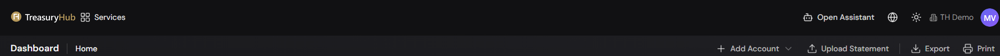
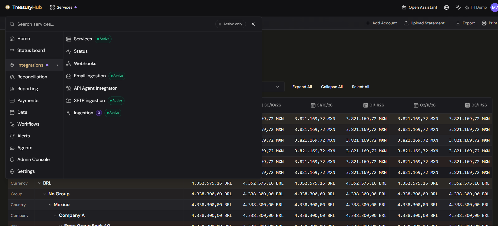

# Navigation & Your Workspace

> **Who this is for:** everyone using the platform.

## Overview
Treasury Hub is a single web application. There is no left sidebar: every screen is reached from the
**top bar** pinned to the top of the window, and from the **Services** menu that opens from it. What
you see depends on your [permissions](04-roles-and-permissions.md) and on what your organization has
set up — screens you have no access to are simply not listed.

## The top bar
From left to right, the top bar gives you:
- **Logo / brand** — returns you to Home. (In white-label deployments this is your brand.)
- **Services** — opens the Services menu, the overlay that lists every section and screen.
- **Open Assistant** — opens the agent for the area you are working in, so you can describe a change
  in plain language and review what it prepares. The same button closes it again.
- **Language** — choose **English**, **Français**, **Deutsch**, or **Español**. The interface
  switches straight away.
- **Theme switch** — toggle **light / dark** mode.
- **Tenant name** — the organization you're currently working in. It is shown when you belong to
  more than one organization.
- **Your avatar** — your email address, tenant switching, **Edit Profile**, **My Access**, and
  **Logout**.

Just below the top bar, every screen shows a slim toolbar: the **page title** and a **breadcrumb**
on the left, and that screen's actions on the right — the screen's own buttons plus **Save view**,
**Export**, and **Print** where the screen offers them.

## The Services menu
Click **Services** in the top bar to open the menu. It opens as an overlay on top of the screen
you're on, so you don't lose your place; press **Esc** or click outside it to close.

On a wide screen the overlay has two columns. The left column lists **Home**, **Status board**, and
every section; select a section and its screens appear on the right. Reconciliation, Reporting,
Admin Console, and Settings are wider, and their groups appear side by side as columns. On a narrow
screen the same menu opens as a full-height panel, where you expand a section with the **›** chevron
beside it.

**Active only.** The toggle at the top of the overlay narrows the menu to the screens that run on
your own data, hiding those that are there to show what a screen will look like. It is remembered
per browser, so a menu that looks shorter than a colleague's usually means this is switched on.

**Menu locations are not URLs.** Where a screen sits in this menu is the only reliable way to find
it; the address in your browser often says something else. *Tags* and the other tagging screens
live under **Settings › Ingestion › Transaction Tagging** even though their address starts
`/admin/`, and *Ingestion* lives under **Integrations** even though its address starts
`/reporting/`. Use the menu paths below, not the address bar.

### The sections
| # | Section | What's inside |
|---|---------|---------------|
| 1 | **Home** | Your cash position dashboard. A direct link — it has no dropdown. |
| 2 | **Status board** | Your delivery roadmap, your open tickets, and what's new on the platform. A direct link. |
| 3 | **Integrations** | Services, Status, Webhooks, Email Ingestion, API Agent Integrator, SFTP ingestion, Ingestion. |
| 4 | **Reconciliation** | Two groups: **Administration** and **Reporting**. |
| 5 | **Reporting** | Three groups: **Overview**, **Operations**, **Risk Management**. |
| 6 | **Payments** | Payment Blotter, Payment Life Cycle Blotter, Payment Approvals, Net Settlements. |
| 7 | **Data** | Data Exports, Financial Events. |
| 8 | **Workflows** | Workflow Dashboard, Workflow Approvals. |
| 9 | **Alerts** | Alerts Dashboard, then one screen per source: Integration, Data, Reconciliation, GL Posting, Payment, Reporting, Prefunding, Workflow, Agent and Admin Alerts. |
| 10 | **Agents** | Agent Dashboard, Agent Builder, Agent Approvals, Agent Chats, Agent Logs. |
| 11 | **Admin Console** | Three groups: **Admin Console**, **Users & Roles**, **Master Data**. |
| 12 | **Settings** | Three groups: **Ingestion**, **Reconciliation**, **Reports**. |

### Reconciliation
| Group | Screens |
|---|---|
| **Administration** | Dashboard, Reconciliation Status, Matching 1-to-1, Reconciliation Approvals, Conciliations, Movements, Movement Graph, Batch Matching, ERP Posting. |
| **Reporting** | Conciliation Reporting, Fee Report. |

The reconciliation screens that *work* a reconciliation sit under **Administration**; the two
read-only reports sit under **Reporting**. Both reports are also listed under
**Reporting › Operations**, so you can reach them from either menu.

### Reporting
| Group | Screens |
|---|---|
| **Overview** | Audit Trail. Then a **Cash & Liquidity** sub-heading: Balance Differential, Category positions, Cash Forecast, Actual vs Forecast, Scenarios (What-If). Then a **Datalake (POC)** sub-heading: Cash position, Opening vs closing balance, Account statement, Cash flow, Build your own report. |
| **Operations** | FX Contracts Blotter, Loans Blotter, Investments Blotter, Transactions, Bank Statements, Invoices, Reconciliation Status, Debt Repayment Schedule, Customer Aging, G/L Posting Life Cycle, Exchange Rates, Conciliation Reporting, Fee Report. |
| **Risk Management** | Risk Cockpit, MtM Portfolio, FX Exposure, Credit Risk by Stage, IRRBB, ALM Gap. |

Reporting can also carry reports built for your organization alone. They sit with the other reports
in the same groups and carry a **Custom** marker.

### Admin Console
| Group | Screens |
|---|---|
| **Admin Console** | User & Agent Management, AI usage, Access Tokens, Groups. |
| **Users & Roles** | User Management, Roles & Permissions, Audit Trail. |
| **Master Data** | Company Groups, Companies, Bank Accounts, Counterparties, Custom Entities, Payment Approval Rules, Static Data. |

**Users & Roles** is the group you manage people from: who belongs to the organization, what each
role grants, and the record of every change. See
[Users & Roles](../10-admin-console/users-and-roles.md).

### Settings
| Group | Screens |
|---|---|
| **Ingestion** | Parse Templates. Then a **Transaction Tagging** sub-heading: Tags, Classification rules, Classification conflicts. |
| **Reconciliation** | Reconciliation Flows, Reconciliation Criteria. |
| **Reports** | Build Your Own. |

### Find a screen faster
- **Search by what you call it.** The **Search services...** box at the top of the overlay matches
  synonyms as well as screen names, so you don't have to know Treasury Hub's wording for something.
  Typing `mt940` or `csv` finds **Parse Templates**; `IBAN` finds **Bank Accounts**. Results are
  grouped by section so you can see where the screen lives.
- **Star what you use daily.** Click the star on any row to add it to a **Favorites** block at the
  top of the overlay. Favorites are kept between sessions in the browser you use, so your short list
  is waiting for you the next time you sign in.
- **Watch for a count on a menu item.** Some items carry a small number for what is waiting on that
  screen — proposals to review on **Ingestion**, disagreeing rule pairs on **Classification
  conflicts** — and the section they sit in shows a dot.

## Working with data grids
Most screens are powerful data grids (blotters). Across the platform you can generally:
- **Add** a record (e.g. **+ Add Account**), **Upload** a file (e.g. **Upload Statement**),
  **Export**, and **Print** from the action bar.
- **Filter** with tabs (e.g. All / Exceptions / Disconnected).
- **Expand All / Collapse All** and **Select All** in hierarchical views.
- **Group** balances and figures by **Currency, Group, Country, Company**, and drill down.
- **Choose the display currency** so all balances convert to one currency of your choice.
- Open a **detail panel** by selecting a row.
- Your **view state** (filters, grouping, columns) is remembered between visits.

## Switching organizations (tenants)
If you belong to more than one organization, the tenant name appears in the top bar next to your
avatar. To switch, open the avatar menu and pick another organization from the list at the top of
it; Treasury Hub reloads with that organization's data. If you belong to a single organization it is
listed in the menu but can't be selected, and no tenant name is shown in the top bar. You only ever
see data for your current organization.

## Related
- [Roles & Permissions](04-roles-and-permissions.md) — why some menu items are hidden.
- [Users & Roles](../10-admin-console/users-and-roles.md) — managing people from the Admin Console.
- [Home Dashboard](../01-home/home-dashboard.md)
