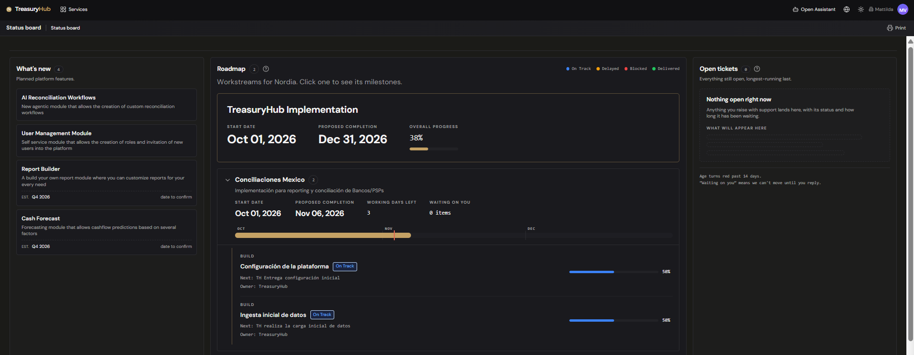

# Status board

> **Where to find it:** Status board
> **Who uses it:** project owners, treasury leadership, administrators — anyone following their own
> Treasury Hub implementation.
> **Permissions required:** none beyond signing in. Every user of your organization can open the
> board.

## Overview
The Status board is the single page where you read how your Treasury Hub implementation is going. It
answers three questions at once: what the platform has built and is building next, where your own
delivery roadmap stands, and which support tickets of yours are still open.

Everything on the page is information to read. There is nothing to fill in, approve or save: the
board's content is maintained by Treasury Hub and refreshed for you. A stamp at the top right says
when the board was last updated and, when one is scheduled, the time of the next refresh.

The page loads even when part of it is empty. If your roadmap has not been set up yet, or you have
no open tickets, that pane explains what will appear there instead of disappearing. If the board
genuinely fails to load, you get a full-page message with a **Try again** button — never a
half-filled board.

## Key concepts
- **Project** — your implementation as a whole: a name, a start date, a proposed completion date and
  an overall progress figure. One project per organization.
- **Workstream** — a strand of the project, such as an ERP integration or a bank onboarding, with
  its own start and end dates and its own milestones.
- **Milestone** — one deliverable inside a workstream, with a phase, a health status, a next step
  and an owner.
- **Phase** — the stage a milestone has reached: **Proof of Concept**, **Design**, **Build**,
  **Test**, **Go Live** or **Post Go Live**. Someone records it; it is never worked out from dates.
- **Status (health)** — how a milestone is *going*: **On Track**, **Delayed**, **Blocked** or
  **Delivered**. Each status has its own colour, used by the badge, the progress bar and the legend.
- **Progress** — a percentage with a bar. A milestone's progress follows its phase, a workstream's
  is the average of its milestones', and the project's is the average of its workstreams'.
- **Waiting on you** — a milestone that is not yet delivered and whose owner is on your side.
- **Working days left** — Monday-to-Friday days between today and a workstream's proposed
  completion date.
- **Timeline axis** — the month scale every workstream's date bar is drawn against, shared by all of
  them so the bars line up, with a marker on today.
- **Overdue ticket** — an open ticket that has been open for longer than your overdue threshold.

Phase and status answer different questions, and a milestone carries one of each: *Build* and
*Blocked* at the same time is a normal, meaningful combination. **Delivered** is a status, not a
phase. A question mark beside the Roadmap title explains how progress is built up.

## Before you start
- You only ever see your own organization's roadmap and tickets. The **What's new** pane is the one
  part of the page that is the same for every customer.
- Nothing on the page can be changed from your account, so there is no permission to ask for beyond
  being able to sign in.

## How to use it
### Open the board
1. Click **Status board** in the main navigation.
2. Read the stamp at the top right to see when the content was last updated.
3. Read the three panes left to right: **What's new**, **Roadmap**, **Open tickets**.

### See what the platform has built and is building
1. Look at the left-hand pane, **What's new**. The number beside the title is how many features it
   lists.
2. Read each card: the feature's name and a short description of what it does.
3. Check the estimate line at the foot of the card. A card either carries a date, with the number of
   days until it, or a rough label such as a quarter, marked *date to confirm*.

This pane is Treasury Hub's own roadmap, so it is identical for every customer, and it covers
features already delivered as well as those still planned. Nothing in it is specific to your
account.

### Read your delivery roadmap
1. Look at the centre pane, **Roadmap**. The number beside the title is how many workstreams you
   have, and the legend on the right gives the colour of each milestone status.
2. Read the project card at the top: your project's name, its **Start date**, its **Proposed
   completion** date, and **Overall progress** as a percentage with a bar.
3. Below it, read one card per workstream. Each shows its name, how many milestones it holds, and a
   chip for anything that needs attention — **Overdue by N days**, **N blocked**, **N delayed**.
4. Read the figures on the card: **Start date**, **Proposed completion**, **Overall progress**,
   **Working days left** and **Waiting on you**. Working days left reads *Completed* once the
   workstream is finished and *Past due* once it is late.
5. Read the date bar underneath. Every workstream is drawn on the same month scale, so the bars line
   up like a chart; a marker shows today, the bar turns green when the workstream is complete, and
   any time past the agreed end date is drawn as red stripes.
6. Click a workstream to open its milestones. Click it again to close it.

### Read a milestone
1. Open the workstream that holds it.
2. Read the row: the **phase** in small capitals above the milestone's name, the name itself, and
   the health status as a coloured badge.
3. Read the two lines under the name: **Next:** the next step, and **Owner:** who holds it. A dash
   means nothing has been recorded yet.
4. Read the progress bar on the right. It is drawn in the status colour and carries the percentage.
5. Click the row to open its detail: the milestone's description, its phase and its progress. Click
   it again to close it.

Milestones are listed in the order Treasury Hub loaded them into your roadmap, not grouped by phase,
so the sequence you agreed is the sequence you see.

### Check what is waiting on you
1. Read the **Waiting on you** figure on each workstream card. It counts the milestones in that
   workstream that are not yet delivered and whose owner is on your side.
2. Open those workstreams and look at the **Owner:** line on each milestone to see who on your team
   holds the next step.

### Read your open tickets
1. Look at the right-hand pane, **Open tickets**. The number beside the title is how many are open;
   the newest sits at the top, so the longest-running is last.
2. On each card, read your own reference code for the ticket when one has been recorded, its title,
   its status badge, and the days-open counter on the right.
3. Click the ticket's title to open it in full: the description, your code, the status, and the date
   it was opened.
4. Use **What the ticket statuses mean** beside the pane title for a reminder of what each status
   means.

A ticket's status is one of **Open**, **In progress**, **Waiting on you** or **Blocked**. *Waiting
on you* means the Treasury Hub team cannot move it forward until you reply. The days-open counter
turns red once the ticket passes your overdue threshold.

Tickets on this pane are raised and maintained by the Treasury Hub team, so there is no *new ticket*
button here. Raise a new one with your account team in the usual way, and it appears on this pane.

## Configuration
There is nothing to configure on this page, and nothing on it can be edited from your account: the
platform roadmap, your delivery roadmap and your tickets are all maintained by Treasury Hub, and you
read the result.

One setting behind the board belongs to your account and is set by Treasury Hub:

- **Overdue threshold for tickets** — how many days a ticket may stay open before its age counter
  turns red. The default is **14 days**, and a ticket is only overdue once it is *past* the
  threshold, not on the day it reaches it.

How the roadmap figures are worked out, because they are asked about often:

- **A milestone's progress** follows its phase, in four steps: **Design 25%**, **Build 50%**,
  **Test 75%**, **Go Live 100%**. Proof of Concept comes before Design and counts 0%; Post Go Live
  comes after Go Live and stays at 100%. A milestone marked **Delivered** is 100% whatever its
  phase. A phase is worth its whole share as soon as the milestone enters it, so progress moves in
  steps rather than creeping up day by day.
- **A workstream's progress** is the plain average of its milestones' percentages, rounded. A
  workstream with no milestones reads 0%.
- **The project's progress** is the plain average of the workstreams' rounded percentages.
- **Working days left** counts Monday to Friday only. It excludes today and includes the proposed
  completion date, and it does **not** exclude public holidays — in a country with a long holiday
  season, expect the figure to run a few days generous. Once the date has passed it reads 0 rather
  than going negative, and the card shows *Past due* instead.
- **Overdue by N days** counts calendar days past a workstream's end date while the workstream is
  unfinished. The end day itself is not overdue.
- **Waiting on you** counts milestones that are not delivered and whose owner is on your side.

## Tips & good practices
- Start with **Waiting on you**. It is the only figure on the page that asks something of you, and
  clearing those milestones is usually what moves the proposed completion date.
- Read phase and status together. A milestone can be in *Build* and *Blocked* at the same time, and
  the badge shows you the status because that is the more urgent fact — the phase is in small
  capitals just above it.
- Do not read a progress bar as effort spent. It reflects the phase the milestone has reached, so a
  milestone can sit at 50% for weeks and then jump to 75% in a day.
- Expect the roadmap order to be the load order. Milestones appear in the sequence Treasury Hub
  entered them, so a *Go Live* milestone can appear above a *Design* one in the same workstream.
- Treat **What's new** as the platform roadmap, not as your plan. Its dates are platform-wide, it
  includes features that have already shipped, and a feature landing there does not mean it is part
  of your implementation. A card for something already delivered keeps its estimate line, so its
  countdown can read a date in the past.
- Check the last-updated stamp before acting on a figure. The board reflects what Treasury Hub last
  recorded, not a live feed from your project team's inbox.
- The days-open counter on a ticket measures elapsed time, not working days, so weekends count
  towards it.

## Related
- [Home — Cash Position Dashboard](home-dashboard.md) — your landing page once onboarding is done.
- [Navigation & Your Workspace](../00-getting-started/02-navigation-and-workspace.md) — where the
  Status board sits in the main navigation.
- [Roles & Permissions](../00-getting-started/04-roles-and-permissions.md) — how access to the rest
  of the platform is granted.
- [What is Treasury Hub](../00-getting-started/01-what-is-treasury-hub.md) — the platform the
  **What's new** pane describes.
