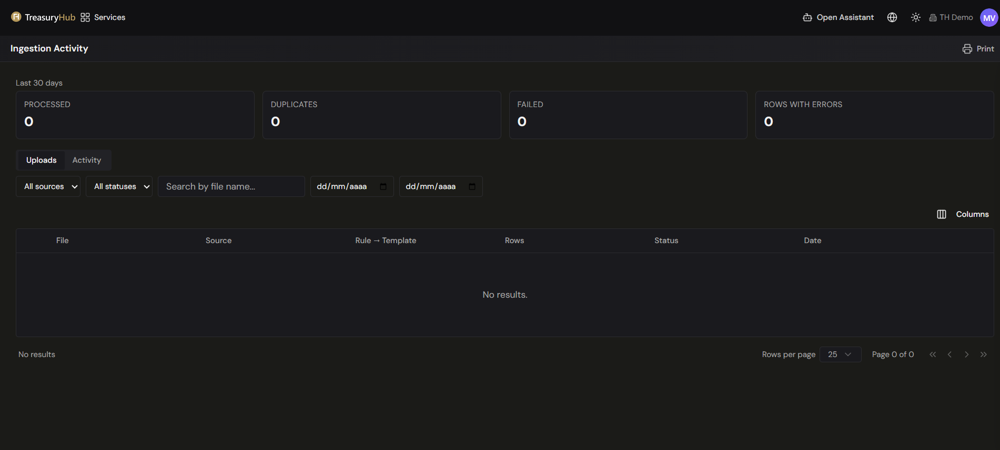

# Ingestion Activity

> **Know your data is complete before you rely on it**
>
> **Why it matters**
> - **Confidence before the close**: processed, duplicates, failed and rows-with-errors on one strip of tiles.
> - **Every file accounted for**: source, rule, template, row count and outcome, per file.
> - **Finish the job here**: a file with no template waits on this screen until you pick one for it.

> **Where to find it:** Integrations › Ingestion
> **Who uses it:** treasury operations, finance systems owners, administrators.
> **Permissions required:** read access to the data being ingested; see [Roles & Permissions](../00-getting-started/04-roles-and-permissions.md).

> **In 60 seconds**
> 1. [Check that data has arrived](#check-that-data-has-arrived) before you rely on a figure.
> 2. [Give a parked file its template](#give-a-parked-file-its-template) so it can finish loading.
> 3. [Resolve a failed file](#resolve-a-failed-file).
> 4. [Watch a batch as it lands](#watch-a-batch-as-it-lands) when timing matters.

## Overview
Know your data is complete before you rely on it: Ingestion Activity is the monitor for everything
coming into TreasuryHub. Across the top, **Last 30
days** tiles summarize activity — **Processed**, **Duplicates**, **Failed**, and **Rows with errors**
— and below them a grid lists each file that has come in, from which source, which rule and template
processed it, how many rows it held, whether it succeeded, and when. It's the screen to check when you
want to confirm your data is complete and current before relying on your cash position or
[reconciliation](../04-reconciliation/overview.md). It is also where you finish the job: a file that
could not be matched to a template waits here until you choose one for it.

## Key concepts
- **Processed / Duplicates / Failed / Rows with errors** — the **Last 30 days** summary tiles: how
  many files were processed, how many were duplicates, how many failed, and how many rows within
  processed files had errors.
- **Source** — the connector or channel the item arrived on (manual upload, email, SFTP).
- **Rule → Template** — the ingestion rule and the file template used to parse the item.
- **Status** — where a file ended up. There are eight:
  - **Queued** — accepted and stored, waiting for a worker to parse it.
  - **Processing** — a worker has it now.
  - **Completed** — the rows were inserted.
  - **No data** — the file was read and held nothing to ingest (an empty statement, a header with no
    rows). Not a failure, and nothing to fix.
  - **Failed** — a row was rejected, so **nothing was inserted**: a load is all-or-nothing.
  - **Not processed — Duplicate** — **every row of this file was already loaded**. Nothing was
    inserted, and the row names the upload that holds the data.
  - **Needs template** — no template could be matched to the file, or the file could not be read at
    all. This is not an error: it is a question addressed to you, and it is the most common
    non-success outcome. The file itself is kept.
  - **Superseded** — the same file was uploaded again, and the newer row is the one being processed.
    Nothing was lost; look at the newer row.
- **Rows inserted / total** — the **Rows** column reads *inserted of total*. On a failure it reads
  `0 / n`, because nothing is inserted when any row is rejected.

## How to use it
### Upload a file
1. Open **Integrations › Ingestion** and choose **Upload file**.
2. Drag your files onto the panel, or **Choose files**. Several can go up at once, as **CSV, TXT,
   Excel (.xlsx/.xlsm) or PDF**; the panel states the file-count and size limits, and a meter shows
   how much of the batch you have used.
3. Each file gets its own row, and **each is set up on its own**. While the row loads it reads
   *Looking for templates for this file…*, then the **Template** list offers the templates that
   recognise it.
4. Choose what should read the file:
   - **An existing template** from the list.
   - **Create a new template with AI** — the last option in the same list. The row is marked
     **New template**, and an optional **Event type** appears: leave it on **Let the AI decide**,
     or name the kind of record the file holds to guide the proposal.

   When nothing recognises the file the row says so and points you at the AI option. If AI is not
   enabled for your organisation it says that instead, and the file has to come out of the batch.
   If the file could not be read at all, **Try again** re-reads it.
5. Fill in what the file itself does not state — the **account**, and a **currency** where the
   account does not settle it. The account is asked for once the template says what the file
   loads, because bank movements and payment orders cannot be committed without one.
6. With several files of the same shape, set the first one up and use **Apply to similar files** to
   copy its template, account and currency to the rest.
7. Upload. Files already loaded before are **skipped as duplicates**, and the panel switches to
   **This upload** so you can watch the batch land. Files given an existing template are parsed
   and loaded straight away.
8. For a file you asked AI for, the draft **waits for your review**: it opens in the template editor
   with the parsed file beside it, every field filled in and marked, so you can check and change
   anything before it becomes real. **Save template** publishes the template; **Save template and
   load file** publishes it *and* loads the file. Nothing is created or loaded until you choose.
   See [Parse Templates](parsing-templates.md).

### Check that data has arrived
1. Open **Integrations › Ingestion Activity**.
2. Read the **Last 30 days** tiles (Processed, Duplicates, Failed, Rows with errors) for a quick
   health check.
3. Switch between the **All**, **Pending review** and **Worker activity** tabs. **Pending review**
   gathers the files waiting on a decision from you and carries a count, so it is the one to clear
   first.
4. Use the filters — source, status, **search by file name**, and the **from / to** dates — to focus
   on what you care about (for example, only files that need a template). The grid shows **File,
   Source, Rule → Template, Rows, Status, Date**.
5. Expand any row with the arrow on its left to see its detail: how many rows went in, the reason a
   file was parked or refused, and the row errors.

### Give a parked file its template
A file with **Needs template** is waiting for an answer, and the file is already stored.
1. Expand the row. The reason it was parked is shown first — an unknown format, two templates that
   match it equally well, or a PDF nobody could read.
2. In **Template for this file**, choose an active template from the list.
3. Click **Process with this template**. The file goes back into the queue with your choice, and the
   worker honours it instead of detecting again.
4. The same row updates — there is **no re-upload and no second row**. If the file arrived with no
   country or account of its own (an email or SFTP file no rule claimed), supply them with the
   template; a template that loads bank movements or payment orders cannot commit without an account.

You can also have the template drafted for you: choose **Create template with AI** in the row's
**Actions** menu, review the draft that comes back, and save it. See
[Parse Templates](parsing-templates.md).

When neither route gets the file in — a bank has changed its statement and nothing recognises it,
or the AI could not propose a template either — the same row offers **Extract the movements with
AI**, which reads that one file so it can be loaded while the format is sorted out. See
[AI Extraction](ai-extraction.md).

### Resolve a failed file
A **Failed** file inserted nothing, so there is nothing to undo.
1. Expand the row and read **Row errors** — the per-row table gives the row number, the error code,
   the message, and the external ID, amount, currency and value date it read. Page through it when
   the file is large.
2. Rows reported as *not loaded* are rows that were not at fault: they are listed so that every row
   of the file is accounted for.
3. Fix the cause — usually the [parsing template](file-import.md) (a column mapped to the wrong
   field, a date format it doesn't read, an identifier column that isn't unique).
4. **Upload the same file again.** The platform deliberately accepts the same bytes after a failure,
   and closes the earlier row rather than leaving two live rows for one file.

### Other outcomes, and what to do about them
- **Not processed — Duplicate** — nothing to do. The data is already in the platform under the
  upload the row points at.
- **No data** — nothing to do. The source sent a file with no movements in it.
- **Superseded** — nothing to do. Follow the newer row.
- **A PDF that could not be read** — a scanned, image-only PDF, a password-protected one, or a
  damaged file cannot be parsed, and no template will change that. The only action on the row is
  **Download**, so you can look at the file and ask the source for a readable one.
- **An email attachment** — an email message has its own **Reprocess** action on the mailbox's
  message list; see [Email Ingestion](email-ingestion.md).

### Watch a batch as it lands
A manual upload can carry several files at once. The platform answers as soon as the files are
stored, so each file appears in the grid — initially as **Queued** — from the moment it is accepted,
and the rows change status as the workers get to them. You can watch the batch progress instead of
waiting on a dialog.

## Tips to get more value
- Make Ingestion Activity part of your **morning routine** — a quick scan of the tiles, plus a filter
  to **Needs template** and **Failed**, catches gaps before they affect your position.
- **Needs template** is a backlog, not an alarm: it is work waiting for a person, and the file is
  safe until you get to it.
- Errors here are often the upstream cause of [reconciliation](../04-reconciliation/overview.md)
  breaks; resolving them at ingestion time saves work later.
- Related failures also surface in [Alerts](../08-alerts/alerts.md), so you don't have to watch this
  screen constantly.

## Where to go next
- [Integrations Overview](overview.md) — all ingestion channels.
- [File Import](file-import.md) — the templates and formats behind these rows.
- [AI Extraction](ai-extraction.md) — the fallback when no template reads a file.
- [Parse Templates](parsing-templates.md) — have the template a parked file waits for drafted with the
  AI assistant, then review it, publish it and activate it.
- [PDF Statements](pdf-statements.md) — why a PDF was refused, and the load refusals explained in plain
  language.
- [Integration Status](webhooks-and-status.md) — connection-level health (last sync, uptime).
- [Alerts](../08-alerts/alerts.md) — where ingestion failures also appear.
