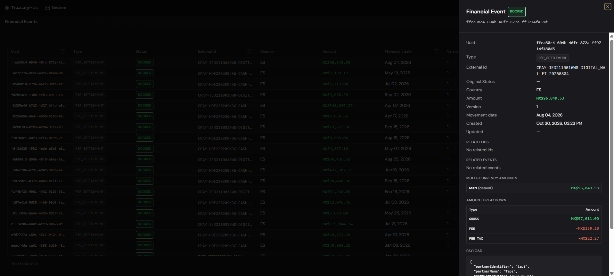

# Financial Events

> **Trace every number back to its source**
>
> **Why it matters**
> - **See exactly what ingestion produced**: every event, its status, its details and its change history.
> - **Answer a query without leaving the platform**: the value date, the booking date and the raw detail are all here.
> - **A read-only window**: nothing can be altered on this screen, which is what makes it evidence.

> **Where to find it:** Data › Financial Events
> **Who uses it:** treasury operations, finance teams, data/IT owners, auditors.
> **Permissions required:** Data access (see [Roles & Permissions](../00-getting-started/04-roles-and-permissions.md)).

> **In 60 seconds**
> 1. [Browse and filter financial events](#browse-and-filter-financial-events) to the period or source you are questioning.
> 2. [Inspect a single event](#inspect-a-single-event) to see its details and its change history.
> 3. Follow it onward into the transactions and movements it produced.

## Overview
Trace any number back to the moment it entered the platform: **financial events** are the
normalized records TreasuryHub creates when data is brought in and committed — for example when a parsed file (via [file import / parsing templates](../02-integrations/file-import.md))
is turned into transactions and movements. The Financial Events screen is a **read-only** place to
see exactly what was created: every event, its status, its details, and its change history. It's your
audit window onto the raw output of ingestion, before and after it flows into the rest of the
platform.

## Key concepts
- **Financial event** — a single normalized record produced by ingestion (a movement, pay-in/pay-out,
  payment order, balance, and so on), identified by a unique **UUID** and, where provided, an
  **External ID** from the source.
- **Status** — where the event is in its lifecycle. There are three:
  - **Pending** — captured, not yet booked.
  - **Booked** — accepted and reflected in the platform.
  - **Rejected** — not accepted (for example, failed a validation).
- **Type** — what kind of event it is: a bank movement, a balance, a payment order, a pay-in, a
  payout, a settlement, an invoice or an invoice line. See
  [The types of event](#the-types-of-event). Which of them you see depends on the types your
  organization has enabled.
- **Amount** — the **principal** figure of the event, and the one figure anything downstream matches
  on: the amount of a movement, the total of an invoice, the net deposited by a settlement. It is
  always carried as a positive figure, with the direction recorded separately, so a debit and a
  negative balance both travel as a positive amount plus a "negative" marker. An amount of **zero is
  valid for a balance** — an account can be empty, and that is a fact rather than an error. For every
  other type, an amount of zero is rejected: a movement of nothing is a mistake.
- **Amount breakdown** — the components a principal amount is made of (a gross, a fee, a tax). It is
  reporting detail only and is never matched on. See
  [How an amount is made up](#how-an-amount-is-made-up).
- **Movement date** — the day the movement happened according to its source, as opposed to **Created**,
  the moment TreasuryHub stored it. Every event has one, it is a calendar date with no time attached,
  and it never changes once the event exists. It is the date to filter, compare and report on: a
  statement loaded today with a month of lines gives each line its own movement date rather than
  today's.
- **Version history** — each event keeps a record of its snapshots over time, so you can see how its
  status, amounts and amount breakdown changed.
- **Related events** — links between events that belong together (for example the two sides of a
  transfer, or the pay-ins a settlement paid), navigable from the detail panel.

## The types of event
| Type | What it records |
|---|---|
| **BANK_MOVEMENT** | A movement on one of your own bank account statements. |
| **ACCOUNT_BALANCE** | The balance of one of your accounts at a point in time. |
| **PAYMENT_ORDER** | A payment you order from your own account — one line of a list of payments to make. |
| **INTERNAL_PAYIN** | Money you collected, as your own systems record it. |
| **EXTERNAL_PAYIN** | Money you collected, as an external party such as a bank or a collector reports it. |
| **PSP_PAYIN** | Money you collected through a payment service provider (PSP), as the PSP reports it. |
| **INTERNAL_PAYOUT** | A payout you made, as your own systems record it. |
| **PSP_PAYOUT** | A payout you made through a payment service provider, as the PSP reports it. |
| **PSP_SETTLEMENT** | A payout a PSP made to you: the batch of collected payments it settles in one deposit. |
| **SALE_INVOICE** | An invoice you issued to a customer: an amount you expect to collect. |
| **SALE_INVOICE_LINE** | One line of an invoice you issued: a product or service you billed a customer for. |

Three things to know about the set:

- **Types are enabled per organization.** You see the ones yours loads, and an event of a type your
  organization has not enabled is refused rather than stored.
- **An invoice and its lines are separate events.** TreasuryHub never builds a header out of its
  lines or the other way round: each line carries its own invoice number, and the link between them is
  a related event. Both the invoice and each line need an identifier of their own.
- **A settlement is identified by its own External ID.** There is no separate settlement number: the
  pay-ins a settlement paid carry that identifier among their related IDs, which is how a PSP pay-in
  is grouped under the settlement that deposited it, and the settlement in turn under the bank
  movement that received it.

## How an amount is made up
A settlement deposits a net figure; an invoice is a total. The **amount breakdown** records what that
principal is made of — the gross collected, the provider's fee, the tax on the fee, the holds, the
taxes, the discounts — so reporting can read it without going back to the source file.

- **It is for reporting only.** The event's **Amount** is still the one figure that reconciles and
  matches. Nothing downstream matches on a component.
- **There is no "net" component.** The net, or whatever principal applies, *is* the Amount.
- **The components do not have to add up to the Amount.** A file that states its fees but not its
  holds still loads; what the components sum to is a question about your source, not a validation.
- Each component is one row of the **Amount breakdown** table in the detail panel, with its own
  currency and its own direction. Amounts are stored positive, with deductions marked as negative.
- The same (component, currency) pair appears only once on an event.
- Every type can carry components **except ACCOUNT_BALANCE**: a balance is a position, not an amount
  made of parts.

The components are:

| Component | What it is |
|---|---|
| **GROSS** | Total collected before any deduction. |
| **FEE** | Fee the payment service provider kept. |
| **FEE_TAX** | Tax charged on the provider's fee — kept apart from **TAX** so reporting never mixes the two. |
| **DISPUTE_HOLD** | Amount held back against open disputes or chargebacks. |
| **REFUND_DISCOUNT** | Amount discounted for refunds issued to payers. |
| **RELEASED_HOLD** | Previously held amount released in this settlement. |
| **SUBTOTAL** | Amount before taxes, discounts and withholdings. |
| **TAX** | Tax charged on the invoice or the line. |
| **DISCOUNT** | Discount granted on the invoice or the line. |
| **WITHHOLDING** | Tax the customer withheld. |

The breakdown is versioned as a whole set rather than component by component. In **Show versions**,
the **Breakdown** column says what each version did to it: *Replaced (n)* when that version installed
a new set, *Cleared* when it emptied it, and a dash when it left the set alone.

## What a bank movement carries
Beyond the amount, currency and description, a bank movement can carry the detail its source
provides, so you can trace and reconcile it without going back to the bank:

- the **value date** and the **booking date**, kept apart;
- the **creditor** and **debtor** names, and their **agents** (the banks on each side), in ISO 20022
  terms;
- a **numeric reference** — the short structured reference a payer quotes on the rail (Mexico's SPEI
  *referencia numérica*, and its equivalents elsewhere) — which is a different value from the
  end-to-end **transaction reference** that identifies the operation;
- a link to the **rail's own receipt** where the provider really has one (for SPEI, Banxico's CEP);
- the **provider's own movement type**, in the provider's words rather than translated into a
  TreasuryHub category, because it is often what makes the provider's status legible;
- the **statement balance** — the running balance the statement prints beside that row, the balance
  of the account *after* that movement.

Which of these are filled depends on what the source file or connector supplies.

**The statement balance is only carried when it can be vouched for.** TreasuryHub sends it on with
the movement when two things hold: the column really is a running balance of its own movements, and
the statement was not proved not to add up. A column that merely repeats the amount, or a file whose
rows stopped reconciling with the balances it prints, would hand downstream reporting a figure nobody
can stand behind, so the movement is stored with no statement balance at all. An empty statement
balance means "not known", never "zero".

## How to use it
### Browse and filter financial events
1. Go to **Data › Financial Events**.
2. The grid lists events with **Uuid, Type, Status, External Id, Country, Amount, Movement date,
   Version, Created** and **Updated**, newest first.
3. Filter using the column headers:
   - **Movement date** — a date filter, for the day the movement happened. This is the one to use
     when you want "everything that happened in September", whenever those files were loaded.
   - **Created** — a date filter, for the moment TreasuryHub stored the event. Use it to see what a
     particular load brought in.
   - **Uuid** and **External Id** — exact-match text filters.
4. Page through results and adjust the page size as needed. Previous rows stay visible while a new
   page loads.

### Inspect a single event
1. Click a row to open the **detail panel**.
2. Review the full record: the common fields (including **Movement date**), related IDs, related
   events, multi-currency amounts, and the underlying payload.
3. Read the **Amount breakdown** table when the event has one — one row per component, with its code
   and its signed amount. An event with no breakdown shows no such section.
4. Toggle **Show versions** to see the event's version history — each snapshot's version, status,
   original status, amount, what it did to the breakdown, and its timestamp.
5. Click a **related-event** link to jump to that event (the list re-filters by its External ID).

## The dates an imported record carries
Every event carries the date its source gives it, not the day somebody uploaded the file. An imported
**payment order** sits on the date its file states, so an order due on the 15th is an order due on the
15th whoever loads it and whenever; an imported **balance** lands on the reference date the file
states, not on its upload date. Loading a statement dated in the past therefore places its records on
the dates it states, which is what lets you backfill a quarter of history and have it read correctly.

Where a file states no date at all, the day of ingestion is used, because a record with no date would
never be picked up by anything downstream.

The movement date is worked out from what the record actually carries: for a bank movement the value
date, or the booking date when there is no value date; for a pay-in or a payout its transaction date;
for a settlement its settlement date, never the start or end of the period it covers; for an invoice
its issue date, never its due date; for a balance its reference date. An invoice line has no date of
its own and takes the one its load gives it. Where a payload date is left empty, the movement date
fills it, so the two never disagree.

## Tips to get more value
- Use Financial Events to **troubleshoot ingestion** — if something looks off downstream (in
  transactions or reconciliation), find the source event here and check its status and version history.
- Filter by **External ID** to trace a specific record from your source system end to end.
- **Rejected** events are the first place to look when an expected transaction didn't appear —
  the version history shows why.
- A balance of **zero** is real data, not a parsing failure. Treat a missing balance and a zero
  balance as different things. The same holds for the **statement balance** on a bank movement: empty
  means "not known", not "zero".
- **Filter on Movement date, not on Created, when you are asking about a period.** Created tells you
  when a file was loaded; Movement date tells you when the money moved. They differ by days or months
  on any backfill.
- **Do not reconcile against a breakdown component.** The Amount is the figure everything downstream
  matches on; the components are there to explain it, and they are not required to add up to it.
- If a settlement and its pay-ins look unrelated, check the pay-ins' **related IDs**: a settlement is
  identified by its own External ID, and that is the value its pay-ins carry.

## Where to go next
- [File import / parsing templates](../02-integrations/file-import.md) — where many financial events originate.
- [Ingestion Activity](../02-integrations/ingestion-activity.md) — the file each event came from.
- [Transactions](../06-reporting/transactions.md) — where booked events appear as transactions.
- [Reconciliation](../04-reconciliation/overview.md) — matching those movements against other sources.
