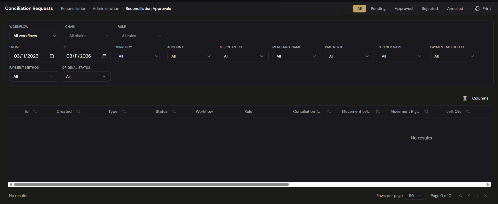

# Reconciliation — Reconciliation Approvals

> **Keep a human check on borderline matches, without slowing the flow**
>
> **Why it matters**
> - **Only what you asked to see**: a request appears because a rule you configured sent it, not because the engine guessed.
> - **A decision, not a rebuild**: approve to create the reconciliation, reject to discard the proposal.
> - **Control where it is worth it**: set match blocks to approve for the cases that warrant a second pair of eyes.

> **Where to find it:** Reconciliation › Administration › Reconciliation Approvals (the screen it
> opens is titled **Reconciliation Requests**)
> **Who uses it:** finance team, reconciliation reviewers and approvers.
> **Permissions required:** reconciliation access · CreateEdit to approve or reject; Read to view (see [Roles & Permissions](../00-getting-started/04-roles-and-permissions.md)).

## Overview
Keep a human check on the borderline cases without holding up the rest: **Reconciliation
Approvals** is the queue of proposed reconciliations waiting for a decision.
A request lands here whenever a rule's match block is set to **send for approval** instead of
auto-reconciling, and whenever a match is ambiguous enough that the rule asks for a second pair of
eyes. You approve a request to create the reconciliation, or reject it to discard the proposal.
Hand-picked matches are made on the [Matching](matching.md) screen instead.

The engine does not guess. Every request on this screen was produced by a rule you configured, and
the rule that produced it is shown on the row — so when a request looks wrong, the fix is in the
[rule](rules-and-criteria.md), not in the queue.

## Key concepts
- **Request** — a proposed reconciliation: the movements on each side, the rule that paired them,
  and a status.
- **Pending** — waiting for a decision.
- **Approved** — accepted; the platform created the corresponding reconciliation.
- **Rejected** — declined with a reason, which is recorded for the audit trail.
- **Annulled** — a pending request that was cancelled rather than judged. Annulling is distinct from
  rejecting: it withdraws the proposal instead of ruling against it.
- **Total** — the sum of one side of the request.
- **Difference** — the signed left-minus-right difference between the two sides, available before
  you approve. Zero means the two sides balance.

## Before you start
- You need reconciliation access at **CreateEdit** level to approve or reject — see
  [Roles & Permissions](../00-getting-started/04-roles-and-permissions.md).
- Your [rules & criteria](rules-and-criteria.md) decide how many requests reach this queue. A rule
  set to auto-reconcile never appears here.

## How to use it

### Read the queue
1. Open **Reconciliation › Reconciliation Approvals**.
2. Pick a tab: **All**, **Pending**, **Approved**, **Rejected** or **Annulled**. The screen opens on
   **Pending**.
3. Narrow the list with the filters: **Workflow**, **Chain** and **Rule** (each one narrows the
   next), a **date range** that defaults to today, and a value filter on any catalog field such as
   currency, partner or payment method.
4. Each row shows the request **Id**, when it was **created**, its **type** and **status**, the
   **workflow** and **rule** behind it, the **conciliation type**, the movement type and item count
   on each side, the **Total**, the signed **Difference**, and who approved or rejected it.
5. Click a row to open its detail panel, where the movements are listed grouped by side.

### Approve or reject one request
1. Find the request and open it to check the movements on both sides and the **Difference**.
2. Choose **Approve**, then confirm. The platform creates the reconciliation.
3. Or choose **Reject** and enter a **reason**. The reason is required and kept for the audit trail.

### Approve or reject many at once
1. Tick the checkbox on each request you want to act on, or use **Select all on page**.
2. Choose **Approve selected** or **Reject selected**. A batch rejection asks once for a reason and
   applies it to every request in the selection.
3. You can act on **up to 100 requests in one batch**. Above that the button is disabled and tells
   you to deselect some rows.
4. Each request is processed on its own, so a batch can partly succeed. If any item fails, a result
   panel opens listing which requests went through and which didn't, with the reason for each — most
   often that someone else already processed it. Your selection stays in the grid until you close
   the panel, so you can compare the failures against the rows.

> The partners, amounts and differences shown in the platform are your own live data; any figures in
> this help center are illustrative examples.

### What approving actually moves
Approving a request settles only the movements that belong to **the flow of the rule that proposed
it**. A movement of yours that sits in another flow is left alone, so approving here cannot quietly
change something in a flow you were not looking at.

A request you created by hand has to resolve to exactly one flow. If its movements span more than
one flow, or belong to none, the request is refused rather than guessed at — pick movements from a
single flow and try again.

## Tips to get more value
- Filter by **rule** before you work a batch. Everything a single rule produced was paired on the
  same criteria, so you can judge the whole group with one decision.
- Check the **Difference** column first — a non-zero difference on a rule that should balance is the
  clearest sign the rule's tolerance is too loose.
- Always write a meaningful **rejection reason**. It is the only record of why a proposal was turned
  down, and it is what tells you which rule to tighten.
- If the same wrong pairing keeps appearing, don't keep rejecting it — fix the criteria in
  [Rules & Criteria](rules-and-criteria.md) so it stops being proposed.
- The date range defaults to today. Widen it when you're clearing a backlog, or you'll only see what
  arrived since midnight UTC.

## Where to go next
- [Reconciliation Overview](overview.md) — where approvals sit in the end-to-end flow.
- [Rules & Criteria](rules-and-criteria.md) — tune what reaches this queue and what auto-reconciles.
- [Matching](matching.md) — make hand-picked matches instead of working proposed ones.
- [Movements & Flows](movements-and-flows.md) — see the chain each approved reconciliation completes.
- [ERP Posting](erp-posting.md) — what happens, and does not happen, after a reconciliation.
- [Alerts](../08-alerts/alerts.md) — the alerts a match block raises alongside its outcome.
