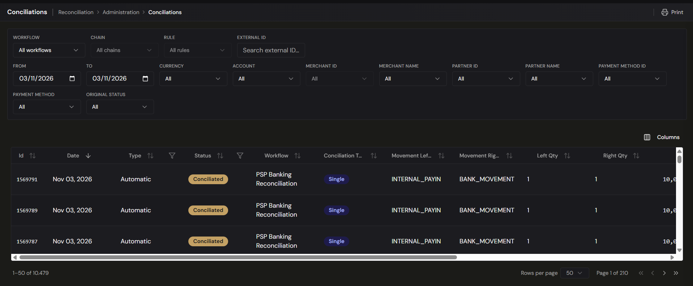

# Reconciliation — Conciliations

> **Where to find it:** Reconciliation › Administration › Conciliations
> **Who uses it:** treasury operations, finance team, accountants, auditors.
> **Permissions required:** `Reconciliation.Conciliations` · Read to view (see [Roles & Permissions](../00-getting-started/04-roles-and-permissions.md)).

## Overview
**Conciliations** is the register of matches that exist. Every time the engine reconciles items
automatically, every time a [reconciliation request](approvals.md) is approved, and every time you
match two movements by hand on the [Matching](matching.md) screen, a conciliation is written — and
this is where you find it afterwards, with the movements it links, the amounts on each side and the
rule that produced it.

It is the answer to "how was this reconciled, and by what?". Nothing is decided here: the
[Approvals](approvals.md) queue holds proposals waiting for a decision, while this screen holds the
results.

## Key concepts
- **Conciliation** — the link the platform created between two or more
  [movements](movements-and-flows.md) it treats as the same real-world event. See
  [Matching](matching.md) for how one is made.
- **Left and Right** — the two sides of the match, taken from the **From** and **To** movement types
  of the [rule](rules-and-criteria.md) that produced it.
- **Total** — the value of the conciliation.
- **Difference** — how far the two sides are from balancing. A difference of zero means they
  balance exactly; anything else is a discrepancy worth looking at.
- **Conciliation Type** — **Single** (one movement on each side) or **Batch** (one movement on the
  anchor side and several on the other).
- **Type** — who originated the match: **Automatic** (a rule did it) or **Manual** (a person did).
- **Conciliated** — the status of a match that stands.
- **Annulled** — the status of a match that has been reversed. The record is kept; it simply stops
  counting.

## Before you start
- Conciliations are produced by your [workflows, chains and rules](rules-and-criteria.md). If the
  list is empty, start there rather than here.
- The screen opens filtered to **today**. Widen the date range before concluding a match was never
  made.

## How to use it

### Find a conciliation
1. Open **Reconciliation › Conciliations**.
2. Narrow the list with the filter bar above the grid:
   - **Workflow**, **Chain** and **Rule** — a cascade. **Chain** and **Rule** stay closed until a
     workflow is picked, and picking a chain narrows the rules on offer to that chain's. Each rule
     reads as `#id · FROM → TO`. Matches made with no rule behind them never match any of the
     three.
   - **External ID** — matches the external id of a movement on **either** side exactly.
   - **From** and **To** — the date range, which defaults to today.
   - **Field filters** — one dropdown per catalog field: **Currency**, **Account ID**, **Merchant
     ID**, **Merchant Name**, **Channel**, **Partner ID**, **Partner Name**, **Payment Method ID**,
     **Payment Method** and **Original Status**. These are the same field filters used across the
     reconciliation screens. Selections on different fields combine with **AND**, and a conciliation
     matches when **at least one of its movements, on either side**, carries that value.
3. Filter the grid's own columns where you need to: **Status** (Pending, Matched, Unmatched,
   Conciliated, Rejected, Annulled) and **Type** (Automatic, Manual). Each takes one value at a
   time.
4. Click **Clear** to drop every filter you have set and go back to the full list.
5. Sort by clicking a column header. The list opens on **Date**, newest first, and can also be
   sorted by **Id**, **Type**, **Status**, **Total** and **Created**.

### Read a row
Each row carries the conciliation's **Id** and **Date**, its **Type** and **Status**, the
**Workflow** it belongs to, the **Conciliation Type**, the movement type and item count on each side
(**Movement Left Type**, **Movement Right Type**, **Left Qty**, **Right Qty**), the **Total**, the
**Difference**, the total number of **Movements**, the **Rule** that produced it, and when it was
**Created**.

A dash in the **Workflow** or **Rule** column means the match was not produced by a rule — a manual
or historical conciliation.

**Watch the Difference column.** It is where a match that does not balance shows itself: the two
sides were paired, but the amounts do not agree. Those are the rows to work, and a recurring pattern
of them usually points at a tolerance or a fee that the [rule](rules-and-criteria.md) is not
accounting for.

### Open a conciliation
1. Click the row. A detail panel opens, headed **Conciliation #id** with its status badge.
2. The top of the panel repeats the key facts: **Date**, **Created**, **Updated**, **Type**,
   **Status**, **Movements**, **Total**, the **Difference** where there is one, the **Rule** that
   produced the match, and any **Notes** recorded with it.
3. Below that, the movements are laid out **side by side, one column per movement** — **L1**, **L2**
   … for the left side and **R1**, **R2** … for the right. The rows are **Amount**, **Date**,
   **Related ids** and every field either movement carries, with a dash where a movement has no such
   field. Related ids are lined up across the columns so a shared id reads straight across, which is
   usually what explains why the two sides were paired.
4. For a **Single** conciliation, a **Chain** section at the bottom shows the whole chain instance
   this match belongs to, with the step it fulfilled highlighted. Click another step to jump to its
   conciliation, or a movement to open the movement itself. A **Batch** conciliation has no single
   chain step to highlight, so the section is not shown.

### Reverse a match
A conciliation made in error is reversed by **annulling** it. Annulling does not delete anything:
the record stays in this list with the status **Annulled**, carrying who annulled it and the
**reason**, which is required. What changes is everything that depended on it:

- The movements on both sides are **released** and re-evaluated — each one goes back to pending, or
  to a partial state if it is still matched elsewhere — so they can be reconciled correctly.
- The match **stops counting** towards its chain, and the chain instance's progress is recalculated
  without it.
- Only a conciliation in **Conciliated** status can be annulled, and only once. An already-annulled
  match cannot be annulled again.

### Record a match by hand
Manual matches are made on the [Matching](matching.md) screen, not here. That screen **requires you
to pick the rule** you are reconciling under: the rule decides which movement types belong on each
side, and it is what this list later shows in the **Rule** column to explain how the match came
about. A manual match appears here with **Type: Manual** as soon as it is confirmed.

## Tips & good practices
- **Start from the Difference column**, not the top of the list. A conciliation that balances needs
  no attention; one that does not is either a fee, a tolerance you have not configured, or a wrong
  pairing.
- **Use the Workflow → Chain → Rule cascade to audit a rule.** Filtering to one rule shows you
  exactly what it has been pairing, which is the fastest way to tell a well-tuned rule from one that
  is matching too freely.
- **Filter by External ID** when you are chasing one transaction end to end — it looks at both sides
  at once.
- **Check Type: Manual periodically.** A steady stream of manual matches of the same shape is a
  [rule](rules-and-criteria.md) waiting to be written.
- **Annulling is the only way back.** There is no undo on a match, so read the comparison table in
  the detail panel before concluding a conciliation is wrong.
- The date range defaults to **today**; widen it before deciding something was never reconciled.

## Related
- [Reconciliation Overview](overview.md) — how matching fits the end-to-end flow.
- [Matching (1-to-1 & Batch)](matching.md) — where manual matches are made, and the rule they are
  made under.
- [Approvals](approvals.md) — the proposals awaiting a decision, as opposed to the matches that
  exist.
- [Rules & Criteria](rules-and-criteria.md) — the rules named in the **Rule** column.
- [Movements & Flows](movements-and-flows.md) — the movements a conciliation links, in context.
