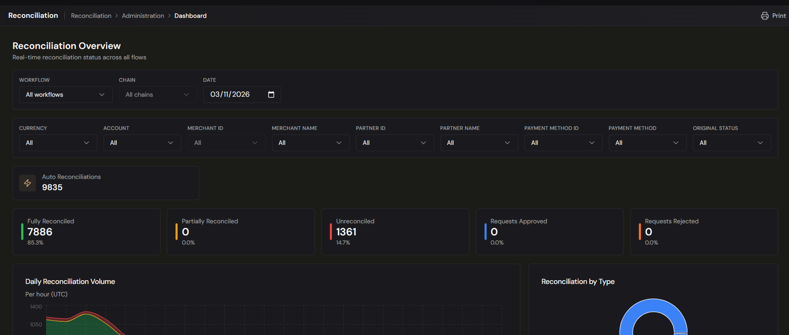

# Reconciliation — Dashboard

> **Know in a minute whether yesterday's money is accounted for**
>
> **Why it matters**
> - **One day, three numbers**: how much reconciled by itself, how much is open, how much is waiting on a person.
> - **Per workflow**: scope it and you also see where that workflow stands over its lifetime.
> - **Find the rules that earn their keep**: the criteria actually doing the matching are named.

> **Where to find it:** Reconciliation › Administration › Dashboard
> **Who uses it:** treasury operations, finance team, accountants.
> **Permissions required:** reconciliation access · Read (see [Roles & Permissions](../00-getting-started/04-roles-and-permissions.md)).

## Overview
Know in under a minute whether yesterday's money is accounted for: the Reconciliation Dashboard is
your daily health check. It answers, for one day, how
much reconciled by itself, how much is still open, and how many proposals are waiting for a person.
Scope it to a single workflow and it adds a lifetime view of where that workflow stands and which
match criteria are actually doing the work.

## Key concepts
- **Reconciliation status** — every chain instance is **Reconciled**, **Partial** or
  **Unreconciled**. See [Core Concepts](../00-getting-started/03-core-concepts.md) and the
  [Reconciliation Overview](overview.md).
- **Chain instance** — one attempt at a flow: a movement arrived, a chain started, and its steps are
  either fulfilled or still waiting. The dashboard counts instances, not individual movements. See
  [Movements & Flows](movements-and-flows.md).
- **Auto reconciliations** — reconciliations the engine created on its own, with no approval step.
- **Net / Gross / Fees and adjustments** — the three ways a workflow's reconciled money adds up.
  Gross plus fees and adjustments equals Net.

## How to use it

### Choose what the day covers
1. Open **Reconciliation › Dashboard**.
2. Pick the **Date**. It defaults to today and covers the full UTC day.
3. Optionally pick a **Workflow**, and then a **Chain** within it. Changing the workflow clears the
   chain.
4. Optionally narrow further with the **field filters** — currency, account, merchant, channel,
   partner, payment method or original status. Each is a dropdown of the values that actually appear
   in your own data, and selections across different fields combine with AND.
5. **Clear** resets the filters and puts the date back to today.

### Read the overview
- **Auto Reconciliations** sits on its own: how many reconciliations the engine made without a
  person.
- Five tiles follow, each with a count and a percentage:
  - **Fully Reconciled** — every step of the chain is matched.
  - **Partially Reconciled** — some steps matched, some still open.
  - **Unreconciled** — nothing matched yet.
  - **Requests Approved** and **Requests Rejected** — what the
    [Approvals](approvals.md) queue produced that day.

### Read the charts
- **Daily Reconciliation Volume** — an area chart of the selected day, one point per hour (UTC),
  stacked into **Reconciled**, **Partial** and **Unreconciled**. Use it to spot the hour a feed
  stopped landing or a rule stopped firing.
- **Reconciliation by Type** — a breakdown of how that day's reconciliations came about:
  **Automatic** (the engine matched and reconciled), **Manual** (someone paired the items on the
  [Matching](matching.md) screen) and **Request** (someone approved a proposal). A manual share that
  keeps growing is a prompt to revisit your [rules](rules-and-criteria.md).

### Read the workflow totals
Select a single **Workflow** and a **Workflow totals** panel appears underneath:

- **Entity type** — for each movement type in the workflow, how many are reconciled and how many are
  not.
- **Money reconciled** — split into **Net reconciled**, **Gross reconciled**, and **Fees and
  adjustments** (gross plus this equals net).
- **How these reconciliations happened** — the workflow's reconciliations grouped by the rule and
  match criteria that produced them, with a count and a share of the total. Rows with no rule are
  the manual ones. This is the quickest way to see whether one over-permissive criterion is doing
  most of the matching.

> **Two things to know about this panel.** It is **lifetime**, not daily — it deliberately ignores
> the date you picked and answers "where does this workflow stand overall". And it labels history
> using **today's** configuration, so editing a rule's criteria re-labels the past rows that rule
> produced.

> The numbers, counterparties and currencies shown in the platform are your own live data. Any
> figures used in this help center are illustrative examples.

## Tips to get more value
- Check **Unreconciled** first thing each day, then jump to
  [Reconciliation Status](movements-and-flows.md) filtered to the same day to see which step is
  stuck.
- A flat stretch in the hourly volume chart usually means an upstream feed stopped rather than a
  reconciliation problem — check [Integrations](../02-integrations/overview.md).
- Compare **Auto Reconciliations** against **Requests Approved** over time: the ratio tells you how
  much of the work your rules are taking off people's hands.
- Use **How these reconciliations happened** before you loosen a tolerance. If one criteria set
  already accounts for most matches, loosening it widens an exposure you can't see from the counts.
- Remember the date filter is a **single UTC day**. For a longer view, read the lifetime workflow
  totals rather than stepping through dates.

## Where to go next
- [Reconciliation Overview](overview.md) — how the whole module fits together.
- [Movements & Flows](movements-and-flows.md) — drill into the chain instances behind the counts.
- [Matching](matching.md) and [Approvals](approvals.md) — clear what the tiles surface.
- [Rules & Criteria](rules-and-criteria.md) — the criteria named in the workflow totals panel.
- [Alerts](../08-alerts/alerts.md) — reconciliation alerts raised by your match blocks.
