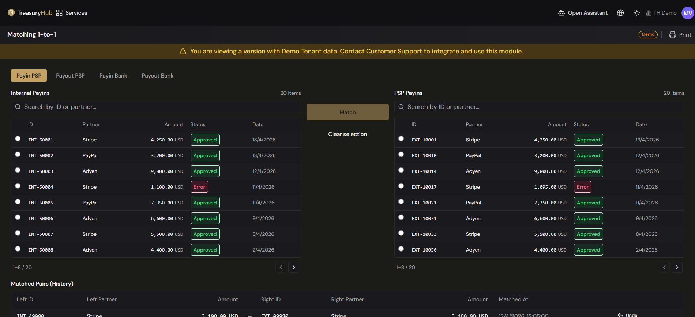

# Reconciliation — Matching (1-to-1 & Batch)

> **Clear exceptions fast, with the best matches ranked for you**
>
> **Why it matters**
> - **The shortlist is done for you**: pick one movement and the other side ranks its likely counterparts, best first.
> - **You see why**: each candidate shows the scoring behind it, so a decision takes seconds.
> - **Counts the same as automatic**: a hand-made match is recorded against the rule exactly as the engine's would be.

> **Where to find it:** Reconciliation › Administration › Matching 1-to-1
> **Who uses it:** treasury operations, finance team, accountants.
> **Permissions required:** reconciliation access · CreateEdit to confirm matches; Read to review (see [Roles & Permissions](../00-getting-started/04-roles-and-permissions.md)).

> **In 60 seconds**
> 1. [Choose what you are reconciling](#choose-what-you-are-reconciling) — pick the rule deliberately.
> 2. [Match a movement against its best candidate](#match-a-movement-against-its-best-candidate) from the ranked list.
> 3. [Narrow a side](#narrow-a-side) when the list is long.
> 4. [Work through a backlog](#work-through-a-backlog) to clear the rest in one sitting.

## Overview
Clear an exception in seconds rather than minutes: Matching is where you pair up the items your
rules did not reconcile automatically, with the best candidates ranked for you. You
pick the rule you are reconciling under, and each side then lists **every movement that rule's
manual reconciliation accepts** — the same set the engine itself would consider, not only the items
it already processed. Pick a movement on the left and the right side **ranks its likely
counterparts**, best first, and shows why each one scored as it did. Confirm, and the result is a
real reconciliation recorded against that rule exactly as an automatic one would be.

Proposals the engine wants a decision on live on a separate screen — see
[Approvals](approvals.md).

## Key concepts
- **Conciliation** — the link between movements the platform treats as the same real-world event.
- **Rule** — the hop you are reconciling under. Manual matching **requires** you to pick one: it
  decides which movement types belong on each side, and it is what later tells you and the
  [Dashboard](dashboard.md) how this reconciliation came about.
- **Single** — one movement on each side. This is what the Matching screen does, so its rule
  dropdown only offers Single rules.
- **Eligible movement** — what a side lists. A movement of that side's type whose status **in this
  flow** is Pending, Processed, Awaiting approval, or a partial on the opposite side. A movement
  that is already conciliated, or that is pending in a different flow, is not offered.
- **Candidate** — a movement on the right that could be the counterpart of the movement you picked
  on the left. Candidates are drawn from movements sharing an ID with your pick, and from
  movements of a similar amount near its date.
- **Score** — how likely a candidate is to be the counterpart, from 0 to 100. It is the sum of four
  signals: a shared ID (35), the amount (30), the date (15) and the rule's own match criteria (20).
- **Signal** — one reason behind a score, shown as a chip under the candidate's ID: **ID**,
  **Amount**, **Date**, **Rule** and **Filters**. Green means it matches, amber means close, grey
  means no. Hovering a chip explains it — the shared ID, the amount difference, the days apart, or
  the criterion that failed.
- **Rule filters** — the conditions that decide which movements a rule is allowed to work on (for
  example one partner together with that partner's bank accounts). Filters are a gate, not points:
  a pair the filters reject is hidden from the ranking rather than scored down.
- **Batch** — one movement on a declared **anchor** side and many on the other, for example one bank
  settlement against many PSP items. Batch rules are handled by the engine and are not offered on
  this screen.
- **Annul** — the way a reconciliation is reversed. There is no undo on this screen.

## Before you start
- Confirm your [rules & criteria](rules-and-criteria.md) are set up so the engine handles the
  routine items and only exceptions reach this screen.
- Make sure the relevant data sources are connected — see
  [Integrations](../02-integrations/overview.md).
- Clear the [Approvals](approvals.md) queue first; what's left on this screen is the genuine
  backlog.

## How to use it

### Choose what you are reconciling
1. Open **Reconciliation › Administration › Matching 1-to-1**.
2. Pick the **Flow** — the workflow you're reconciling in. The Chain and Rule dropdowns depend on
   it, and changing the flow clears both.
3. Optionally pick a **Chain** to narrow the rule list; leave it on **All chains** to see them all.
4. Pick the **Conciliation rule**. Each entry is listed as its number and the two movement types it
   joins, for example `#12 · PSP_PAYIN → PSP_SETTLEMENT`. Until you pick one the screen shows
   *Select a flow and a rule to load movements.*
5. Both panels load, each labelled with its side's movement type. Above each list, a count reads
   **loaded of total** (for example "100 of 1,234"), so you can see the real size of the backlog.
   Scrolling a list loads the next rows automatically.

### Match a movement against its best candidate
1. Pick **one** row on the left. Click a row's eye icon first if you need to see the whole movement
   before deciding.
2. The right side switches to **Candidates for …**, ranked best first, with a score bar on each row
   and the signal chips underneath. Until you pick a left movement the right side is locked and
   shows *Pick a movement on the left first*.
3. Use **Dates around the movement** — **±3 days**, **±7 days** or **±30 days** — to say how far
   from your pick's date a look-alike amount may be. Movements that share an ID are always
   candidates, whatever their date. If a notice warns that there were more look-alikes than were
   evaluated, narrow the window.
4. Pick a candidate. The centre panel shows **Δ amount** and **Δ days** between the two picks, in
   green when they agree, or *other currency* when the candidate has no amount in your pick's
   currency.
5. Click **Match**. A **Confirm match** dialog shows both movements field by field so you can check
   them before committing.
6. If the two amounts differ, the dialog says by how much and offers a **Tolerance**, pre-filled
   with that difference rounded up to cents. Leave it, change it, or cancel — without a tolerance a
   reconciliation whose sides don't balance is refused.
7. Choose **Confirm match**. The screen tells you which conciliation it created, and both rows drop
   off the lists.

To start over before confirming, click **Clear selection**. Clicking a selected row again
deselects it; changing or clearing your left pick also clears the right one, because a right
movement is always chosen against one specific left movement.

### Narrow a side
Each side has its own filter box, and **the two sides are independent and never sync**.

1. Set a **From** and **To** date, or use the **Today**, **7 days** and **30 days** shortcuts. Both
   sides default to the last 7 days.
2. Set **Amount from** and **Amount to** to keep only a band of amounts. The band is matched on the
   absolute value, so a band of 100–200 includes a movement of −150.
3. Pick values in the field dropdowns — Currency, Account, Merchant ID, Merchant Name, Partner ID,
   Partner Name, Payment Method ID, Payment Method and Original Status. Each one takes **several
   values**: choosing two partners shows both, and different fields narrow each other.
4. Type in the side's **Search by ID or related ID…** box. From two characters on it matches any
   part of the external ID or of a related ID, across the whole side rather than the rows on
   screen.
5. Click the **ID**, **Amount** or **Date** column header to sort that side; click again to flip the
   direction.
6. Turn on **Only what passes the rule's filters** to leave only the movements the rule is allowed
   to work on. Partner and account conditions are applied exactly; with other kinds of condition the
   total is shown as an approximation (`~N`).
7. Use **Clone filters →** to copy the left side's field filters, dates and amount band onto the
   right side. The search box, the sort and the rule-filters switch are not copied.

Accounts appear by name — the account's description, else its name, else its number — and hovering
one shows its number, company, bank and identifier.

### Work through a backlog
1. Leave **After a match, move to the next one** ticked in the centre panel. After each
   reconciliation the next movement on the left is picked for you and its candidates load. Nothing
   moves on after an error.
2. Use the keyboard instead of the mouse. The shortcuts are listed in the centre panel and work
   whenever you are not typing in a field and no dialog or detail panel is open:

   | Keys | Action |
   |---|---|
   | ↑ / ↓ | Previous / next movement on the left |
   | Shift + ↑ / ↓ | Previous / next movement on the right |
   | Enter | Open the confirmation; in the confirmation, confirm |
   | Esc | Clear the right pick, then the left one |

3. Use the **Columns** menu on a side to show or hide **Partner**, **Account**, **Status**,
   **Date**, **Related IDs** and **Received**. The first four show by default; the ID, the amount
   and the eye icon always show.
4. A movement whose reconciliation is waiting for a decision carries a **Pending request** badge.
   You can still pick it — approving or rejecting that request is a separate decision, taken on
   [Approvals](approvals.md).
5. Switch the right side back to the full filtered list at any time with **Filters**, next to
   **Candidates for …**, without losing your left pick.

### Work with candidates the rule's filters reject
1. When the ranking hides candidates, a notice reads *N candidates hidden by the rule's filters*.
2. Click **Show them** to list them as well. They always come after every admitted candidate, are
   marked **outside filters**, and their grey **Filters** chip says why — the filter and field that
   reject them, or the two different filters that each admit only one side.
3. You can still reconcile one of them: manual matching is not blocked by a rule's filters.
4. If your left pick itself gets through no filter of the rule, a warning says so, and no candidate
   can meet the filters.

### Reverse a match
There is no **Undo** on this screen and no list of pairs you matched here. A reconciliation made in
error is reversed by **annulling** it: the record is kept and carries the **Annulled** status, and
both sides' movements are released so they can be reconciled correctly. Annulled reconciliations are
visible on the [Conciliations](conciliations.md) screen through the **Status** filter. Annulling
requires a reason and can only be done once — ask your TreasuryHub administrator to annul a
reconciliation for you.

### Match in batch
A **batch** is not a separate screen and it is not a many-to-many free-for-all. It is **N:1 around a
declared anchor side**: when you create a Batch rule you say which side has exactly one movement —
the bank settlement, the invoice header — and the other side is implicitly the many.

What that means in practice:

- Items **join the anchor one at a time, as they arrive**. The anchor is never "used up": the first
  item to match creates the reconciliation, and every later item is appended to the same one.
- The **totals and the difference recalculate** over the whole set each time an item joins, so the
  reconciliation grows towards balance rather than being assembled in one go.
- **Order of arrival doesn't matter.** The anchor can turn up before or after its items; neither
  gets lost or orphaned.
- A batch **never mixes currencies**. One reference currency is taken from the anchor's side and
  applied to every movement in the batch.
- A duplicate item is ignored rather than counted twice.

> Counterparties, amounts and dates shown in the platform are your own live data; any figures in
> this help center are illustrative examples.

## Configuration
- **The address bar carries the screen's setup.** The flow, the chain, the rule and each side's
  filters are kept in the link, so a reload or a link you send a colleague opens the same screen.
  Your picks are not kept: they are your own work in progress.
- **Columns and auto-advance are remembered per side and per browser.** They are your preferences,
  not your tenant's settings.
- **Excluded related-ID values.** A value that appears on nearly every movement (a constant
  reference an upstream system sends) makes "shares an ID" meaningless and slows matching down.
  TreasuryHub can exclude such a value for your tenant: it stops counting as a shared ID both for
  the engine and for the ranked candidates on this screen, and the movements keep it. Ask your
  TreasuryHub administrator if a value needs excluding; a change takes effect within a minute.

## Tips to get more value
- Pick the **rule** deliberately, not just the one that loads the movements you can see. It is
  recorded on the reconciliation and drives the "how these reconciliations happened" breakdown on
  the [Dashboard](dashboard.md).
- Read the **chips**, not only the score. A candidate at 65 with a green **ID** chip is usually a
  safer match than one at 65 built from amount and date alone.
- Widen **Dates around the movement** only when the default misses the counterpart; a wide window
  makes the pool bigger and the ranking less useful.
- Both sides default to the **last 7 days**. Widen the date filter before concluding a counterpart
  is missing.
- Turn on **Only what passes the rule's filters** when a side is large and you keep meeting
  movements the rule can't use anyway.
- Read the **Confirm match** dialog rather than clicking through it. It is the only check between
  you and a reconciliation that has to be annulled to undo.
- Set a **tolerance** only for a difference you can explain (a rounding, a small fee). A large
  difference usually means the wrong counterpart.
- If you find yourself matching the same shape of exception every day, that's a rule to write — see
  [Rules & Criteria](rules-and-criteria.md).

## Where to go next
- [Reconciliation Overview](overview.md) — how matching fits the end-to-end flow.
- [Approvals](approvals.md) — review and approve the reconciliations your rules propose.
- [Rules & Criteria](rules-and-criteria.md) — reduce what reaches this screen by tuning your rules.
- [Movements & Flows](movements-and-flows.md) — see the movements you're matching in context.
- [Conciliations](conciliations.md) — the register of the reconciliations you create here.
- [Conciliation Reporting](conciliation-reporting.md) — what is reconciled and what is still open,
  week by week.
- [Alerts](../08-alerts/alerts.md) — the alerts your match blocks raise.
