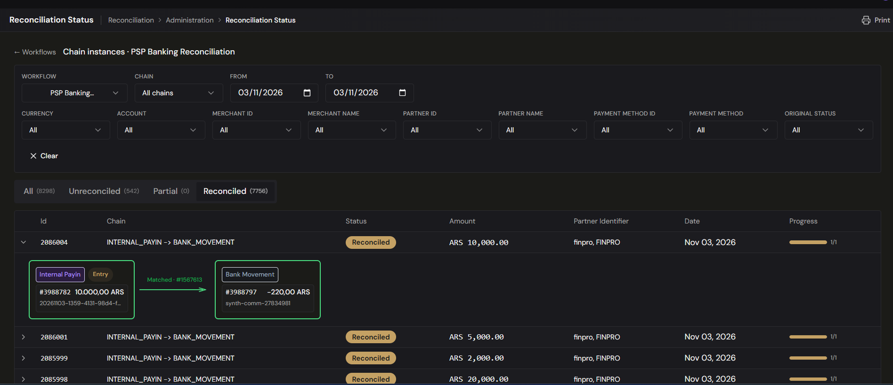

# Reconciliation — Movements & Flows

> **Follow any payment end to end and see exactly where it is stuck**
>
> **Why it matters**
> - **Three angles on the same money**: chain instances, the flat movement list, and the graph from one movement outwards.
> - **Find the blockage**: each chain instance shows how far it got and what it is waiting on.
> - **No dead ends**: the graph fans out across every workflow a movement takes part in.

> **Where to find it:** Reconciliation › Administration › **Reconciliation Status** (also reachable
> under **Reporting › Operations**). Movements and Movement Graph sit in the same group.
> **Who uses it:** treasury operations, finance team, accountants.
> **Permissions required:** reconciliation access · Read (see [Roles & Permissions](../00-getting-started/04-roles-and-permissions.md)).

## Overview
Find exactly where a payment is stuck: three screens follow money through reconciliation from three
angles.
**Reconciliation Status** lists **chain instances** — each one an attempt at a flow, showing how far
it got and where it is stuck. **Movements** is the flat list of every individual item the module
holds. **Movement Graph** starts from one movement and fans out across every workflow to show each
reconciliation it takes part in.

## Key concepts
- **Movement** — a single financial item: a bank movement, a payin or payout, a PSP settlement, an
  invoice, a fee.
- **Chain** — the configured route a transaction should take between movement types, for example
  **Payout Internal → Payout PSP → Bank Movement**. Chains are defined in
  [Rules & Criteria](rules-and-criteria.md).
- **Chain instance** — one live run of a chain: a movement arrived, the chain started, and its steps
  are either fulfilled or still waiting. A chain instance is what **Reconciliation Status** lists.
- **Step** — one hop of the chain. A step can hold **OR alternatives** — several rules at the same
  position, any one of which fulfils it.
- **Reconciliation status** — **Unreconciled**, **Partial** or **Reconciled**. See
  [Reconciliation statuses](overview.md#reconciliation-statuses).
- **Waiting movement** — a movement attached to the instance that hasn't found its counterpart yet.

## How to use it

### Browse chain instances
1. Open **Reconciliation › Reconciliation Status**.
2. Choose the **Workflow**. Each tab — **All**, **Unreconciled**, **Partial**, **Reconciled** —
   carries its own count, and the counts respect every filter except the status itself, so you can
   see the shape of the whole workload at once.
3. Narrow with **Chain**, a **From / To** date range that defaults to today, and a value filter on
   any catalog field such as currency, partner or payment method.
4. Each row shows the instance **id**, its **chain**, its **status**, the entry movement's **amount**
   and currency, the **partners** involved, the **date**, and a **progress** indicator of completed
   steps out of total.

### See inside a chain instance
1. Click a row to **expand** it.
2. The chain is drawn as a horizontal flow of movement-type cards joined by arrows, with each part
   annotated with its runtime state:
   - a card is **solid** once it holds a movement and **dashed** while it is still an empty slot;
   - an arrow is labelled **Matched** when that step reconciled, or **Pending** when it hasn't;
   - **OR alternatives** hang below the main line, so you can see both the path that was taken and
     the one that wasn't;
   - **movements are grouped by side**, so each card lists the movements of its own type with their
     origin, external id, amount and currency;
   - movements still **waiting for a counterpart** are shown on the step they're attached to.
3. Click a **Matched** arrow to open that reconciliation, or a movement chip to open that movement's
   detail — either opens in the right-hand panel.
4. If the chain's configuration is broken — a rule unreachable from the flow start, or a loop — the
   expanded row says so in a warning and **still draws what it can**: the connected part of the
   chain plus the orphan branches, detached. Fix the chain itself in
   [Rules & Criteria](rules-and-criteria.md).

### Find an individual movement
1. Open **Reconciliation › Movements**.
2. Search by **External ID**, or narrow with the date range (today by default) and the catalog field
   filters.
3. The list shows each movement's **Id**, **Created**, **Type**, **Origin**, **Status**, its
   **workflow status** in each workflow it belongs to, its **currencies**, **External Id** and when
   it was last **updated**. Sort by any of those columns.
4. Click a row to open the detail panel: its fields, its currencies and amounts, its external and
   related ids, which workflows it is attached to, and its full status history.

### Trace a movement across every workflow
1. Open **Reconciliation › Movement Graph**.
2. Search for a movement by **External ID** and select it. It becomes the centre of the canvas.
3. The graph draws every reconciliation that movement takes part in — across all workflows, not just
   one — with an edge per reconciliation and a node per counterpart movement.
4. Click a counterpart to **expand** it in turn, and keep going: the graph grows outward as far as
   the relationships do. Click an edge to open that reconciliation's detail.
5. Pan, zoom and use the minimap to navigate a large web of relationships.

> Counterparties, amounts and currencies shown in the platform are your own data; any figures in
> this help center are illustrative examples.

## Tips to get more value
- Work from the **Unreconciled** and **Partial** tabs. The counts on the tabs tell you how big the
  job is before you open anything.
- Expand the row rather than guessing from the progress figure — the dashed card and the **Pending**
  arrow show you the exact step that never completed.
- A step that is waiting with a movement already attached means the counterpart hasn't arrived;
  a step waiting with nothing attached usually means the movement never got in. Check the workflow's
  filter gate in [Workflows](workflows.md).
- A **degraded** chain warning is a configuration problem, not a data problem. No amount of
  re-running will fix it — repair the chain.
- All date filters work on **UTC** days, and all three screens default to today. Widen the range
  before concluding something is missing.
- Use **Movement Graph** when the same item appears in several workflows and you need to see the
  whole picture; use **Reconciliation Status** when you care about one flow completing.

## Where to go next
- [Reconciliation Overview](overview.md) — movements, chains, statuses, and how matching works.
- [Rules & Criteria](rules-and-criteria.md) — where chains and their steps are defined.
- [Workflows](workflows.md) — which movements get into a workflow in the first place.
- [Matching](matching.md) — pair up movements that are still waiting.
- [Dashboard](dashboard.md) — the daily summary of these same chain instances.
- [Transactions](../06-reporting/transactions.md) — the wider reporting view of individual items.
