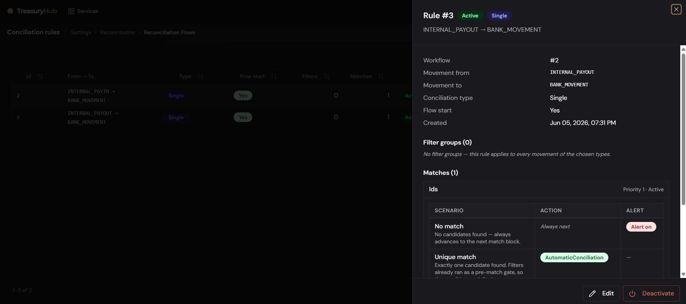

# Reconciliation — Rules & Criteria

> **Write the rule once, and let the engine do the matching every day**
>
> **Why it matters**
> - **The exceptions are all that reach a person**: good rules reconcile the bulk automatically.
> - **Matched on what matters**: amount, tolerance, reference, date, partner and currency, in combination.
> - **End to end**: chains trace a transaction through every step of its journey.

> **Where to find it:** a flow's rules, chains and filter groups under **Settings › Reconciliation ›
> Reconciliation Flows** → open a flow.
> **Who uses it:** treasury operations lead, reconciliation administrators.
> **Permissions required:** reconciliation matching rules · CreateEdit to create or edit; Read to view (see [Roles & Permissions](../00-getting-started/04-roles-and-permissions.md)).

> **In 60 seconds**
> 1. [Create a rule](#create-a-rule) with the criteria a match must meet.
> 2. Set the [tolerance](#tolerance) so near-identical amounts still match.
> 3. [Organise rules into chains](#organise-rules-into-chains) to trace a transaction end to end.
> 4. Choose the [rule outcomes](#rule-outcomes): auto-reconcile, or send for approval.

> **Two related but distinct things — mind the difference:**
> - **Classification rules** — rules that give a transaction its category and tags. They are managed
>   under **Settings › Ingestion › Transaction Tagging › Classification rules**, and they have
>   nothing to do with reconciliation.
> - **Reconciliation rules** — the rules, chains and filter groups described on this page, which
>   decide how two movements are matched into a reconciliation. They live **inside a workflow**:
>   open **Settings › Reconciliation › Reconciliation Flows**, then open a flow to reach its
>   **Rules**, **Chains** and **Workflow filters**.

## Overview
Write the rule once and let the engine do the matching every day after: reconciliation rules are
the conditions that make items match automatically. In the rule builder you
define the criteria a match must meet — amount, tolerance, reference, date, partner, currency — and
group rules into **chains** that trace a transaction end to end. Good rules mean most items reconcile
with no manual effort, leaving only genuine exceptions for the [Approvals](approvals.md) queue and
the [Matching](matching.md) screen.

## How workflows, chains & rules fit together
Three levels, from the outside in:

- **Workflow** (shown as a **Reconciliation Flow**) — a named container for a body of reconciliation
  logic, for example "HG.Cash Operative Balances". It holds the chains, the rules, the workflow
  filter groups, and the run **instances** those rules produce.
- **Chain** — inside a workflow, a set of rules that together form one flow. Each rule is one **hop**
  between two movement types; connected up they trace a transaction end to end — for example
  `PSP_PAYIN → INTERNAL_PAYIN → BANK_MOVEMENT` is **two rules in one chain**. Exactly one rule in a
  chain is the **flow start**.
- **Rule** — one hop: a **From** and **To** movement type, **Single** or **Batch**, optional
  **filter groups**, and one or more **match blocks** holding the **match criteria** (field +
  operator) that pair the two sides.

A **single chain can capture an entire flow** across several movement types — you don't need one
chain per hop. A chain with one rule is the simplest case.

## Key concepts
- **Match criterion** — a condition comparing the *same field on the two movements*, such as *amount
  equals*, *amount within a tolerance*, or *same reference*.
- **Filter criterion** — a condition comparing *one movement against a value you type in*, used to
  narrow which movements a rule considers before matching, or which movements enter the workflow at
  all.
- **Filter group** — a set of filter criteria that combine with **AND**. Sibling groups combine with
  **OR**, so a movement qualifies if it satisfies any one group in full.
- **Match block** — a named group of match criteria plus the actions and alerts to apply to its
  outcome. A rule can carry several match blocks, tried in priority order.
- **Chain** — a set of rules that connect into a flow. Its **topology** is **Valid** when every rule
  is reachable from the flow start, **degraded** when it isn't.
- **Movement type** — the kind of item on each side of a hop, for example `PSP_PAYIN`,
  `INTERNAL_PAYIN`, `BANK_MOVEMENT`, `SETTLEMENT`, `INVOICE`.
- **Flow start** — the rule that begins the chain. Each chain must have exactly one.

## Before you start
- Rules live under a **workflow**. Set up (or pick) the workflow first — see
  [Workflows](workflows.md).
- Decide the movement types you're matching (for example internal payins to PSP payins) and the
  tolerance your business accepts.
- Know your field types. Every field in the catalog is **String**, **Decimal** or **Date**: `amount`
  is Decimal, `createdOn` is Date, and everything else (references, partner and account identifiers,
  names, channel, currency code) is String.

## How to use it

### Create a rule
1. Open **Settings › Reconciliation › Reconciliation Flows**, find your flow, and choose **Rules**.
2. Choose **New rule**.
3. Set the **basics**: the **From** and **To** movement types, the **conciliation type** (**Single**
   or **Batch**), whether it's the **flow start**, and the **chain** it belongs to. For a Batch rule
   you must also declare the **anchor side** — the side that has exactly one movement.
4. Optionally add **filter groups** to restrict which movements the rule considers before matching.
5. Add one or more **match blocks**. In each block, add the match criteria: pick the field to compare
   and the operator.
6. In the block's **actions matrix**, set what the engine does when exactly one candidate matches and
   when several do, and tick the alerts you want.
7. Save. The rule joins its chain and starts matching new movements straight away.

### Edit, move or deactivate a rule
1. Select a rule to open its detail, then choose **Edit** to change its criteria, filters or actions.
2. To stop a rule matching new items without removing it, choose **Deactivate**. Existing
   reconciliations and alerts are kept; the rule stops running.
3. The chain is read-only on the rule form. To put a rule in a different chain of the same workflow,
   open the **chain page** and use **Move rule**. The chain's topology is re-validated on the move,
   and a move that would break it is rejected with the offending rules highlighted.

### Organise rules into chains
1. From a workflow, open its **Chains**.
2. Create a chain with a **name**, then assign rules to it.
3. **You don't order the rules by hand.** The chain's order is derived from how the rules' From and
   To movement types connect, so the steps list is a result, not something you drag.
4. A step can hold **several rules at the same position** — these are **OR alternatives**: fulfilling
   any one of them fulfils the step. Chains are therefore not strictly linear.
5. A chain must have **exactly one active flow-start rule**; saving one with none or more than one is
   refused. Chains that loop back on themselves, or that leave a rule unreachable from the flow
   start, are also refused and the chain is flagged **degraded** with a short explanation.

### Decide which movements enter a workflow
1. From a workflow, open **Workflow filters**.
2. Choose **New group** and add the conditions a movement must satisfy. Criteria in a group combine
   with **AND**; the screen separates consecutive groups with an explicit **OR**.
3. A movement that satisfies no active group never enters the workflow at all — it gets no chain
   instance and, deliberately, no orphan alert, because being excluded by a filter you configured is
   the expected outcome rather than an anomaly.
4. With no groups defined, every movement whose type has applicable rules enters the workflow.

## Configuration

### Operators
Seven operators are available:

| Operator | Where you can use it | Needs |
| --- | --- | --- |
| **Equals** | Match criteria and filters | — |
| **Range** | Match criteria and filters | a tolerance |
| **Greater than** / **Greater than or equal** | Match criteria and filters | — |
| **Less than** / **Less than or equal** | Match criteria and filters | — |
| **In** | Filters only | a list of values |

- **Range and the four inequalities only work on Decimal or Date fields.** Choosing one on a String
  field is rejected when you save, so a mis-configured criterion fails loudly instead of silently
  never matching. The operator dropdown hides the combinations your field can't use.
- **In** lets a filter accept any of several values. You enter them as a list of chips — "matches any
  of them" — and the set is case-insensitive, so `AAA` and `aaa` are the same entry. It is rejected
  on match criteria, because a list of literals means nothing when you are comparing two movements
  against each other.

### Tolerance
**Tolerance is an absolute amount, never a percentage.** `Range` matches when the difference between
the two values is within the tolerance:

- on a **Decimal** field, the tolerance is an amount — `0.5` means the two sides may differ by up to
  half a unit of currency;
- on a **Date** field, the tolerance is a whole number of **calendar days** — `2` means up to two
  days apart.

The only Date field in the catalog is **`createdOn`**, the movement's creation date.

### Two behaviours that change your results
- **Match criteria compare magnitude and ignore sign.** The two sides of a reconciliation carry
  opposite signs by accounting convention, so `−23,421` matches `23,421`. **Filter criteria keep the
  sign**, so a filter of *amount greater than 0* really does mean credits only.
- **Equals on a String field is case-insensitive**, deliberately: partner and account identifiers
  arrive from different providers with inconsistent casing.

### Matching on sets
Five fields in the catalog are **collections** rather than single values, and they match differently:

| Field | Matches when |
| --- | --- |
| **ids** | the two movements' related-ID sets share at least one value |
| **externalIdOrRelatedIds** | the union of external ID and related IDs on each side shares a value |
| **amounts** | for a currency present on both sides, some pair of amounts is equal (multicurrency) |
| **currencies** | the two movements share at least one currency |
| **personalName** | any payer or beneficiary name on one side equals one on the other |

**All five support only `Equals`.** Configure one of them with any other operator and the criterion
never matches — nothing warns you, so check the operator when a set-based rule produces
nothing. `personalName` compares case-insensitively and trims surrounding spaces, but it does **not**
normalise accents and does **not** do fuzzy matching: *JOSE PEREZ* and *jose perez* match, *José
Pérez* does not.

### Rule outcomes
A match block decides what happens for each outcome:

- **Auto-reconcile** — create the reconciliation immediately.
- **Send for approval** — create a reconciliation request for a person to approve, which is what
  populates the [Approvals](approvals.md) screen.
- **Try the next rule** — leave the movement alone and let the next rule have a go.

**No match** has no action of its own; it always moves on to the next match block.

Alerts are separate from the outcome. Each match block carries three independent checkboxes — alert
when nothing matched, when exactly one thing matched, and when several did — and ticking one never
changes what the engine does.

### Other settings
- **Conciliation type:** Single (one-to-one) or Batch (many items around one anchor — see
  [Matching](matching.md)).
- **Common criteria fields:** amount, external ID, account ID, type, partner name and identifier,
  payer and beneficiary names and personal IDs, merchant, channel, payment method, currency code, and
  the movement's creation date.

## AI Reconciliation Assistant
**New workflow** and **Edit** on the Reconciliation Flows screen open the **Workflow Studio**, where
you describe what you want in plain language ("reconcile PSP payins → internal payins → bank
movements, matching on external/related IDs") and the agent drafts the whole workflow: its
chains, rules and filter groups. The workflow is shown as a graph you can click through, with JSON
and YAML views of the same document and a list of the operations a save would execute. The agent
asks only what it needs (match field and operator, Single or Batch, what to do on multiple matches),
flags risks such as matching on IDs alone with no amount criterion, and checks that the topology is
connected with a single entry point before you save. You confirm every change.

> Saving a workflow as a whole document can **delete** a node outright, which the per-screen
> Deactivate buttons never do. A delete is refused when execution data — a conciliation, a movement
> tag, a trace row — still references the node, because that history is never deleted.

## Tips to get more value
- Give each match block a clear name; it is what the [Approvals](approvals.md) screen and the
  [Dashboard](dashboard.md) use to explain *why* two items were paired.
- Put the **strictest, most specific** block first in a rule and looser tolerance blocks after
  it, so exact matches win before approximate ones.
- Keep tolerances realistic: too tight and good items fall through to manual matching; too loose and
  the engine mis-matches.
- Use **send for approval** rather than auto-reconcile while you are still tuning a rule — the
  requests give you a reviewable record of what the rule would have done.
- Prefer **Deactivate** over deleting on the rule, chain and filter-group screens — it preserves the
  audit trail.

## Where to go next
💡 Get more from this: combine your reconciliation rules with [Working with an Agent](../09-agents/assistant.md) to describe a new rule in plain language and get it back prepared for review.

- [Reconciliation Overview](overview.md) — rules, chains, and the matching engine.
- [Workflows](workflows.md) — rules, chains and filter groups live inside workflows.
- [Approvals](approvals.md) — the queue that "send for approval" fills.
- [Matching](matching.md) — where items your rules didn't catch are resolved.
- [Movements & Flows](movements-and-flows.md) — the chain instances your rules produce.
- [Admin — Matching Rules](../10-admin-console/matching-rules.md) — the tenant-wide matching rules
  used across the platform (distinct from reconciliation rules).
