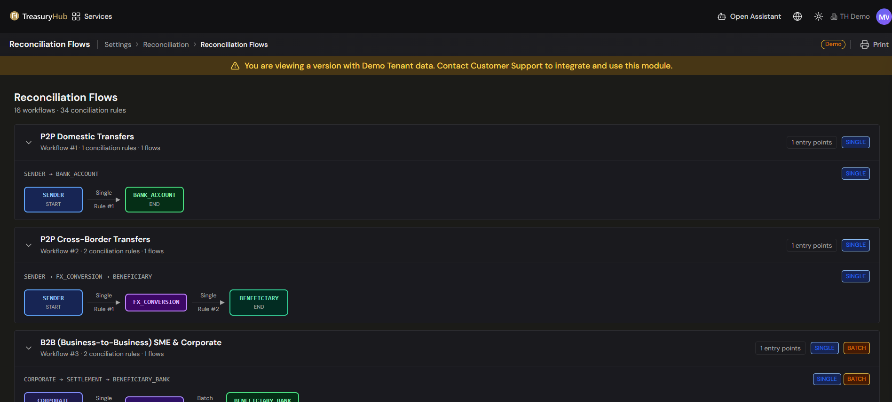

# Reconciliation — Workflows

> **Model any reconciliation process, from simple bank-to-ledger to multi-step payment flows**
>
> **Why it matters**
> - **Your process, not a fixed one**: a workflow holds the rules, the chains and the filter groups you decide on.
> - **Scoped deliberately**: filter groups decide which movements are allowed in at all.
> - **Everything hangs off it**: chain instances, approval requests and dashboard counts all belong to a workflow.

> **Where to find it:** Settings › Reconciliation › **Reconciliation Flows**. The flows it produces are viewed under [Flows (Reconciliation Status)](movements-and-flows.md).
> **Who uses it:** treasury operations lead, reconciliation administrators.
> **Permissions required:** reconciliation workflows · CreateEdit to create or edit; Read to view (see [Roles & Permissions](../00-getting-started/04-roles-and-permissions.md)).

## Overview
Model any reconciliation process you actually run, from bank-to-ledger to a multi-step payment
flow: a reconciliation **workflow** is the container for one body of matching logic. It holds the
[rules and chains](rules-and-criteria.md) that pair movements, and the **filter groups** that decide
which movements are allowed in at all. Everything the module does — the chain instances on
[Reconciliation Status](movements-and-flows.md), the requests in [Approvals](approvals.md), the
counts on the [Dashboard](dashboard.md) — happens inside a workflow. The screen is listed as
**Reconciliation Flows**.

## Key concepts
- **Workflow** — a named configuration that groups chains, rules and filter groups. Names are unique
  within your organization.
- **Chain** — a set of rules inside the workflow that connect into one end-to-end flow, for example
  **Payin Internal → Payin PSP → Bank Movement**. See [Rules & Criteria](rules-and-criteria.md).
- **Filter group** — a set of conditions that decides whether a movement enters the workflow. This
  is the workflow's **entry gate**.
- **Chain instance** — one run of a chain on real movements. See
  [Movements & Flows](movements-and-flows.md).

## Before you start
- Decide the movement types the workflow chains together and whether each hop matches one-to-one or
  in batch.
- Have your [rules & criteria](rules-and-criteria.md) planned — a workflow does its job through the
  rules and chains inside it.
- Work out which movements belong in this workflow before you write the rules. Getting the entry
  gate right is what stops a workflow filling up with chains that could never complete.

## Common patterns
A workflow can describe any end-to-end matching pattern you need. The ones treasury teams build most
often are:

- **PSP and bank reconciliation** — internal payins and payouts to their PSP records, and on to the
  bank settlement. The richest pattern, usually mixing single and batch hops.
- **Invoice reconciliation** — a purchase or sales invoice against its bank movement.
- **Bank-to-bank reconciliation** — one bank movement against another, for example a transfer
  between your own accounts.
- **Treasury-specific patterns** — FX, loan and investment reconciliation, where the deal record is
  one side and the cash movement the other.

## How to use it

### View workflows
1. Open **Settings › Reconciliation › Reconciliation Flows**.
2. Use the tabs (**Active**, **Inactive**, **All**) to filter the list.
3. Click a workflow to open its detail panel.
4. From a workflow row you can drill into its **Rules**, **Chains**, **Workflow filters** and
   **Chain instances**.

### Create a workflow
1. Choose **New workflow**. This opens the **Workflow Studio**, where a flow and everything
   inside it is built.
2. Enter a **name**, unique within your organization.
3. Build the flow. You can work in the **graph** view, read it as **JSON or YAML**, or review it
   as a list of **operations** — the same flow, shown three ways. Or describe what you want to
   the agent beside it and refine its proposal turn by turn; the views update as you go. See
   [Working with an Agent](../09-agents/assistant.md).
4. Save. The workflow is created active, with the [rules and chains](rules-and-criteria.md) you
   built; you can add more at any time.

### Edit or deactivate a workflow
1. From a workflow row or its detail panel, choose **Edit** to reopen it in the **Workflow Studio**,
   where you can rename it or change its chains, rules and filters.
2. Choose **Deactivate** to stop it taking in new movements. Existing reconciliations are
   unaffected and the configuration is kept — deactivation is the safe alternative to deleting.

## Configuration

### Filter groups — the entry gate
Each workflow can define groups of conditions that a movement must satisfy before it is admitted.

1. Open the workflow's **Workflow filters**.
2. Choose **New group** and add its criteria. Criteria inside a group combine with **AND**; the
   screen separates consecutive groups with an explicit **OR**, so a movement qualifies if it
   satisfies any single group in full.
3. A movement that satisfies no active group never enters the workflow: it gets no chain instance,
   and deliberately raises no orphan alert — an exclusion you configured is the expected outcome,
   not an anomaly.
4. With no groups defined, every movement whose type has applicable rules enters the workflow.

Deactivating a group changes the gate for movements that arrive afterwards. Movements already
assigned stay where they are until a maintenance run re-evaluates them.

> Filter groups are also a rule-level feature, where they narrow which movements a *rule* considers.
> The workflow-level gate runs first and decides whether the movement is in the workflow at all —
> see [Rules & Criteria](rules-and-criteria.md).

### Workflow maintenance
Changing a workflow only affects what arrives next. Three on-demand bulk processes bring the
movements that are already inside into line with the current configuration. Each runs over one
workflow and one date range, in chunks, picking up where the previous run stopped, and each returns
a per-movement account of what it did or would do. Ask your TreasuryHub administrator to run one.

- **Re-apply the entry gate** — re-tests the movements already in the workflow against the current
  filter groups and removes the ones that no longer belong, along with any chain instance left with
  nothing pointing at it. It **defaults to counting only**, so an accidental run reports what it
  would remove instead of removing it, and it never touches a movement with work in progress: only
  movements that are not part of a live reconciliation are eligible.
- **Reprocess unreconciled movements** — pushes movements that haven't settled back through the
  rules, so a late-arriving counterpart or a rule you have since edited gets another chance to
  match. It never deletes anything.
- **Assign existing movements** — runs assignment over movements that already exist but never
  reached this workflow, because the workflow was created after they were ingested. It never
  deletes anything.

> The specific workflows, counts and counterparties shown in the platform are your own
> configuration; any examples in this help center are illustrative.

## Tips to get more value
- Build the **entry gate first**, then the rules. A workflow with no gate takes in every movement
  whose type has an applicable rule, which is rarely what you want once you have more than one
  workflow.
- Give workflows **clear, descriptive names** — every other reconciliation screen navigates by them,
  and the name is what reviewers see on a request.
- Count before you purge. The re-apply process reports by default for a reason: read the list of
  movements it would remove before letting it remove them.
- After you tighten a rule, run **reprocess unreconciled movements** over the affected dates rather
  than waiting for the backlog to resolve itself.
- **Deactivate** rather than delete when a pattern is no longer needed, so history and linked rules
  stay intact.

## Where to go next
- [Reconciliation Overview](overview.md) — how workflows fit the module.
- [Rules & Criteria](rules-and-criteria.md) — the rules, chains and filter groups inside each
  workflow.
- [Movements & Flows](movements-and-flows.md) — the chain instances a workflow produces.
- [Dashboard](dashboard.md) — per-workflow totals and which criteria did the matching.
