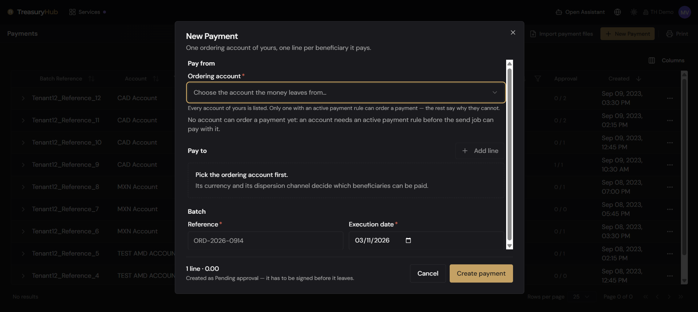

# Creating a Payment

> **Build a full payment batch in one pass, to validated payees only**
>
> **Why it matters**
> - **One dialog, whole batch**: one ordering account, a line per beneficiary, a reference and an execution date.
> - **No free-typed account numbers**: payees come from your validated counterparties and their settlement instructions.
> - **Controlled from the start**: the batch is created pending approval and waits to be signed before it leaves.

> **Where to find it:** Payments › Payment Blotter › **+ New Payment**
> **Who uses it:** treasury operations, accounts payable, anyone who raises payments.
> **Permissions required:** `CashManagement.Payments` · CreateEdit

> **In 60 seconds**
> 1. [Choose the account the money leaves from](#choose-the-account-the-money-leaves-from).
> 2. [Add the payment lines](#add-the-payment-lines), one per beneficiary.
> 3. [Finish and create the batch](#finish-and-create-the-batch) with a reference and an execution date.
> 4. The batch waits in the blotter, pending approval, until it is signed.

## Overview
Build a whole payment batch in one pass, to validated payees only: the **New Payment** dialog,
opened from the [Payment Blotter](payment-blotter.md) with **+ New Payment**, composes the whole
**batch** at once: you pick the single account the money leaves from, add one line for each beneficiary you
are paying, then give the batch a reference and an execution date. On **Create payment** the batch is
created *Pending approval* and appears in the blotter, waiting to be signed before it leaves.

## Key concepts
- **Ordering account** — the one account of yours the money leaves from. Its **currency** and the
  **dispersion channel** it pays through decide which beneficiaries the batch can pay.
- **Payment line** — one beneficiary, one amount, one concept. A batch holds as many lines as you
  need, all paid from the same ordering account on the same date.
- **Beneficiary (payable instruction)** — a settlement instruction you can actually pay: a
  counterparty's banking coordinates on a given channel. You never type account details here; you
  pick from what is already on record. See
  [Counterparties & SSIs](../10-admin-console/counterparties-and-ssis.md).
- **Own account** — a counterparty marked as your own company. Money moving to it is a transfer
  between your own accounts, not a payment to a third party, and the dialog treats it differently.
- **Dispersion channel** — the rail an account pays through (for example SPEI, SEPA, SWIFT, Kuspit).
  A beneficiary can only be paid from an account that uses the same channel.
- **Batch reference** — your own reference for the whole batch. It cannot contain spaces.
- **Concept (remittance information)** — the text the beneficiary's bank prints on their statement,
  so they can identify the money.
- **Execution date** — the date you are asking for the batch to be executed.

## Before you start
- You need `CashManagement.Payments` at **CreateEdit**.
- At least one of your accounts must have an **active payment integration**. The picker lists every
  active account anyway and tells you which ones cannot order payments and why — see
  [Bank Accounts](../06-reporting/bank-accounts.md).
- The beneficiaries must already exist and be **approved** in
  [Counterparties & SSIs](../10-admin-console/counterparties-and-ssis.md), with a settlement
  instruction in the ordering account's currency on the ordering account's channel.
- Remember the **four-eyes rule**: the batch is created *Pending approval* and you cannot sign your
  own batch — a different user with approval rights has to. See [Payment Approvals](approvals.md).

## How to use it

### Choose the account the money leaves from
1. On the **Payment Blotter**, click **+ New Payment**.
2. Under **Pay from**, open **Ordering account**. Type in the search box at the top of the list to
   filter by account name, bank or currency.
3. The list is split under two headings: **Can order payments** and **No payment integration**.
   Entries in the second group cannot be chosen, and each one says why — for example *"This account
   has no payment integration configured, so nothing could disperse it."*, *"Its payment integration
   is switched off."* or *"Payments are switched off for this account."* Both headings always show,
   so an empty **Can order payments** group is itself the answer.
4. Choose an account. A panel under the field states its **Currency** and what it **Disperses
   through**. Neither is a choice — both come from the account's payment integration, and together
   they decide which beneficiaries are payable.

If exactly one of your accounts can order payments, it is selected for you and the field is hidden.

> Changing the ordering account after you have composed lines clears the **beneficiary** on every
> line — what an account can pay depends on its currency and channel. Amounts and concepts are kept.

### Add the payment lines
1. Under **Pay to**, the first line is already there. Use **Add line** for each further beneficiary,
   and the bin icon on a line to remove it (it is hidden when only one line is left).
2. On **Beneficiary**, search by beneficiary name, code, account or bank. One search term filters the
   whole list, which is grouped as **Can be paid from this account** and **Cannot be paid from this
   account**.
3. Each row shows the counterparty name and code, a badge with the **channel** it is paid through,
   the bank, account number or IBAN and currency, and on the right where it stands with the payment
   provider: *Not registered yet*, *Registered*, *Under review* or *Refused by the provider*. Rows
   can also carry a **Default**, **Own account** or **Change pending** badge.
4. Rows under **Cannot be paid from this account** are greyed and cannot be selected, and every one
   of them states its reason, for example:
   - *"The counterparty is Pending: nobody has signed off on paying it."* (also Rejected, Suspended)
   - *"It is paid in USD, and this account pays in MXN."*
   - *"It is paid through SPEI, and this account pays through KUSPIT."*
   - *"This own account is not registered with the provider yet."*, *"The bank is still validating
     this own account."* or *"The provider refused this own account."*
   - *"This account does not pay through any counterparty channel."*
5. Click a payable row to select it. Once chosen, the line shows the beneficiary with its channel and
   where the money lands; **Change** reopens the search.
6. Fill in **Amount**. It must be greater than zero. The currency is shown beside the field and is
   always the ordering account's — it is not a choice.
7. Fill in **Concept** — what this line pays for. It is **required when you are paying a third
   party**, because it is the text that beneficiary's bank shows on their statement.
   When the beneficiary is one of **your own accounts**, the field is replaced by **Concept: the
   batch reference**: there is nothing to type, and the batch reference travels in its place.

If no counterparty of yours has a live settlement instruction, the list says so and offers a
**Manage counterparties** link. If the account pays through no counterparty channel at all (it
disperses by file), the list says that instead — send that account's payments from the file import
route described in [Payment Blotter](payment-blotter.md).

### Finish and create the batch
1. Under **Batch**, enter the **Reference**. It is required and cannot contain spaces.
2. Check the **Execution date**. It is pre-filled with today and cannot be in the past.
3. The footer totals the batch — the number of lines and the sum, in the account's currency — and
   reminds you that it is created as *Pending approval*.
4. Click **Create payment** (or **Cancel** to discard). A confirmation names the batch reference and
   how many signatures it needs before it leaves.
5. The batch appears on the blotter under **Awaiting approval**.

## Validation rules
Nothing is sent until every rule below passes. A refused submit keeps the dialog open with everything
you typed, marks the offending fields and says *"Nothing was sent: check the fields marked in red."*

- An **ordering account** must be chosen.
- Every line must name a **beneficiary**, and only a payable one can be chosen — greyed rows cannot
  be selected at all, and the platform refuses the same combinations again when the batch is posted.
- Every **amount** must be greater than zero.
- Every line paying a **third party** must carry a **concept**. A line paying one of your own
  accounts does not ask for one.
- The **reference** is required and cannot contain spaces.
- The **execution date** is required and cannot be earlier than today, counted where you are.
- A batch needs **at least one line**.

If the platform refuses the batch, the dialog shows exactly what it answered — each reason names the
instruction or the field to change — and keeps your work so you can correct it and try again.

## Tips to get more value
- Pick the **ordering account first**. Its currency and channel are what the beneficiary list
  answers, and changing it later costs you the beneficiaries you already chose.
- If the beneficiary you want is greyed, read its reason before changing anything: an unapproved
  counterparty is somebody to chase, a currency or channel mismatch means a different ordering
  account, and an unregistered own account is something to wait for.
- Put a meaningful, unique value in **Reference** — it identifies the batch on the blotter and makes
  [reconciliation](../04-reconciliation/overview.md) far easier later. For lines paying your own
  accounts it is also the text that travels with the transfer.
- Group payments that share an account and a date into one batch: they are approved and tracked
  together, and each line still keeps its own status.
- A **Change pending** badge means the beneficiary's data changed since the provider last agreed to
  it; the payment carries the update, and it will not leave until the counterparty is approved again.

## Where to go next
- [Payment Blotter](payment-blotter.md) — where the new batch lands and how you track it.
- [Payment Approvals](approvals.md) — the sign-off the batch now needs.
- [Counterparties & SSIs](../10-admin-console/counterparties-and-ssis.md) — where beneficiaries and
  their settlement instructions come from.
- [Invoices](invoices.md) — attach the backing document for approvers.
- [Roles & Permissions](../00-getting-started/04-roles-and-permissions.md) — create vs. approve rights.
