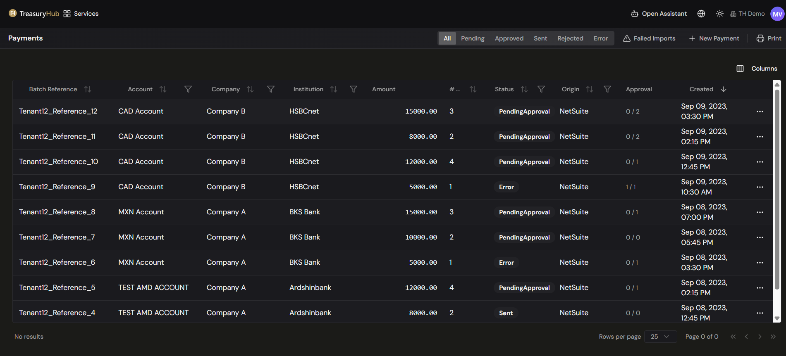

# Payment Blotter

> **Where to find it:** Payments › Payment Blotter
> **Who uses it:** treasury operations, accounts payable, finance managers, approvers.
> **Permissions required:** `CashManagement.Payments` · Read to view, CreateEdit to act. See [Roles & Permissions](../00-getting-started/04-roles-and-permissions.md).

## Overview
The Payment Blotter is the main screen of the Payments module: a single list of every outbound
payment batch across your group. From here you see each payment's account, company, institution,
amount, count of items, origin, approval progress, and status — and you can expand any row to see
exactly what happened to it, line by line. It's where your team tracks the daily outflow: supplier
payments, intercompany transfers, FX settlements, loan disbursements, payroll, and taxes.

## Key concepts
- **Status tab** — a filter across the top that groups payments by where they are in their
  lifecycle (see below).
- **Batch reference** — the reference that identifies a payment (or payment batch) on the grid.
- **Origin** — where the payment came from (for example an ERP feed such as **NetSuite**, an
  imported file, or created manually in Treasury Hub).
- **Approval progress** — how many of the required approvals a payment has (for example, 1 of 2).
- **Traceability** — the three separate answers to "did this payment happen?": what Treasury Hub did
  with the order, what the payment provider says, and whether the bank statement backs it up.

## The status tabs
Payments are organized into tabs so you can focus on what needs action:

| Tab | Shows |
|---|---|
| **All** | Every payment, regardless of status. |
| **Awaiting approval** | Payments that have been created and still need one or more signatures. |
| **On its way** | Payments that are signed and have not landed yet — approved and waiting for the send run, or going out right now. |
| **Awaiting confirmation** | Payments that have been sent to the provider, with no verdict back yet. |
| **Confirmed** | Payments the provider has confirmed as executed. |
| **Rejected** | Payments a reviewer declined. |
| **Needs attention** | Payments that hit a problem and need a person to look at them. |

> Numbers, counterparties, and amounts shown in demos (for example, headline "payments today" or
> "total outflow" figures) are illustrative — your blotter reflects your own data.

## The payment grid
Each row is a payment batch, with these columns:

| Column | Shows |
|---|---|
| **Batch Reference** | The reference identifying the payment or batch. |
| **Account** | The ordering account the money leaves from. |
| **Company** | The paying legal entity. |
| **Institution** | The bank / financial institution. |
| **Amount** | The total amount. |
| **# Txns** | The number of payment lines in the batch. |
| **Status** | Where the batch stands — including what the provider did with the money, not only how far the send got. |
| **Origin** | Where the payment came from (for example `NetSuite`, an imported file, or manual). |
| **Approval** | Approval progress as *x / y* (approvals collected / required). |
| **Created** | When the payment was created. |
| **Account Number** | The ordering account's number. Hidden by default; switch it on with **Columns**. |
| **Account Owner** | Who holds the ordering account. Hidden by default; switch it on with **Columns**. |

Each row also has a **⋯** menu with **View Details**, **Approve** / **Reject** (when you may),
**Add Note**, **View Notes** and **Status History**.

## Before you start
- You need `CashManagement.Payments` at **Read** to view the blotter. Creating payments and
  approving/rejecting require **CreateEdit** and a sufficient approval level.
- Bank accounts and beneficiaries must exist for payments to appear.

## How to use it

### Find and filter payments
1. Open **Payments › Payment Blotter**.
2. Click a **status tab** — All, Awaiting approval, On its way, Awaiting confirmation, Confirmed,
   Rejected, Needs attention — to narrow the list.
3. Use the column filters to narrow further by account, company, institution, status or origin.
4. Use the **Columns** button to choose which columns are shown, including the ones hidden by
   default.
5. Sort a column to group, for example, everything created today.

### Track what happened to a payment
1. Click a row (or its chevron) to expand it. The **traceability panel** opens underneath, without
   leaving the list.
2. On the left, **Payment lifecycle** lists the stages of the batch in order: **Received**,
   **Approved**, **Beneficiary**, **Dispatch**, **Taken by the provider**, **Confirmed by the
   provider**, and **Reconciled with the statement**. Each stage shows when it happened and who did
   it when a person did, and the stages that nothing feeds yet stay on the page saying so, rather
   than disappearing.
   - **Beneficiary** is a stage of its own because a first payment to a new beneficiary registers it
     with the provider before it transfers anything. It reads *registered*, *already registered*,
     *updated*, *refused by the provider*, or *registered when the payment is dispatched*.
   - When a batch's lines did **not** all end the same way at a stage, the stage says so with a
     count — for example *"3 of 5 lines were ordered — the rest never left"* — and the connector
     splits visually, so you can see exactly where the batch divided.
3. On the right, each **payment line** is shown with its beneficiary, reference, bank, amount and its
   own status. Under each line, three cards keep three different questions apart on purpose:
   - **The order — us** — what Treasury Hub did: whether it was ever attempted, and when it last was.
   - **The provider** — the provider's own verdict and its tracking key for the transfer.
   - **The statement** — whether the bank statement backs it up.
   They are separate because they can disagree, and the disagreement is the information.
4. A line that failed shows the reason, the failure code, when it happened, how many send attempts
   there were, and the provider's message word for word.
5. Act on a line where the panel offers it:
   - **Retry the send** on a line that did not go out. When a retry is not allowed, the reason
     replaces the button — for example because the order already reached the provider and retrying
     could pay twice, or because only an approver may retry.
   - **Link beneficiary** on a line that arrived without one (typically from a file or ERP feed).
     Choose the settlement instruction the line will be paid into; only approved instructions in the
     line's own currency are offered.
6. Use **Full history** for the batch's complete status history, or **Open the whole batch** for the
   full detail screen.

### Create a new payment
1. Click **+ New Payment** on the blotter's toolbar.
2. Compose the batch in the [New Payment dialog](creating-a-payment.md).
3. On **Create payment**, the batch appears in the blotter under **Awaiting approval**.

### Import payment files
1. Click **Import payment files** on the toolbar.
2. Choose the **Ordering account**. The picker works exactly like the one in New Payment: searchable,
   split into **Can order payments** and **No payment integration**, with the reason on each account
   that cannot be used. The account sets the approval level and the provider the batch is dispersed
   through — the file only says who is being paid.
3. Check **Country** and **Fallback currency**. Both are taken from the ordering account; fill the
   country in yourself if it could not be worked out, and note that the currency is used only for
   rows that carry none of their own.
4. Drag the files onto the dropzone, or browse for them. You can send several at once: `.pdf`,
   `.xlsx`, `.xls`, `.csv` and `.txt`, up to 20 files of 10 MB each. Anything rejected says why, and
   the rest of the batch is still queued.
5. Click the send button — it counts what you picked, for example **Send 3 files**. The dialog
   confirms only that the files were **received**, and closes.

> **This dialog tells you nothing about parsing, on purpose.** It returns before a single file has
> been read, so "received" is the only honest thing it can say. What each file actually became — the
> rows read, the payments created, the errors — is shown on
> [Ingestion Activity](../02-integrations/ingestion-activity.md), and that is where to go after you
> send. The dialog's footer points you there too.

### Approve or reject a payment
You can approve or reject straight from a row's **⋯** menu when you have the rights. The dedicated
workspace for reviewing is the **Payment Approvals** screen — see
[Payment Approvals](approvals.md) for how the approval workflow works.

## Tips & good practices
- Work the tabs in order of urgency — clear **Needs attention** and **Awaiting approval** first.
- Don't read **On its way** as "paid". A payment is only confirmed once the provider says so, which
  is what **Confirmed** means and what the traceability panel's provider card shows per line.
- Use the **Approval** column to see at a glance how many sign-offs a payment still needs.
- When a line failed, copy the provider's message verbatim into any support request — it is the
  string support searches for.
- After importing files, go straight to **Ingestion Activity**: nothing about the parse is reported
  on the blotter.

## Related
- [Creating a payment](creating-a-payment.md) — compose a payment batch by hand.
- [Payment Approvals](approvals.md) — the dedicated approvals workspace.
- [Payments — Overview](overview.md) — how the module fits together.
- [Ingestion Activity](../02-integrations/ingestion-activity.md) — what happened to the files you
  imported.
- [Counterparties & SSIs](../10-admin-console/counterparties-and-ssis.md) — the beneficiaries lines
  are paid into.
- [Reconciliation](../04-reconciliation/overview.md) — matching sent payments to bank movements.
