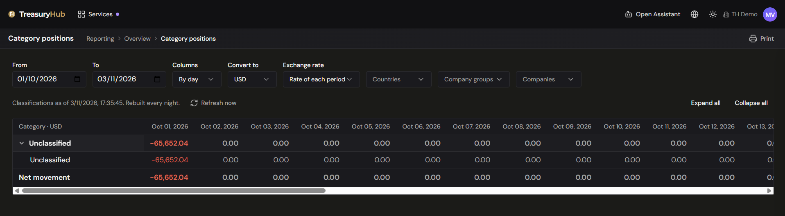

# Category Positions

> **See where your cash came from and where it went**
>
> **Why it matters**
> - **The other half of the cash question**: not how much you hold, but what it went to.
> - **Three levels deep**: Nature, then Category, then your own tags, period by period.
> - **One currency**: net movement converted so the group reads as a single picture.

> **Where to find it:** Reporting › Cash & Liquidity › Category positions
> **Who uses it:** treasurers, cash managers, finance teams, controllers.
> **Permissions required:** `CashManagement.CashPosition` · Read. **Refresh now** additionally needs
> `CoreData.Tags` · Create/Edit. See
> [Roles & Permissions](../00-getting-started/04-roles-and-permissions.md).

## Overview
See where your cash came from and where it went: [Cash Position](../01-home/home-dashboard.md)
answers "how much do we have", and Category Positions answers the other half — **what did the money
go to, and where did it come from?** It takes the
classification each transaction carries — its category and its tags — and reports the **net
movement** behind it, period by period, converted into a single currency.

The rows are a three-level tree: **Nature › Category › Tag**. Open *Operating* to see *Net payroll*,
*Supplier payment* and the rest; open *Net payroll* to see how it splits across your own tags. Each
column is a day, a week or a month, with a total at the end and a net movement line at the bottom.

Nothing is hidden: movement that nobody has classified appears as its own **Unclassified** nature,
so every period still adds up to the whole movement of your accounts.

## Key concepts
- **Nature** — the top level of the category catalogue: **Operating**, **Investing** and
  **Financing**, plus **Unclassified** for movement that has no category yet.
- **Category** — the specific kind of movement, such as *Net payroll* or *Customer receipt*. Only
  categories with movement in the range are listed. See
  [Transaction Tagging](../02-integrations/transaction-tagging.md).
- **Tag** — your organization's own label on a transaction. A category opens into its tags; the
  untagged part of a category appears as **No tag**.
- **Net movement** — inflows minus outflows inside the period. These are **movements, not
  balances**: the report never carries a figure forward from one period to the next.
- **Period column** — one day, one calendar week (Monday to Sunday) or one calendar month. The first
  and last columns are clipped to the dates you asked for.
- **Report data** — the report reads daily sums that are rebuilt overnight, so what you see is the
  classification as of the last rebuild rather than this minute's. The note above the grid says when
  that was, and **Refresh now** rebuilds it on demand.

## Before you start
- Transactions must be classified for the report to say anything useful. Unclassified movement is
  still reported, but it all lands in one row — see
  [Transaction Tagging](../02-integrations/transaction-tagging.md) for how to classify by hand or with rules.
- The accounts included are the same ones [Cash Position](../01-home/home-dashboard.md) uses, limited to the
  accounts and companies your permissions allow.
- Conversion needs exchange rates for the currencies involved. See
  [Exchange Rates](exchange-rates.md).
- A classification made today normally appears tomorrow. If you need it now, use **Refresh now**,
  which requires `CoreData.Tags` at Create/Edit.

## How to use it

### Open the report and set the period
1. Go to **Reporting › Cash & Liquidity › Category positions**. It opens on the current month to
   date, with one column per day, converted to USD.
2. Set **From** and **To**. Both dates are included.
3. Choose **Columns** — **By day**, **By week** or **By month**. Weeks run Monday to Sunday. The
   report shows at most 62 columns, so widen the grouping before you widen the range.
4. Choose **Convert to** — the single currency every figure is restated in.
5. Choose the **Exchange rate** basis: **Rate of each period** converts each column at the rate in
   force on its last day, which keeps each period in the money of its own time; **Latest rate**
   restates the whole range at today's rate, which makes periods comparable with each other.
6. Narrow the scope with **Countries**, **Company groups** and **Companies**. These behave exactly
   as on [Balance Differential](balance-differential.md) — the company list follows the countries
   and groups you picked.

### Read the grid
1. The grid opens with the natures collapsed. The left-hand column is headed **Category** followed
   by the currency everything is converted to.
2. Click the chevron on a nature to open it into its categories, and the chevron on a category to
   open it into its tags.
3. Use **Expand all** and **Collapse all**, above the grid on the right, to open or close everything
   at once.
4. Read across for the periods and down for the breakdown. The right-most **Total** column adds the
   whole range, and the **Net movement** line at the foot of the grid adds every nature for each
   period.
5. Negative figures — net outflows — are shown in red.

Two things are worth knowing when the numbers are read closely:

- **A category whose movement is entirely untagged does not open.** There is nothing to break down,
  so no chevron appears.
- **Tag rows can add up to more than the category above them.** A transaction with two tags is
  counted under both, which is what you want when you cut the same money two ways — but it means the
  tag rows are a breakdown by label, not a partition of the category.

### Keep the figures up to date after classifying
1. Look at the note above the grid — *Classifications as of* the date and time of the last rebuild,
   followed by *Rebuilt every night.*
2. If you have just classified or reclassified transactions and want them counted now, click
   **Refresh now**.
3. The daily sums are rebuilt — it takes seconds — and the report reloads with the new note.

### When a currency has no rate
If movement in some currency could not be converted for one or more periods, an amber note above the
grid names the currencies concerned. That movement is **left out of those periods** rather than
mixed in unconverted, so a small or zero figure in an affected column is not necessarily a real
zero. Try another **Convert to** currency, switch the basis to **Latest rate**, or add the missing
rates — see [Exchange Rates](exchange-rates.md).

## Configuration
There is nothing to set up on this screen and nothing is saved between visits: it opens on the
current month to date, by day, in USD, and your choice of dates, grouping, currency and scope lasts
for as long as you stay on the page.

What *does* shape the report is configured elsewhere — the classification of your transactions, in
[Transaction Tagging](../02-integrations/transaction-tagging.md), and the rates it converts with, in
[Exchange Rates](exchange-rates.md).

## Tips to get more value
- Watch the **Unclassified** nature. It is the report's own quality measure: the smaller it is, the
  more the rest of the grid can be trusted. Open [Transactions](transactions.md), filter the
  **Category** column by **To review**, and work it down.
- Pick the grouping to match the question. *By day* finds the one payment that moved a week; *by
  month* shows whether a category is drifting over a quarter.
- Keep the basis consistent when you compare periods. **Rate of each period** mixes real FX movement
  into the comparison; **Latest rate** removes it.
- Remember these are movements, not balances. A nature with a large negative total spent money in
  the range; it says nothing about what is left. Pair it with [Cash Position](../01-home/home-dashboard.md).
- Reclassify first, refresh second, read third. Clicking **Refresh now** before you have finished
  reclassifying means doing it twice.
- To work with the underlying movements — or to take figures away as a file — go to
  [Transactions](transactions.md) and filter by the category you are looking at.

## Where to go next
- [Transaction Tagging](../02-integrations/transaction-tagging.md) — categories, tags and the rules that
  produce the classification this report reads.
- [Transactions](transactions.md) — the movements behind every figure here, with a filter on the
  Category column.
- [Cash Position](../01-home/home-dashboard.md) — how much you have, as opposed to what moved.
- [Balance Differential](balance-differential.md) — movement per account between two dates, with the
  same filters and conversion rules.
- [Exchange Rates](exchange-rates.md) — the rates this report converts with.
- [Reporting — Overview](overview.md) — the rest of the report library.
