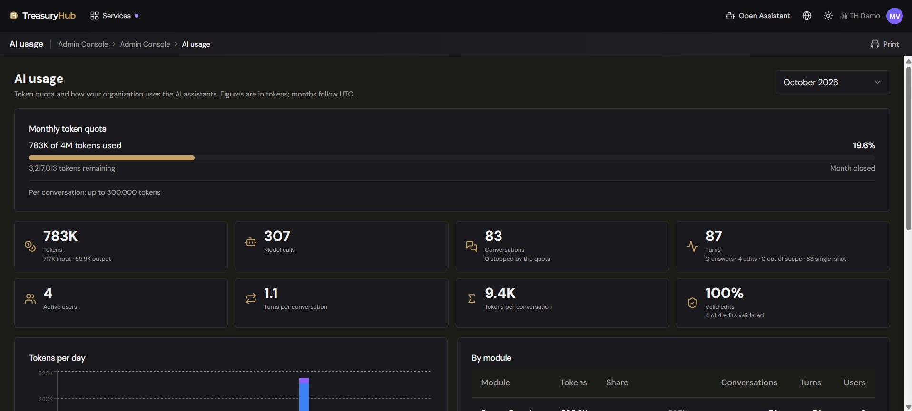
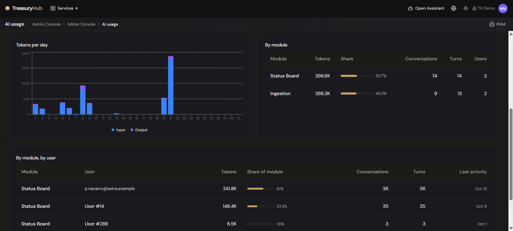

# AI usage

> **Where to find it:** Admin Console › AI usage
> **Who uses it:** administrators (and super administrators) accountable for how much AI assistance
> the organization consumes.
> **Permissions required:** Administrator. The screen is listed only for administrators, and the
> figures that name people are released only after the server has confirmed the reader is one. See
> [Roles & Permissions](../00-getting-started/04-roles-and-permissions.md).

## Overview
**AI usage** shows how much [AI assistance](../09-agents/overview.md) your organization is using, one
calendar month at a time, measured against the quota the platform enforces. It answers the questions
an administrator actually has: how much of this month's allowance is gone, how much is left, when it
resets, which parts of the platform the usage came from, and who is using it.

Everything on the screen is reported in **tokens**. Months run on UTC, which is the same window the
quota itself is counted in, so the "used" figure here is exactly the figure the platform compares
against when it decides whether to allow the next piece of AI work.

## Key concepts
- **Token** — the unit AI work is measured in. Roughly, a token is a fragment of text: everything
  sent to the agent and everything it writes back is counted in tokens. The screen separates
  **input** (what went in) from **output** (what came back).
- **Quota** — the ceiling on tokens your organization may consume in a calendar month. It resets at
  the start of the next month.
- **Conversation** — one thread with the agent, from the first question to the last.
- **Turn** — one exchange inside a conversation: you ask, the agent answers or proposes. A
  conversation usually has several turns.
- **Module** — the part of the platform a conversation belonged to, so you can see where the usage is
  coming from.
- **Proposal** — a prepared change the agent hands back for a person to review and submit. The
  agent never saves anything itself; see [AI assistance](../09-agents/overview.md).

## Three things to know before you read the numbers
These are deliberate product decisions, not gaps, and they explain most first-time questions about
this screen.

- **Usage is reported in tokens, never in money.** The ceiling the platform enforces is a token
  ceiling, and what a token costs depends on a commercial contract your organization does not see.
  Putting a currency figure on this screen would invite comparison with an invoice it is not, so no
  price, cost or currency appears anywhere on it.
- **A limit of zero means unlimited.** Where a ceiling has not been configured, the screen says so in
  words instead of drawing a bar: there is nothing to be a percentage of. Consumption is still shown.
- **Usage not attributed to a person is work the platform requested on its own.** Most AI work starts
  with someone typing a question. Some does not — for example, working out how to read a file that
  arrived by email or transfer overnight, long after everyone went home. That work is still charged
  to your organization's monthly quota and still appears in the breakdowns, but there is no person
  behind it and none is named.

## Budgets are a hard stop
AI work is metered against **three independent ceilings**:

- **per conversation** — so a single thread cannot run away;
- **per person per day** — so one person cannot consume the organization's allowance;
- **per organization per month** — the overall quota, which resets at the start of each month.

When one of them is reached, **the turn stops**. The platform does not quietly switch to a weaker
answer, shorten its reply or degrade in any other way you would have to detect — it tells the person
the allowance is exhausted and does nothing further. Nothing is saved, because the agent never
saves anything in the first place, and **the work in progress is not lost**: the draft lives on the
screen the person is working in, not inside the conversation, so it is still there afterwards.

The three ceilings are counted independently, so exhausting one does not consume the others.

**What to do when you hit one:**

| Which ceiling | What a person should do |
|---|---|
| Per conversation | Start a fresh conversation. A long thread re-sends its own history on every turn, so a new one on a narrower question is usually both cheaper and better. |
| Per person per day | Carry on with the screens directly, and return to the agent the next day — the daily count resets. |
| Per organization per month | Check this screen: it shows how much is gone and the date the quota resets. Until then, the agent is unavailable to everyone in the organization, so it is worth telling the team rather than leaving them to discover it. |

The **Conversations** tile on this screen counts how many conversations in the month were stopped by
a budget. A number that is climbing is the signal to review the ceilings before people start
complaining.

## Before you start
- You need to be an administrator. If the **AI usage** entry is not in your Admin Console menu, you
  are not one — the entry is hidden and the address redirects away.
- There is nothing to configure first. The screen is read-only and reports on usage that has already
  happened.

## How to use it

### Check where the organization stands this month
1. Open **Admin Console › AI usage**. It opens on the current month.
2. Read the **Monthly token quota** panel at the top. It shows the tokens used against the limit, the
   percentage used as a bar, the tokens remaining, and the date the quota resets. The bar changes
   colour as consumption climbs, so a month in trouble is visible at a glance.
3. If no monthly ceiling is configured, the panel says so and simply reports the tokens used this
   month.

### Check your own consumption today
1. On the same quota panel, look at the line below the bar.
2. It shows **your own** tokens used today against the per-person daily limit — your figure, not
   anyone else's, and only for the current month.
3. Beside it, the panel states the per-conversation ceiling, so you can see all three limits in one
   place.

### See where the tokens went
1. Read the tiles under the quota panel: total tokens (split into input and output), model calls,
   conversations, turns, active people, turns per conversation, tokens per conversation, and the
   share of proposed changes that passed validation.
2. The **Turns** tile breaks the month's turns down into those that **answered** a question, those
   that proposed **changing something**, those that were **out of scope** — a request the agent
   declined because it was not something it covers — and one-off requests made outside a
   conversation.
3. Read **Tokens per day** for the shape of the month: every day is charted, with input and output
   stacked, so a single runaway day stands out immediately.
4. Read **By module** for the split across the platform: tokens, share of the month, conversations,
   turns and distinct people per module. Usage that could not be attributed to a module is grouped
   under a catch-all line.

### See who is using the agent
1. Scroll to the **By module, by user** table at the bottom of the page.
2. Each line gives the module, the person, their tokens, their share of that module's tokens, their
   conversations, their turns and their last activity. Lines are ordered by module, then by the
   heaviest user within it.
3. Where a line is not attributed to a named person, it is work the platform requested on its own
   (see [Three things to know](#three-things-to-know-before-you-read-the-numbers)).

> **This table is for administrators only, and the check is made on the server.** The named figures
> are only added to the answer once the platform has confirmed, on its own, that the person asking is
> an administrator, and it fails closed — if that confirmation cannot be obtained, no names are
> returned. A non-administrator cannot see named people by reaching the screen another way: what they
> would get back is counts, organization-wide totals and their own figure, and nothing about anybody
> else.

### Look at an earlier month
1. Use the month selector at the top right. It offers the current month and the five before it.
2. Pick a month. Every panel, chart and table reloads for that month.
3. A closed month shows no personal "today" figure — there is no today in a month that has ended —
   and its quota panel says the month is closed rather than giving a reset date.

## Configuration
Nothing is configured on this screen; it reports, it does not set. The three ceilings — per
conversation, per person per day, per organization per month — are part of your organization's
platform configuration rather than a setting in the Admin Console, so a change to an allowance is a
conversation with Treasury Hub, not an edit here.

## Tips & good practices
- Check the quota panel around the middle of the month. Reaching the monthly ceiling stops the
  agent for everybody, and a mid-month look gives you time to act rather than explain.
- Watch the count of conversations stopped by the quota. It is the earliest honest signal that the
  ceilings no longer fit how the team works.
- Use **By module** to decide whether the spend is going where the value is. Heavy usage in one
  module and none in another is usually a training or an awareness question, not a budget one.
- Treat **tokens per conversation** and **turns per conversation** as a quality measure. Long
  conversations that keep needing more turns often mean a question that would be better asked fresh
  and more specifically.
- Watch the share of proposed changes that passed validation. A low share means the agent is
  being asked for things it cannot get right first time, which costs tokens for nothing.
- When you compare this screen with a bank-style month, remember the months here run on UTC — that
  is the window the quota itself uses, so the figures line up with what actually stops the AI.

## Related
- [AI assistance](../09-agents/overview.md) — the agent, what it can reach, and the guardrails
  around it, including the token budgets.
- [Admin Console — Overview](overview.md) — the rest of the administrator's screens.
- [Roles & Permissions](../00-getting-started/04-roles-and-permissions.md) — who counts as an
  administrator.
- [Users & Roles](users-and-roles.md) — the people behind the names in the
  by-user table.
