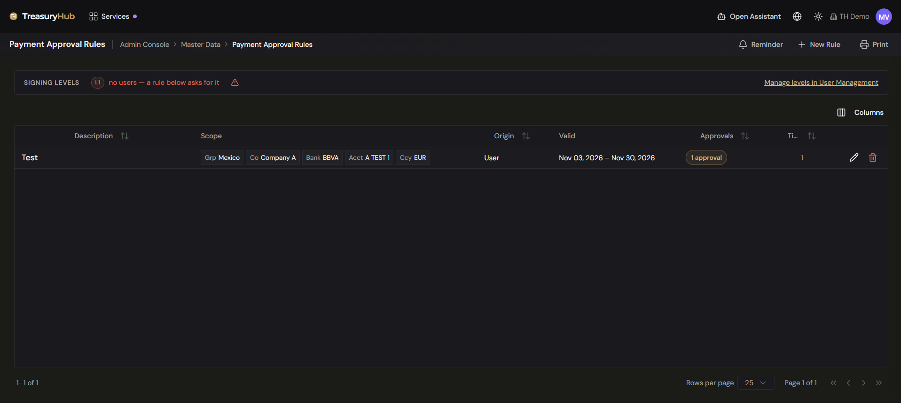
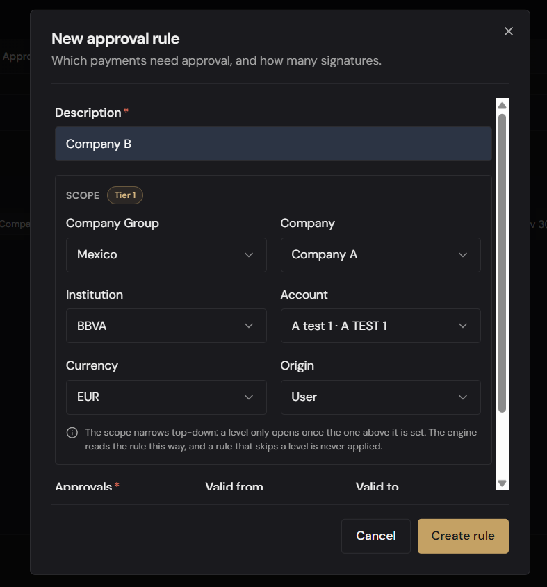

# Payment Approval Rules

> **Your signing policy, enforced automatically on every payment**
>
> **Why it matters**
> - **Policy becomes configuration**: who must sign, by company group, company, bank, account, currency and origin.
> - **Visible on the payment**: the *1 of 2* on a payment is the rule you wrote here.
> - **No reliance on memory**: the control applies whether or not anyone remembers it.

> **Where to find it:** Admin Console › Master Data › Payment Approval Rules
> **Who uses it:** administrators, treasury operations leads.
> **Permissions required:** administrator access to the tenant — the screen is reserved for administrators (see [Roles & Permissions](../00-getting-started/04-roles-and-permissions.md)).

> **In 60 seconds**
> 1. [Read the list of rules](#read-the-list-of-rules) to see what your policy currently enforces.
> 2. [Create a rule](#create-a-rule): choose its scope, then the [number of approvals](#number-of-approvals) it requires.
> 3. Set its [validity period](#validity-period), [currency](#currency) and [origin](#origin) if it is narrower than the default.
> 4. [Set the pending-approval reminder](#set-the-pending-approval-reminder) so nothing sits unsigned.

## Overview
Have your signing policy enforced automatically on every payment: a **payment approval rule**
decides how many signatures a payment needs before it can be sent to the bank. This screen is where those rules are written: you say which payments a rule covers — by
company group, company, bank, account, currency and where the payment came from — and how many
approvals they require. It is the configuration behind
[Payment Approvals](../05-payments/approvals.md): the number of approvals shown as *1 of 2* on a
payment is the number a rule set here.

One rule, and only one, applies to any given payment. The screen also carries the tenant-wide
**reminder** that chases approvers when a payment is close to its execution date.

## Key concepts
- **Rule** — a description, a scope, an optional validity period, and the number of approvals
  payments in that scope need.
- **Scope** — which payments the rule covers, expressed as a cascade: **Company Group → Company →
  Institution (bank) → Account → Currency**. Any level you leave empty means "all of them".
- **Tier** — how specific a scope is. **Tier 1** names all five levels; **Tier 6** names none and
  covers the whole tenant. The column on each row shows which tier a rule falls in.
- **Origin** — where the payment came from: **NetSuite**, **User** or **Data Hub**. A rule can be
  restricted to one origin or left open to all of them. **Data Hub** here names the ingestion
  pipeline, not a screen: it means the payment was raised from a financial event that arrived in a
  file. See [Financial Events](../03-data/financial-events.md).
- **Approvals** — how many signatures the payment needs, from **0** to **9**.
- **Signing level** — the authority a user holds, assigned per user in
  [Users & Roles](users-and-roles.md). A payment needing 2 approvals is signed
  by a level-1 user and then by a level-2 user, in that order.

## How a rule is chosen
The platform does not add rules together. It looks for a rule at the **most specific tier first**,
and only drops to a looser tier when nothing matched at the one above:

1. The account, its currency, its bank, its company and the company's group all named (Tier 1).
2. The same without the currency (Tier 2).
3. Company group, company and bank (Tier 3).
4. Company group and company (Tier 4).
5. Company group only (Tier 5).
6. Nothing named — the whole tenant (Tier 6).

A more specific rule therefore **replaces** a broader one for the payments it covers rather than
adding to it. A company-wide rule of 2 approvals plus an account-level rule of 1 approval means
payments from that account need **one** signature, not three.

Two consequences follow:

- **A scope that skips a level is never applied.** The form keeps a level closed until the one above
  it is set, and clears everything below a level you change, so the scope can never grow a gap.
- **Two rules that would be collected at the same tier cannot both exist.** The screen refuses to
  save a rule when another one already covers the same scope and origin over an overlapping validity
  period, and it names the rule it collides with. The refusal exists because such a tie is broken in
  favour of the rule asking for **fewer** approvals — the weaker control would win.

## Before you start
- You need administrator access; the screen does not appear otherwise.
- Your [company groups, companies](companies-and-groups.md) and bank accounts must already exist —
  they are what the scope is built from.
- Users need a **signing level** before they can approve anything. Assign it in
  [Users & Roles](users-and-roles.md).

## How to use it

### Read the list of rules
1. Open **Admin Console › Master Data › Payment Approval Rules**.
2. Read the **Signing levels** strip across the top: it shows how many users hold each level
   (**L1**, **L2**, …). A level turns red with *"a rule below asks for it"* when a rule demands a
   level **no user holds** — payments needing that signature would stall. **Manage levels in User
   Management** takes you there.
3. Read each row:
   - **Description** — what the rule covers, in your own words.
   - **Scope** — one chip per level the rule names: **Grp**, **Co**, **Bank**, **Acct**, **Ccy**. A
     rule that names none shows a single **entire tenant** chip. A chip turns red when the record it
     points at is no longer available (deactivated or removed); the rule still names it.
   - **Origin** — the origin the rule is restricted to, or **any**.
   - **Valid** — **always**, a date range, **from** a date, or **until** a date.
   - **Approvals** — the number of signatures, or a red **no approval** badge.
   - **Tier** — the tier its scope falls in.
4. If the list cannot be read you get a red banner in place of the strip. **An empty table and a
   failed read look alike here and mean opposite things**, so reload before concluding anything
   about what is configured.

### Create a rule
1. Click **New Rule**.
2. Enter a **Description**. It is required, and it is what identifies the rule in the list and in a
   collision message.
3. Build the **Scope**, top down. Each level only opens once the one above it is set; a closed level
   reads *"Set the level above first"*.
   - **Company Group** — leave it on *Entire tenant* for a rule that covers everything.
   - **Company** — *All companies in the group* if left empty. Only companies in the chosen group
     are offered.
   - **Institution** — *All banks of the company*. Only banks where that company holds an account
     are offered.
   - **Account** — *All accounts at the bank*.
   - **Currency** — *Any currency of the account*. The only value offered is the **account's own
     currency**; any other would build a rule that matches no payment.

   A badge beside the **Scope** heading shows the **Tier** your scope resolves to as you build it.
4. Choose an **Origin**, or leave it on **Any origin**.
5. Choose the number of **Approvals**.
6. Optionally set **Valid from** and **Valid to**.
7. Click **Create rule**. The rule applies to payments created from that moment on.

### Change or withdraw a rule
1. Use the **pencil** on the row to edit a rule. Everything can be changed, including the scope and
   the number of approvals.
2. Use the **bin** to remove one. The confirmation spells out what happens: the rule **stops
   applying to new payments straight away**, and it **cannot be brought back from this screen**.
3. Neither action touches payments already in flight — a payment keeps the number of approvals it
   was given when it was created.

### Set the pending-approval reminder
1. Click **Reminder** in the header. The **Pending-approval reminder** dialog applies to the whole
   tenant, not to one rule.
2. Set **Warn within (hours)** — a whole number from **1 to 8760** (one year). It is counted back
   from the payment's **requested execution date**: once a payment still awaiting approval is inside
   that window, the approvers of the **next level due to sign** are emailed.
3. Check **Who gets the email**. The dialog lists the users holding each signing level, read
   straight from User Management, and warns when **no user holds a signing level at all** — nobody
   would be emailed. The list is read-only here.
4. Click **Save**.

> **A value above zero is required.** Clearing the field is not a way to switch the reminder off:
> with no window configured, the reminder emails every pending payment on every run.

## Configuration

### Number of approvals
- **1 to 9** — signatures are given level by level. Two approvals mean a level-1 user signs, then a
  level-2 user.
- **0 — No approval (exemption)** — a deliberate exemption: payments the rule matches are not held
  for a signature. The form marks the choice in red as you make it, and the list shows it as a red
  **no approval** badge.

Two things decide what an exemption actually does, and both are worth knowing before you set one:

- Payments created on the [Create Payment](../05-payments/creating-a-payment.md) screen, and
  payments arriving from Data Hub, **always require at least one approval**. When the matching rule
  asks for none — or when no rule matches at all — the platform falls back to a single approver
  rather than letting a payment leave unattended.
- Payments **imported from payment files** are not held: an exemption rule, or no matching rule at
  all, means they are dispatched with **no signature**. This is the case an exemption really
  governs, and the reason an empty rule list is not a harmless empty state.

### Validity period
**Valid from** and **Valid to** are both optional and both inclusive. A rule with neither is in
force whenever its scope matches, and reads as **always**. The start cannot be later than the end.
Outside its window a rule is ignored and the next matching tier applies instead — so a rule that
expires can quietly hand a set of payments back to a broader, different rule.

### Currency
A rule's currency is always the **account's own currency**. The dropdown offers nothing else, and a
rule naming a different one is refused when you save it.

### Origin
**NetSuite**, **User** (created in TreasuryHub) and **Data Hub** (raised from an ingested
financial event). A rule left on **Any origin**
matches payments from all of them — which also means it collides with a rule that names one, for the
purposes of the overlap check above.

## Tips to get more value
- **Treat 0 approvals as a control decision, not a convenience.** For the payments it covers it
  removes the only human check between an instruction and the bank. Give the rule a description that
  says why the exemption exists, bound it with **Valid from** / **Valid to**, and review it on a
  schedule.
- **Write the broad rule first**, then add the specific exceptions. The specific one wins outright,
  so the list reads as "this is the default, and these are the exceptions".
- **Watch the Signing levels strip.** A rule demanding a level nobody holds does not fail loudly —
  the payments sit unapproved.
- **Give every rule a description you will recognise months later.** It is what a collision message
  quotes back at you.
- **Set the reminder window shorter than your payment lead time**, so approvers are chased while
  there is still time to act.
- **Check the Tier badge while building a scope.** If it does not resolve, a level has been skipped
  and the rule would never be applied.

## Where to go next
- [Payment Approvals](../05-payments/approvals.md) — where approvers act on what these rules demand.
- [Payment Blotter](../05-payments/payment-blotter.md) — approval progress and status across all
  payments.
- [Users & Roles](users-and-roles.md) — where each user's signing level is set.
- [Companies & Company Groups](companies-and-groups.md) — the structure a rule's scope is built from.
- [Admin Console — Overview](overview.md) — the other master data screens.
