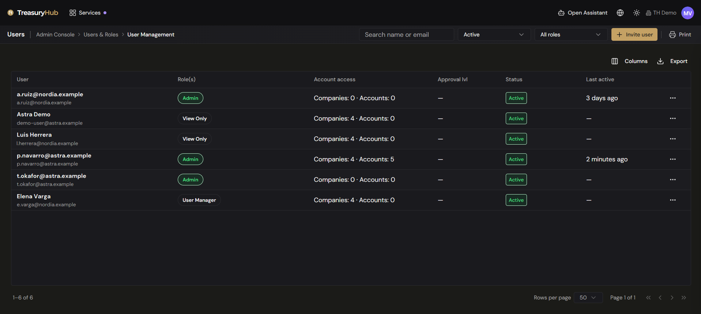
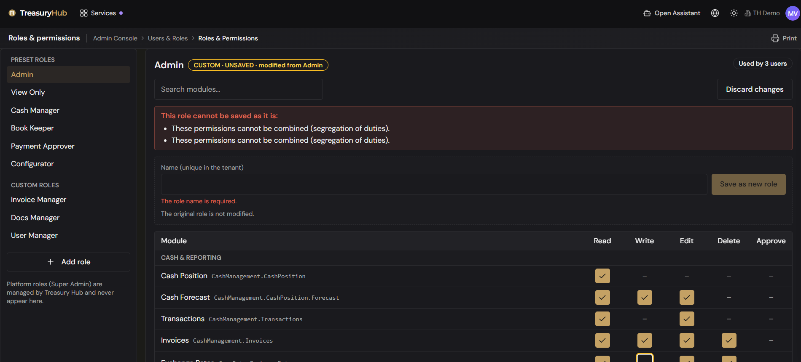
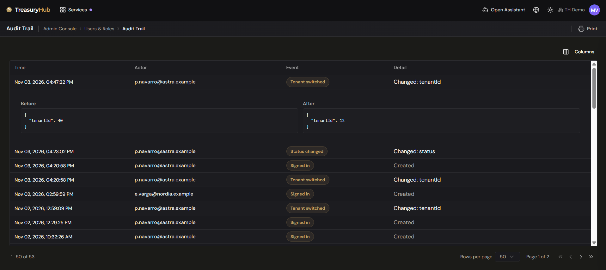

# Users & Roles

> **Onboard a new user in minutes, with segregation of duties built in**
>
> **Why it matters**
> - **Roles, never person by person**: build the matrix of modules and actions once, then hand the role out.
> - **Two independent controls**: what a role grants, and which accounts a person can reach.
> - **Every change recorded**: the audit trail covers both user management and permission changes.

> **Where to find it:** Admin Console › Users & Roles
> **Who uses it:** administrators and user managers.
> **Permissions required:** `AdminAndSettings.UserManagement` · Read to open the screens, Create/Edit
> to change people and roles, Delete to delete a user or a role, Admin to set a payment approval
> level.

> **In 60 seconds**
> 1. [Invite someone](#invite-someone) with their email address and role.
> 2. [Change what data someone sees](#change-what-data-someone-sees) by setting their account access.
> 3. [Set a payment approval level](#set-a-payment-approval-level) if they will sign payments.
> 4. Check the result in the audit trail — every change above is recorded.

## Overview
Onboard someone in minutes, with segregation of duties built in: **Users & Roles** is where you
decide who belongs to your organization and what each of them can do. It holds three screens: **User Management** for the
people and their invitations, **Roles & Permissions** for what a role grants, and **Audit Trail**
for the record of every change the first two make.

Access is granted through roles, never person by person: you build a role once as a matrix of
modules and actions, then hand that role to people. A second, independent setting — **account
access** — decides which companies and accounts a person's data is narrowed to. See
[Roles & Permissions](../00-getting-started/04-roles-and-permissions.md) for the model behind both.

## Key concepts
- **Role** — a named set of permissions. A **preset** role is maintained by TreasuryHub and cannot
  be changed; a **custom** role is yours to build, rename and delete.
- **Permission matrix** — the table behind a role: one row per module, five columns of actions.
- **Action** — **Read**, **Write**, **Edit**, **Delete** or **Approve**. Not every action applies to
  every module; where it doesn't, the cell shows a dash.
- **Membership status** — where a person stands in your organization: **Invited**, **Invitation
  expired**, **Active**, **Suspended** or **Deactivated**.
- **Invitation** — a single-use emailed link with an expiry date. Nobody sets a password: a person
  joins by accepting the link.
- **Account access** — the companies and accounts a person's data is narrowed to. It is independent
  of their roles.
- **Payment approval level** — the signing level used by multi-level payment approvals. See
  [Payment Approvals](../05-payments/approvals.md).
- **Segregation of duties** — the rule that one person may not both make a change and approve it.
  The platform refuses a role or an assignment that breaks it.
- **Escalation** — handing out more than you hold yourself. You can only grant actions you have.

## Before you start
- You need `AdminAndSettings.UserManagement`. Read lets you look; Create/Edit lets you change
  things; Delete lets you remove a user or a role; Admin lets you set a payment approval level.
- Create your companies and bank accounts first — account access is chosen from them. See
  [Companies & Groups](companies-and-groups.md).
- **Super Admin is not a role.** It is a flag TreasuryHub sets on a person's record, so it never
  appears in these lists and cannot be granted from here.

## How to use it
### Find a person
1. Open **Admin Console › Users & Roles › User Management**.
2. Read the grid: **User** (name and email), **Role(s)**, **Account access** as a count of companies
   and accounts, **Approval lvl**, **Status**, and **Last active**.
3. Narrow it with the toolbar: type a name or email in the search box, pick a **status**, or pick a
   **role**.
4. Note the line above the grid: deactivated people are hidden until you choose **Deactivated** in
   the status filter.
5. Use the **Export** action to download what the grid currently shows as a CSV file.

Pending invitations are rows in the same grid, with the status **Invited** or **Invitation
expired**. They offer invitation actions only.

### Invite someone
1. On **User Management**, click **Invite user**.
2. Fill in **First name**, **Last name** and **Email**. Only the email is required.
3. Tick the **Role(s)** the person should hold. A role you could not grant yourself is locked. With
   no role ticked, the person joins as **View Only**.
4. Under **Account access**, choose **By company (all its accounts)** or **By single account**, then
   tick what they should see.
5. Add a **Personal message** if you want one; it goes into the invitation email, up to 1,000
   characters.
6. Watch the **Resulting effective permissions** panel beside the form. It shows what the ticked
   roles add up to, and updates as you tick.
7. Click **Send invitation**. The person is created with the status **Invited** and is emailed a
   single-use link that expires. Until they accept, they cannot sign in.

If the email already belongs to your organization, the dialog says so and offers **Edit their
roles**. If they already have an invitation waiting, it offers **Show in grid** so you can resend it
from there.

### Change someone's roles
1. Open the row's actions menu and choose **Change roles**.
2. Tick or untick roles. A role carrying approval rights is marked **Approves**; a role you cannot
   grant is locked, with the reason on the row.
3. Check the **Resulting effective permissions** panel, then click **Save**.

Leaving someone with no role leaves them unable to use the organization, and the dialog says so.

### Change what data someone sees
1. Open the row's actions menu and choose **Edit access**.
2. Choose **By company (all its accounts)** or **By single account**.
3. Tick the companies or accounts, then click **Save**.

Saving replaces the whole selection, so start from what is already ticked rather than adding to it.
If the dialog warns that the current access could not be read, the list starts empty — check it
carefully before saving, because saving will still replace everything.

### Set a payment approval level
1. Open the row's actions menu and choose **Payment approval**. The action needs **Admin** on
   `AdminAndSettings.UserManagement`.
2. Set the level and save. See [Payment Approvals](../05-payments/approvals.md) for what each level
   signs.

### Suspend, reactivate, deactivate or delete someone
1. Open the row's actions menu. What it offers depends on the person's status:
   - **Active** — Edit access, Change roles, Payment approval, Suspend, Deactivate, Delete.
   - **Suspended** — Edit access, Reactivate, Deactivate, Delete.
   - **Deactivated** — Delete.
2. **Suspend** stops the person using this organization while keeping everything about them;
   **Reactivate** gives it back.
3. **Deactivate** ends their membership but keeps the row and its history.
4. **Delete** asks you to confirm and cannot be undone: the person loses access to this
   organization.

Suspension applies to this organization only — someone who also belongs to another organization
keeps working there. Nobody can suspend, deactivate or delete themselves, and only an administrator
can change their own roles or access.

### Resend or revoke an invitation
1. Find the row with status **Invited** or **Invitation expired**.
2. Choose **Resend invite** to send a fresh link. The previous link stops working straight away and
   the new expiry date is shown in the confirmation.
3. Choose **Revoke invite** to cancel it. The link stops working and the person needs a new
   invitation.

### Read what a role grants
1. Open **Admin Console › Users & Roles › Roles & Permissions**.
2. Pick a role from **Preset roles** or **Custom roles** on the left.
3. Read the header: the role's name, whether it is **PRESET** or **CUSTOM**, and how many people
   use it.
4. Read the matrix on the right. Rows are grouped — Cash & Reporting, Payments, Reconciliation,
   Accounting, Data & Integrations, Workflows/Alerts/Agents, Administration, Platform — and each row
   names a module with its key underneath. A ticked cell is a granted action; a dash means the
   action does not apply to that module.
5. Use **Search modules...** to jump to a row by its name or key.

### Create or change a custom role
1. On **Roles & Permissions**, click **+ Add role** for an empty matrix, or pick an existing custom
   role.
2. Click cells to turn actions on and off. Click a row's label to toggle the whole row, or a column
   heading to toggle that action on every row currently listed. Changed cells stay highlighted until
   you save or discard.
3. **Read is the base.** Turning on any action turns Read on, and Read cannot be removed while
   another action is on.
4. Watch the red block above the table. It appears as you edit and lists anything that would stop
   the role being saved, outlining the cells it is about.
5. Click **Save** to save a custom role in place, or **Discard changes** to go back.

You can only grant actions you hold yourself; cells for anything else are disabled.

### Build a role from a preset
1. Pick the preset and change the matrix. A preset cannot be saved over — there is no Save button
   for it, and no rename or delete.
2. Type a name in the **Save as new role** bar at the top of the editor and click **Save as new
   role**.
3. The new custom role is created and selected. The preset is untouched.

The same bar appears on a changed custom role, so you can fork one instead of editing it in place.

### Delete a role
1. Pick the custom role and choose **Delete role** in the editor header. The action needs Delete on
   `AdminAndSettings.UserManagement`.
2. Confirm. If the role is still assigned to anyone — including deactivated people — the
   confirmation stays open and tells you to reassign them first.

Preset roles cannot be deleted.

### Read the audit trail
1. Open **Admin Console › Users & Roles › Audit Trail**.
2. Read the table: **Time**, **Actor** (the email of whoever made the change), **Event**, and
   **Detail**. The newest entry is first.
3. Click a row to expand it and read the **Before** and **After** snapshots.
4. Page through with the controls at the foot of the table.

Events recorded here include **Created**, **Updated**, **Deleted**, **Invited**, **Invitation
resent**, **Invitation revoked**, **Invitation accepted**, **Invitation refused**, **Roles
changed**, **Access changed**, **Status changed**, **Approval level changed**, **Signed in**,
**Tenant switched**, and **Super Admin change refused**.

## Configuration
### Preset roles
New organizations start with these preset roles. Your own list is whatever the **Preset roles**
panel shows, because organizations set up earlier keep the roles they already had.

| Preset role | What it is for |
|---|---|
| **Admin** | Administers the organization and is not narrowed by account access. |
| **Configurator** | Sets up master data, integrations, parsing templates and builders. |
| **User Manager** | Manages people and their access, and reads access tokens. |
| **Cash Manager** | Day-to-day cash: position, transactions, forecast, payments, invoices, exports, with read access to master data. |
| **View Only** | Reads everything outside the Administration and Platform groups. |
| **Book Keeper** | G/L postings, CoA rules and journal entries. |
| **Payment Preparer** | Prepares payments and reads invoices and the cash position. |
| **Payment Approver** | Reads the payment blotter and approves payments. |

Alongside them, new organizations get **Invoice Manager**, **Invoice Admin** and **Docs Manager** as
ordinary custom roles, so you can change or delete those.

### Segregation-of-duties rules
A role, or a set of roles given to one person, is refused when it combines the make side and the
approve side of the same thing:

| Make | Approve |
|---|---|
| **Write** on Payment Blotter | **Approve** on Payment Approvals |
| **Write** or **Edit** on G/L Postings | **Approve** on G/L Postings |
| **Write** or **Edit** on Counterparties | **Approve** on Counterparties — approve |
| **Write** or **Edit** on Settlement Instructions (SSIs) | **Approve** on Settlement Instructions (SSIs) |

Editing a payment is not creating one, so Edit on the Payment Blotter sits happily beside Approve on
Payment Approvals. The **Admin** role is exempt from these rules.

### Who can do what
| Action | Level needed on `AdminAndSettings.UserManagement` |
|---|---|
| Open the three screens, read roles and the audit trail | Read |
| Invite, change roles, edit access, suspend, reactivate, deactivate, resend, revoke | Create/Edit |
| Create, edit or fork a role | Create/Edit |
| Delete a user, delete a role | Delete |
| Set a payment approval level | Admin |

## Tips to get more value
- Build roles around jobs, not people. A role used by one person is a sign the matrix wants
  splitting.
- Fork a preset rather than starting from an empty matrix: **Save as new role** gives you a working
  set of permissions to trim.
- Read the **Used by N users** figure before saving a role in place. Everyone holding it is affected
  the next time they load a page.
- Keep at least two people with the **Admin** role, so an organization is never locked out. The
  platform refuses to take admin access from the last active administrator.
- Prefer **Suspend** to **Delete** when someone leaves temporarily: suspension is reversible and
  keeps their roles and access intact.
- Use the audit trail before asking what changed. Every role, user, invitation and access change is
  there with a before and after.
- Check a person's **Account access** as well as their roles when they report missing rows. The two
  are independent, and a narrow account access hides data a generous role would otherwise show.

## Where to go next
- [Roles & Permissions](../00-getting-started/04-roles-and-permissions.md) — the permission model,
  the levels and how account access narrows what you see.
- [Admin Console — Overview](overview.md) — the other admin areas.
- [Access Tokens](access-tokens.md) — credentials for integrations, managed separately from people.
- [Payment Approvals](../05-payments/approvals.md) — what a payment approval level signs.
- [Companies & Groups](companies-and-groups.md) — the companies and accounts that account access is
  chosen from.
- [Navigation & Your Workspace](../00-getting-started/02-navigation-and-workspace.md) — where the
  Users & Roles group sits in the menu.
