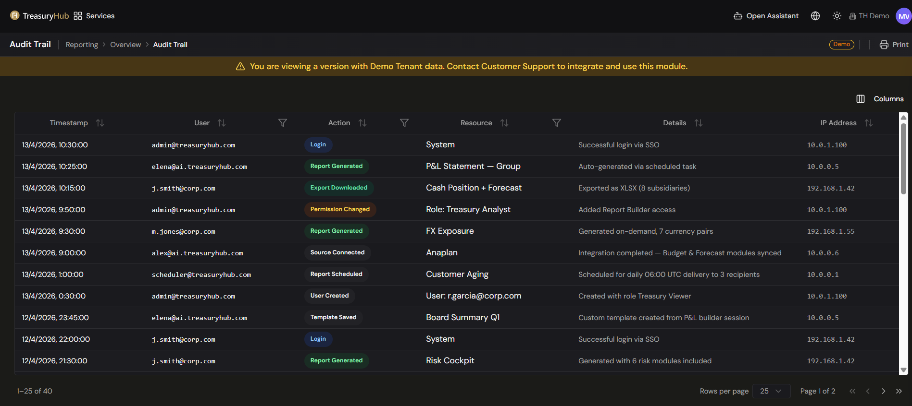

# End-to-End Audit Trail

> **Follow any transaction end to end, with an immutable record ready for audit**
>
> **Why it matters**
> - **From arrival to ERP, and back**: every step, every change, who or what did it, and when.
> - **Built in, not bolted on**: the workflow model records the trail as a by-product of doing the work.
> - **Nothing to reconstruct**: what the auditor asks for is already there.
>
> *For the CFO: audit preparation becomes a query rather than a project, and the control framework is evidenced continuously.*

> **Where to find it:** Reporting › Overview › Audit Trail (a filterable audit log).
> **Who uses it:** auditors, financial controllers, compliance, treasury operations.
> **Permissions required:** Read on the relevant module; auditors will typically have read access across modules plus the audit trail. See [Roles & Permissions](../00-getting-started/04-roles-and-permissions.md).

## Overview
Follow any transaction end to end, with a record an auditor can rely on: the **audit trail** is the
immutable history of everything that happened to it — every
step, every change, who or what did it, and when. It lets you follow a single item from the moment
it arrived in the platform all the way to its record in your ERP, and back again, which is exactly
what auditors and compliance teams need.

Auditability is built into the platform's [workflow model](../00-getting-started/03-core-concepts.md#everything-is-a-workflow):
every workflow step records who did what, when, and the outcome. This page explains how the trail
works for accounting and posting activity.

The trail itself is unaffected by the switch-off of [G/L posting](gl-postings.md), but it no longer
gains posting events: no entry is generated, approved or exported any more, so the accounting end of
the chain below is history. Everything recorded in the past is kept and stays readable.

## Key concepts
- **Event** — one immutable record of a single action (for example *created*, *approved*,
  *exported*, *matched*, *rejected*, *escalated*).
- **Immutable / append-only** — events are never edited or deleted; a correction is a new event, so
  the history is complete and tamper-evident.
- **Actor** — who performed the action: a **user** (with their identity) or an **AI agent** (with the
  agent's identity).
- **ID chain** — the linked identifiers that connect a transaction across every phase and system, so
  you can trace it end to end.
- **Correlation ID** — the single identifier that ties all of one transaction's events together
  across the whole pipeline.
- **Retention policy** — how long the trail is kept, configurable to your regulatory needs.

## The ID chain — following a transaction end to end
Each transaction keeps a chain of identifiers that links every stage together:

```
Transaction → Reconciliation → Journal Entry → Approval → ERP Export → ERP Entry
 (ingestion)    (matching)       (generated)    (workflow)  (sent)       (recorded in ERP)
```

The chain stops at reconciliation for anything recent: the journal entry, approval and ERP export
stages exist only on records that reached the posting stage. Where those stages are
present, they are linked, so you can navigate in both directions:

- **Drill down (backwards):** from an entry recorded in the ERP → back to its journal entry → back
  to the reconciliation → back to the original bank movement.
- **Drill up (forwards):** from an ingested bank movement → forward to reconciliation → forward to
  the journal entry → forward to the ERP record.
- **Cross-entity:** when a transaction affects more than one company (for example intercompany), the
  trail connects the entries across all the entities involved.

## What each event records
Every event captures a consistent set of fields:

| Field | What it records |
|---|---|
| **Timestamp** | When it happened (UTC, to the millisecond). |
| **Actor** | The user or AI agent that performed the action. |
| **Action** | The type of operation (created, approved, exported, matched, rejected, escalated…). |
| **Status change** | The transition — previous status → new status. |
| **Snapshot** | The data as it stood at the moment of the action. |
| **Context** | For an AI action: its reasoning and confidence score. For a user: session details such as IP. |

## How to use it

### Browse the audit log
1. Open **Reporting › Overview › Audit Trail**.
2. The log lists events with **Timestamp, User, Action** (e.g. Login, Report Generated, Export
   Downloaded, Permission Changed, Source Connected, User Created, Template Saved), **Resource,
   Details,** and **IP Address**, newest first.
3. Sort any column, and use the **column filters** (User, Action, Resource) to narrow the log; use
   **Columns** to show/hide fields and **Print** to print the current view.



> A per-record **timeline in the detail panel** follows one item end to end across modules.

### Trace a transaction across systems
1. From any event, use the **linked reference** to jump to the connected record in another phase
   (for example from a journal entry to its source reconciliation, or forward to its ERP record).
2. Follow the chain in either direction until you reach the point you need — the original bank
   movement or the final ERP entry.

### Filter and search the trail
1. Use the column filters on **User**, **Action**, and **Resource** to narrow the log to the events
   you need.
2. Sort by **Timestamp** to work in chronological (or reverse-chronological) order.
3. Trace by **phase** (ingestion, reconciliation, and, on older records, journal entry, approval and
   export) using the end-to-end ID chain — see *Trace a transaction across systems* above.

### Export the trail for an external audit
1. Open the trail for the record or period you need.
2. Choose the **export** option and select **PDF** or **CSV**.
3. Hand the exported record to your auditors, or feed it into your GRC (governance, risk, and
   compliance) tooling.

## Tips to get more value
- Because the trail is **append-only**, treat it as your single source of truth for "who changed
  what" — there is no hidden edit history to chase.
- When reviewing an **AI agent's** decision, check the recorded **reasoning and confidence score** to
  understand why it approved or escalated an item.
- Agree your **retention period** with your auditors up front (many regulations expect several years;
  seven or more is a common baseline) and confirm it is configured for your organization.
- Use **cross-entity** tracing for intercompany items so both sides of a transaction are reviewed
  together.

## Also in the audit trail
- **Consolidated Transaction Timeline** — a single unified view of every event for any transaction,
  with phase and actor filters in one place.
- **Compliance query API** — programmatic access to the audit trail for external GRC tools.

## Where to go next
- [G/L Postings](gl-postings.md) — the postings whose history the trail records.
- [Journal Entries](journal-entries.md) — the entry generation and approvals recorded in the trail,
  which no longer run.
- [Roles & Permissions](../00-getting-started/04-roles-and-permissions.md) — who can view the trail.
- [Reconciliation](../04-reconciliation/overview.md) — matching events feed the same trail.
