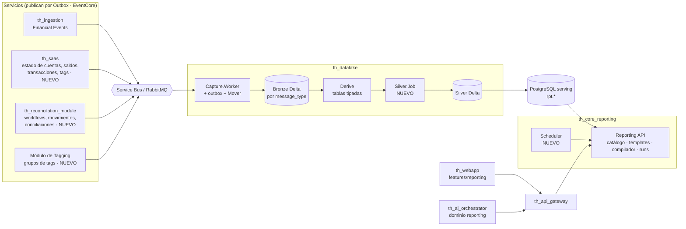

# 03 · Módulos: qué hace cada uno y por qué existe

El POC está separado en capas con la misma forma que tendría la versión real. Cada módulo tiene su **destino**: el repo y el componente donde iría en producción.

```
model/     → qué datos existen y cómo se relacionan    (semántica)
engine/    → cómo se calcula un reporte                 (motor, sin UI)
builder/   → cómo se arma un reporte                    (UI de autoría)
output/    → cómo se muestra un resultado               (UI de visualización)
pages/     → pantallas                                  (Library, Builder, Viewer, Model)
state/     → persistencia de templates y runs           (hoy localStorage)
scripts/   → smoke test con invariantes                 (especificación ejecutable)
```

**Regla de dependencias:** `engine/` no importa nada de React ni de `builder/`. Esto es lo que permite portarlo a C# como una unidad y usar el POC como oráculo en los tests (ver [04](04-plan-de-ejecucion.md)).

## model/: la capa semántica

| Archivo | Qué hace | Por qué existe | Destino |
|---|---|---|---|
| `types.ts` | Define `Entity`, `Field`, `Domain`. Una entidad es una tabla Silver con su clave, su fecha de negocio, su relación (parent, subtype o lookups) y su disponibilidad. Un campo tiene tipo, rol, agregación por defecto, `semiAdditive`, `partitionBy`, `currencyRef` y linaje. | Las reglas difíciles (grano, saldos, monedas) tienen que estar **en los metadatos**, no en la cabeza del usuario ni hardcodeadas en el motor. | Catálogo versionado en **th_core_reporting**, con los mismos conceptos |
| `silver.ts` | El catálogo concreto: 13 entidades en 4 dominios, con linaje a bronze, a th_saas o a recon. | Es el contrato entre el equipo de datos y el de reporting. De acá sale el DDL de serving. | DDL de serving y catálogo en C# |
| `mockData.ts` | Unas 25k filas deterministas de un tenant (seed fijo), con relaciones coherentes: un BANK_MOVEMENT genera una Transaction, las conciliaciones agrupan Left contra Right, los tags se asignan a egresos, los saldos se derivan de las transacciones. | Permite probar grano, M:N y semi-aditivos con datos que "cierran". | **Fixture de tests** exportado a SQL/parquet para los tests diferenciales |
| `seeds.ts` | 11 templates de ejemplo y los runs históricos. | Cada template demuestra un caso difícil. Son la batería de regresión. | **Golden templates** para los tests del compilador y los evals del agente AI |

## engine/: el motor

| Archivo | Qué hace | Por qué existe | Destino |
|---|---|---|---|
| `report.ts` | Tipos del **contrato**: `ReportTemplate`, `ColumnRef`, `Filter`, `JoinContext`, `ReportParam`, `CalcField`, `GrainResolution`, `OutputConfig`, `Schedule`, `ReportRun`. | Es lo que comparten el Builder, el backend, el scheduler y el agente AI. | **JSON Schema** publicado por th_core_reporting (generado desde C#) |
| `catalog.ts` | Grafo de entidades: `base()` para subtipos, `pathUp()` (camino de JOINs N:1), `isAncestor()`, `commonAncestor()` (hermanos), `commonDescendant()` (bridge M:N). `DataStore` indexa por clave primaria. | Toda la resolución de JOINs sale de acá. Con el grafo explícito, un JOIN nuevo es un dato y no código. | Resolución de JOINs del compilador SQL |
| `query.ts` | **El corazón.** Ver el detalle abajo. | Concentra toda la semántica. | **Compilador ReportTemplate → SQL** en th_core_reporting |
| `formula.ts` | Tokenizer y parser por precedencia a un AST. Evalúa por fila (`evalRow`) y por grupo (`evalGroup`). Detecta `isAggregate`. Tiene la lista blanca de funciones. | Un parser propio, en vez de `eval`, da seguridad, una clasificación automática del tipo de fórmula y la posibilidad de compilar a SQL. | Parser C# que **compila el AST a SQL parametrizado** |
| `params.ts` | Resuelve fechas relativas y valores de parámetros, liga los filtros (`bindFilter`), interpola etiquetas y formatea valores. | Los parámetros cruzan filtros, etiquetas, SQL y el scheduler. Conviene tenerlos en un solo lugar. | Compartido por el compilador y el scheduler |

### Qué hace `query.ts`

1. **`analyzeMix`**: a partir de las entidades usadas, detecta:
   - hojas (leaves);
   - hermanos;
   - bridge M:N;
   - par padre/hijo;
   - subtipos;
   - JOINs propios (`multiScope`).

   También calcula la `signature` que decide si hay que volver a preguntar el grano.
2. **Elige el modo:** flat, parent, nested, child o drill-across.
3. **Arma los scopes:** uno por cada combinación de tabla y JOIN context, con sus medidas. Hermanos y JOINs usan el mismo camino.
4. **Filtra las filas de cada scope.** Aplica los filtros globales y los del JOIN, ya ligados a sus parámetros. Además:
   - agrega el filtro por tipo de los subtipos;
   - convierte en semi-join los filtros sobre hijos;
   - pasa por el padre común los filtros sobre hermanos.
5. **Agrupa y agrega.** Aplica el agregado simétrico para las medidas de ancestros y para el M:N, y "último por partición y después suma" para los saldos.
6. **Chequea las monedas** por fila y en el total.
7. **Evalúa las fórmulas entre columnas** sobre las filas, los hijos y los totales.
8. Aplica **HAVING**, orden y límite.
9. **Genera el SQL** equivalente: CTE por scope, `ROLLUP` para el modo jerárquico, `:parametros` y subquery para las fórmulas entre columnas.

## builder/: la UI de autoría

| Archivo | Qué hace | Por qué existe |
|---|---|---|
| `FieldPanel.tsx` | Árbol por dominio, entidades relacionadas, campos calculados, drag y "+". | El usuario piensa en dominios ("cuentas", "conciliación"), no en tablas. Ver la jerarquía anticipa el diálogo de grano. |
| `Shelves.tsx` | Dimensiones, Medidas, Filtros, filas de JOIN y Parámetros. Chips con popover: agregación, grano, orden, JOIN, "comparar con". | Es el modelo mental de pivot o Tableau, que la gente de finanzas ya conoce. Los JOINs como filas propias hacen visible "qué filtro aplica a qué columna". |
| `FilterEditor.tsx` | Operador y valor según el tipo de campo. El valor puede ser fijo o un parámetro, y desde ahí se crean parámetros. | Se usa igual en el Builder y en el Viewer, así que no hay dos lógicas de filtros. |
| `FormulaEditor.tsx` | Nombre, expresión, formato, validación en vivo, tipo detectado, valor de ejemplo e insertables. | Ver el tipo detectado y un valor real previene errores de fórmula antes de guardar. |
| `GrainDialog.tsx` | Las tres opciones de grano, con dibujo y conteo real de filas. | Es la pregunta clave del producto. Mostrar "10 filas vs 1.812 filas" la vuelve concreta. |
| `ScheduleDialog.tsx` | Frecuencia, hora, destinatarios, formato y próximas ejecuciones. | Es el prototipo de la UX del scheduler. En la versión real se reemplaza por cron validado (ver 04). |
| `OutputBar.tsx` | Tipo de salida y opciones de eje, series, columnas, totales y límite. | Separa "qué datos" de "cómo se ven". El mismo resultado se muestra de varias formas. |
| `helpers.tsx` | Íconos por tipo, `refInfo`, operadores por tipo, valores distintos para los filtros, resumen de filtros. | Utilidades compartidas. |

El diálogo **¿mismo JOIN o nuevo JOIN?** y la orquestación del Builder están en `pages/BuilderPage.tsx`.

## output/ReportOutput.tsx: visualización

- Tabla plana o jerárquica, Pivot, gráficos de Recharts y KPI.
- Los **totales del pivot** y los **gráficos con menos dimensiones** llaman de nuevo al motor en su propio grano.

**Por qué:** es la regla "los totales no mienten" (ver [01](01-como-se-ideo.md) §7). En la versión real esa re-consulta es un pedido al backend con `GROUPING SETS`.

**Destino:** `th_webapp/src/features/reporting`, reemplazando el mock actual.

## pages/ y state/

| Archivo | Qué hace | Destino |
|---|---|---|
| `LibraryPage.tsx` | Lista de templates y runs, alta por dominio. | th_webapp |
| `BuilderPage.tsx` | Orquesta el Builder: agregar o mover campos (funciones puras sobre el template), diálogo de JOIN, creación de parámetros, banda de padre/hijo, vista previa con SQL y JSON, guardado. | th_webapp |
| `ViewerPage.tsx` | Parámetros, ejecutar, strip del run, historial y CSV. | th_webapp |
| `ModelPage.tsx` | Catálogo Silver navegable con sus brechas. | Documentación interna o una página de admin |
| `state/store.ts` | Templates y runs en localStorage. `actions.run` congela el snapshot y resuelve los parámetros. | **API de th_core_reporting**: templates, runs y resultados en su base |

## scripts/smoke.ts: especificación ejecutable

Corre los 11 templates y verifica 11 invariantes:

- saldo semi-aditivo;
- drill-across sin fan-out;
- M:N deduplicado, con la suma de los grupos mayor que el total;
- agregado simétrico de una medida del padre;
- fórmulas encadenadas;
- dos JOINs de Balances con sus saldos al t1 y al t2;
- el tercer JOIN con el rango (t1, t2];
- la fórmula entre columnas;
- la etiqueta interpolada;
- un parámetro cambiado en ejecución.

**Por qué:** es la especificación de comportamiento más precisa que tenemos. La versión real tiene que pasar **los mismos invariantes** sobre el mismo dataset.

## Mapa de destino en producción


