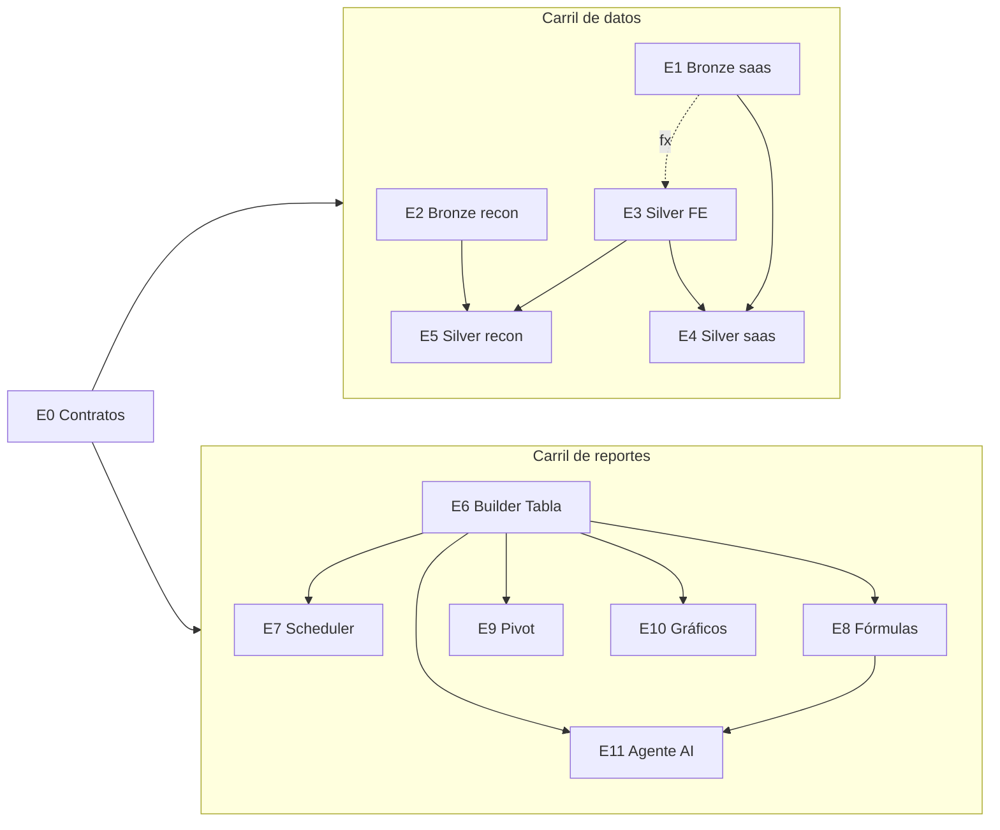

# 04 · Plan de ejecución

Este plan convierte el POC en producto. Las tareas están cortadas en **rebanadas funcionales**: cada una se puede mergear, probar y, en lo posible, mostrar por separado. Además están pensadas para que las **desarrolle un agente AI** con revisión humana.

## 1. Resumen

### Las épicas pedidas, más una de contratos

| # | Épica | Repos | Rebanadas |
|---|---|---|---|
| E0 | **Contratos compartidos** (nueva, habilita el trabajo en paralelo) | th_event_core_library, th_core_reporting, POC | 3 |
| E1 | Traer entidades de th_saas a Bronze (Outbox) | th_saas, th_datalake | 4 |
| E2 | Traer entidades de th_reconcilation_module a Bronze (Outbox) | th_reconcilation_module, th_datalake | 3 |
| E3 | Silver de Financial Events | th_datalake | 4 |
| E4 | Silver de th_saas | th_datalake | 4 |
| E5 | Silver de th_reconcilation_module | th_datalake | 4 |
| E6 | Report Builder: Data Sets, Dimensiones, Medidas, Filtros, Parámetros, salida Tabla | th_core_reporting, th_webapp, th_api_gateway | 10 |
| E7 | Report Scheduler con cron configurable (frecuencia mínima diaria) | th_core_reporting, th_webapp | 3 |
| E8 | Fórmulas en el Report Builder | th_core_reporting, th_webapp | 4 |
| E9 | Vista Pivot | th_core_reporting, th_webapp | 2 |
| E10 | Gráficos | th_webapp (+ th_core_reporting) | 3 |
| E11 | Agente AI para gestionar el Report Builder | th_ai_orchestrator, th_webapp | 3 |

### La idea clave: dos carriles en paralelo

- El **carril de datos** (E1–E5) y el **carril de reportes** (E6–E11) no se esperan.
- Lo que los desacopla es **E0.2**: el esquema de serving (`rpt.*`) queda fijado como DDL, y el dataset del POC se exporta como fixture.
- El motor, el Builder y el agente se desarrollan y testean **contra el fixture** desde el día uno. Cuando llega el Silver real, cambia la conexión, no el código.



### Releases: lo que ve el usuario

| Release | Qué habilita | Rebanadas |
|---|---|---|
| **R1: Reportes de eventos en tabla** | Reportes propios sobre Financial Events, incluidos los subtipos Payin, Payout y Bank Movement: guardar, ejecutar y ver el historial | E0.\*, E3.1, E3.2, E3.4, E6.1–E6.4, E6.6, E6.8–E6.10 |
| **R2: Cuentas, saldos y cierre de caja** | Posición de caja, saldo al t1 vs t2, movimientos del período, grano padre/hijo, JOINs propios, fórmulas | E1.\*, E3.3, E4.1–E4.3, E6.5, E6.7, E8.\* |
| **R3: Conciliación y tags** | Workflows, conciliaciones, movimientos abiertos y reportes por tag (con grupos cuando exista el módulo de Tagging) | E2.\*, E4.4, E5.\* |
| **R4: Reportes programados** | Envío diario, semanal o mensual por cron validado | E7.\* |
| **R5: Visual** | Pivot y gráficos | E9.\*, E10.\* |
| **R6: Asistente** | Pedir un reporte en lenguaje natural y recibir una propuesta | E11.\* |

Por el fixture, R4 a R6 se pueden **desarrollar** en paralelo con R2 y R3. El orden de la tabla es el orden en que **llegan a usuarios con datos reales**.

## 2. Cómo trabajar esto con AI

### Método por rebanada

1. **Ficha de tarea** (plantilla en §5): objetivo, contratos que no se tocan, entregables, criterios de aceptación **ejecutables** y lo que queda fuera de alcance.
2. **Spec corto**, solo en las rebanadas M o L, con el estilo de `th_datalake/docs/superpowers/specs`. Lo aprueba una persona.
3. **Primero los tests**, derivados del oráculo. Recién después la implementación.
4. **Verificación con comandos**: el agente corre build, tests y smoke, y pega la salida en el PR.
5. **Revisión humana** del PR. Nada se mergea sin revisión.

### El POC es el oráculo

- `engine/` es una especificación ejecutable: 11 templates y 11 invariantes.
- **E0.2** exporta tres cosas: el dataset mock a SQL de serving, los 11 templates como JSON y **los resultados esperados** de cada template, calculados por el motor del POC.
- **Test diferencial:** el compilador C# corre los mismos templates contra el mismo fixture en PostgreSQL (Testcontainers) y compara el resultado **celda por celda** con el del POC.

Así un agente puede iterar solo hasta que dé igual, sin que nadie tenga que explicarle qué es un drill-across.

- Cuando el comportamiento real **tenga** que diferir del POC, se cambia primero el POC y su invariante, y después el C#. El oráculo nunca queda desactualizado.

### Reglas para los agentes

- **Una rebanada es un PR en un solo repo.** Lo que cruza repos pasa por los contratos de E0.
- Respetar el `CLAUDE.md` y los gates de cada repo: tests de arquitectura, builds limpios en Release, `ITenantScopedQuery` en th_core_reporting, prácticas de th_ai_orchestrator.
- **Nunca** concatenar en SQL un valor que venga del usuario. Todo literal va como parámetro, y todo identificador sale del catálogo.
- Tenant: toda query lleva `tenant_id`, y los tests de aislamiento ya existentes tienen que pasar.
- **Checkpoints humanos obligatorios:**
  - las decisiones de §4;
  - los PRs de contratos (E0);
  - todo cambio que toque el aislamiento entre tenants;
  - la revisión de seguridad del compilador SQL (E6.2) y de las fórmulas (E8.1).

### Tamaños

| Tamaño | Significado |
|---|---|
| **S** | 1 sesión de agente y un PR chico |
| **M** | 2–3 sesiones y un PR mediano |
| **L** | Hay que partirla antes de empezar |

## 3. Rebanadas por épica

Cada rebanada indica **[tamaño]**, de qué **depende** y cuándo está **terminada**.

### E0 · Contratos compartidos

**E0.1 Contratos de eventos de estado** [M] · repo: th_event_core_library · depende de: D1 (decidido: Outbox)
- Nuevos contratos en `TreasuryHub.EventCore.Contracts`, con carpetas `Saas/` y `Reconciliation/`. Se publican como versión nueva del paquete.
- **Patrón:** *event-carried state transfer*. Cada evento `<Entidad>Changed` lleva el **estado completo** después del cambio, más `ChangeKind` (`Created` \| `Updated` \| `Deleted` \| `InitialLoad`).
- Implementan `ICorrelatedIntegrationEvent`, así bronze deduplica igual que con Financial Events:
  - `TenantId`: el uuid del tenant, nunca el id int o long;
  - `AggregateId`: el uuid de la entidad;
  - `AggregateVersion`: un número que crece con cada cambio de la entidad.
- `AggregateVersion` sale de una **columna de versión** que un interceptor de EF incrementa en cada cambio. Este mecanismo es parte del contrato.
- **Por qué estado completo y no eventos de dominio:** Silver necesita el estado actual. Reconstruirlo desde eventos de dominio obligaría a replicar la lógica de cada servicio.
- **Asociaciones** que cambian solas, como los tags de una transacción, van como su propio evento, con el conjunto completo (`TransactionTagsChanged`: transactionId + tagIds).
- **Topics:** `saas-state-events` y `recon-state-events`, una cola por publicador, según el diseño de captura por endpoint.
- Los datos personales viajan en crudo a bronze, que es inmutable y tolera borrados por derecho de supresión. El tratamiento se aplica al servir (ver [05](05-definiciones-po-ceo.md)).
- *Terminada cuando:*
  - el paquete está publicado;
  - hay un test de ida y vuelta (serializar y deserializar) por contrato;
  - el contrato está documentado junto a `bronze-contract.md`.

**E0.2 Contrato de serving y fixture** [M] · depende de: D3
- DDL `rpt.*` generado desde `src/model/silver.ts`: tipos, PKs, `tenant_id` en todas las tablas e índices por (`tenant_id`, fecha).
- `pnpm export-fixture` en el POC genera tres archivos: `fixture/rpt.sql` (datos), `fixture/templates/*.json` y `fixture/expected/*.json` (resultado de cada template).
- *Terminada cuando:* `psql -f rpt.sql` carga sin errores y los 11 esperados están versionados.

**E0.3 Contrato ReportTemplate v1 y catálogo** [S]
- JSON Schema de `ReportTemplate` y `ReportRun`, portado de `engine/report.ts`.
- Forma de `GET /api/reporting/catalog`: dominios, entidades, campos y relaciones, con los mismos atributos que `model/types.ts`.
- *Terminada cuando:* los 11 templates del fixture validan contra el schema.

### E1 · Bronze de th_saas (Outbox)

Decisión D1: th_saas adopta el **Outbox transaccional de EventCore** (MassTransit sobre EF, `integration_event_log`, republicación y purga), que ya existe y soporta PostgreSQL. El evento se escribe **en la misma transacción** que el cambio, así que no se puede perder ni publicar un cambio que no se confirmó.

**E1.1 th_saas adopta EventCore y publica las entidades de referencia** [M] · repo: th_saas · depende de: E0.1
- Registrar `AddIntegrationEvents<TContext>` con `DatabaseProvider.PostgreSql`, más la migración de las tablas de log, outbox y versión.
- **Un interceptor de `SaveChanges`** detecta las entidades publicables que cambiaron, incrementa su versión y encola su `<Entidad>Changed` en el outbox. No hay que tocar cada handler.
- **Entidades:** Tenants, Companies, CompanyGroups (+ la unión con Companies), Institutions, Countries, Currency, Accounts (+ AccountGroups), Tags, Counterparties, MatchingRules (+ assignments y tags).
- *Terminada cuando:*
  - un test de integración (Postgres + RabbitMQ con Testcontainers) crea, modifica y borra una Account, y aparecen los 3 eventos con la versión creciente;
  - un rollback no publica nada.

**E1.2 Entidades de alto volumen** [M] · repo: th_saas · depende de: E1.1
- Transactions, TransactionTags (como conjunto), TransactionPostings, Balances, ExchangeRate, Payments y PaymentDetails.
- **Medir el costo del outbox** en la base de saas con la ingesta real de transacciones de QA, y ajustar el ritmo con `IntegrationEventOutboxOptions`.
- *Terminada cuando:* hay un test de la regla automática de tags (el job) que publica `TransactionTagsChanged`, y quedan documentadas las métricas de carga en QA.

**E1.3 Escrituras fuera de EF y carga inicial** [M] · repo: th_saas · depende de: E1.2
- **Relevar todas las escrituras que no pasan por el interceptor:** SQL crudo, Dapper, `ExecuteUpdate`/`ExecuteDelete`, scripts SQL, jobs de Hangfire, Azure Functions (incluidas las de Python) y parsers. Cada una tiene que pasar a EF o publicar a mano. El relevamiento queda como hallazgo en el PR.
- **Carga inicial:** un comando idempotente, que se puede retomar, publica `InitialLoad` de todas las filas existentes por tenant y en lotes, a través del mismo outbox. Si se superpone con eventos en vivo, se resuelve por versión.
- **Control de consistencia:** conteo por tabla y tenant entre origen y bronze, con una alerta si difieren.
- *Terminada cuando:*
  - el relevamiento está completo y los caminos están cubiertos;
  - la carga inicial en QA termina y el control da 0 diferencias.

**E1.4 Captura y tablas tipadas en el datalake** [S] · repo: th_datalake · depende de: E0.1
- Agregar el endpoint `saas-state-events` a la captura. Es solo configuración, según el diseño por endpoint.
- Agregar mapas tipados (Derive) por contrato. Si alguien renombra un campo en el contrato, rompe el build acá.
- *Terminada cuando:* los eventos de QA llegan a bronze y a sus tablas tipadas, y la receta de DuckDB lee el último estado por entidad.

### E2 · Bronze de th_reconcilation_module (Outbox)

**E2.1 El módulo de conciliación adopta EventCore; entidades de configuración** [M] · repo: th_reconcilation_module · depende de: E0.1
- Mismo patrón que E1.1: registro, interceptor y columna de versión.
- **Entidades:** tenant (lleva el uuid), workflow, conciliation_rule_chain, conciliation_rule (+ match, filter, criteria) y fields.
- Respetar los gates del repo: build limpio en Release con `TreatWarningsAsErrors`.
- *Terminada cuando:* hay un test de integración equivalente al de E1.1.

**E2.2 Entidades operativas y carga inicial** [M] · repo: th_reconcilation_module · depende de: E2.1
- movement (con fields, currencies, amounts e ids como parte del estado), workflow_movement, conciliation (+ detail), conciliation_request (+ detail), movement_tag, movement_status_log y alerts.
- **Revisar el motor de matching:** si escribe fuera de EF o hace borrados físicos al desconciliar o anular, tiene que publicar `Deleted` o el estado nuevo.
- Carga inicial y control de consistencia, como en E1.3.
- *Terminada cuando:* un test reproduce matchear, desconciliar y anular, y el estado final en bronze coincide con el de origen.

**E2.3 Captura y tablas tipadas** [S] · repo: th_datalake · depende de: E0.1
- Igual que E1.4, para `recon-state-events`.

### E3 · Silver de Financial Events

**E3.1 Silver.Job y `fct_financial_event`** [M] · depende de: D2, bronze existente
- Nuevo proyecto `TreasuryHub.Datalake.Silver`, con DuckDB embebido: lee bronze Delta y escribe silver Delta.
- **Rebuild completo idempotente**, con un manifiesto por corrida.
- **Estado actual del evento:**
  - dedupe por (`message_type`, `aggregate_id`, `aggregate_version`), prefiriendo `bus` sobre `backfill`;
  - aplica `Created` y después `Updated` por uuid, ordenados por `version`.
- **Columnas:** las del payload tipadas (partiendo de las tablas tipadas existentes), `amount_signed` y `direction`.
- *Terminada cuando:* un test con bronze sintético verifica versiones fuera de orden, duplicados bus/backfill y un update parcial.

**E3.2 Publicador a serving** [M] · depende de: E3.1, E0.2
- Carga silver en `rpt.*` de PostgreSQL de forma atómica: staging y swap por tabla.
- Registra `rpt.silver_build` (tabla, `built_at`, watermark de origen). Este patrón lo reusan E4 y E5.
- *Terminada cuando:*
  - el DDL coincide con E0.2 (hay un test contra `information_schema`);
  - un lector nunca ve una tabla a medio cargar.

**E3.3 `amount_base` (USD)** [S] · depende de: E1.2 (ExchangeRate), D8
- FX diario, con la última tasa disponible si falta la del día.
- *Terminada cuando:* hay un test con un día sin tasa.

**E3.4 Frescura** [S] · depende de: E3.2
- Frecuencia de rebuild según D10 y `rpt.silver_build` expuesto a th_core_reporting.
- *Terminada cuando:* el Viewer puede mostrar "datos al …" (lo consume E6.9).

### E4 · Silver de th_saas

**E4.1 `dim_account`** [S] · depende de: E1.1, E3.2
- Desnormalizada con banco, BIC, empresa, grupo de empresas, país, moneda y conectividad. Clave `account_uuid` (= `Accounts.Uuid`).
- *Terminada cuando:* los eventos resuelven cuenta en un 100% de los casos, o los huérfanos quedan reportados.

**E4.2 `fct_account_balance`** [M] · depende de: E4.1, E1.2, E3.1
- Un saldo por cuenta y día. **Regla de prioridad:** FromUser > Closing > Available > External > FromTransactions.
- Une los eventos `ACCOUNT_BALANCE` con Balances de saas, deduplicados.
- Columnas `balance` y `balance_base`.
- *Terminada cuando:* el invariante "saldo semi-aditivo" del POC pasa contra este Silver en QA.

**E4.3 `fct_account_transaction`** [M] · depende de: E4.1, E1.2, E3.1
- Vínculo `event_uuid` (vía `InternalTransactionId`), signo y USD.
- `counterparty_name`, resuelto por nombre en la v1.
- `tag_list` y estado de contabilización.
- *Terminada cuando:* hay reconciliación de conteos contra saas por cuenta y mes.

**E4.4 `dim_tag`, `brg_tag_assignment` y `dim_tag_group`** [S] · depende de: E1.2, D7 (módulo nuevo de Tagging)
- `dim_tag` y el bridge salen de los Tags y TransactionTags de th_saas.
- `dim_tag_group` sale de los eventos del **nuevo módulo de Tagging**, que publica por EventCore desde el día uno. Hasta que exista, todos los tags van al grupo "Sin grupo" y el Data Set funciona igual.
- *Terminada cuando:* el invariante "M:N deduplicado" pasa.

### E5 · Silver de th_reconcilation_module

**E5.1 `dim_recon_workflow`** [S] · depende de: E2.1, E3.2
- Tenant mapeado a uuid y resumen de reglas.

**E5.2 `fct_recon_movement`** [M] · depende de: E5.1, E3.1
- **Grano:** (workflow, movimiento).
- **Columnas:**
  - moneda default y USD;
  - lado del match;
  - `wm_status` e `is_reconciled`;
  - `days_open` y `recon_tag`;
  - `event_uuid`.
- *Terminada cuando:* los conteos por estado coinciden con `docs/reports/daily_reconciliation_kpi.sql` del módulo.

**E5.3 `fct_conciliation`** [M] · depende de: E5.2
- Moneda derivada de los detalles, importes izquierdo y derecho, USD y nombres de regla.
- Estado del request calculado a partir de `ApprovedBy`, `RejectedBy` y `AnnulledBy`.
- *Terminada cuando:* coincide con `partner_flows_report.sql` en QA.

**E5.4 Tags de conciliación en `dim_tag`** [S] · depende de: E4.4
- Con `tag_origin = 'recon-filter'`.

### E6 · Report Builder: Data Sets, Dimensiones, Medidas, Filtros, Parámetros y Tabla

**E6.1 Catálogo semántico y endpoint** [M] · depende de: E0.2, E0.3
- Catálogo en C# dentro de th_core_reporting, con dominios (Data Sets), entidades, campos y relaciones. Expone `GET /api/reporting/catalog`.
- Ruta en th_api_gateway.
- **Test que rompe el build** si un campo del catálogo no existe en `rpt.*`. Es la misma filosofía de los mapas tipados del datalake.
- *Terminada cuando:* el catálogo coincide con el del POC (hay un test de diff) y está enrutado por el gateway.

**E6.2 Compilador v1, modo plano** [M] · depende de: E6.1
- `ReportTemplate` → SQL parametrizado, para una entidad más sus lookups N:1 y sus subtipos.
- Dimensiones con granularidad de fecha; medidas SUM, AVG, MIN, MAX, COUNT y COUNTD; todos los operadores de filtro; orden y límite.
- Pasa por el gate de tenant.
- `POST /api/reporting/query` para la vista previa.
- *Terminada cuando:*
  - los templates planos del fixture dan **idéntico** al POC (test diferencial);
  - hay un test de inyección con valores maliciosos;
  - se hizo la revisión de seguridad.

**E6.3 Parámetros** [S] · depende de: E6.2
- `ReportParam`, fechas relativas resueltas en la zona horaria del tenant y `ParamRef` en filtros.
- Interpolación de etiquetas y `:parametros` en el SQL.
- *Terminada cuando:* pasan los invariantes de "parámetro cambiado en ejecución" y "etiqueta interpolada".

**E6.4 Templates y Runs** [M] · depende de: E6.2, D4, D5
- CRUD de templates con versión, y `POST /runs` (ad-hoc).
- El run guarda el snapshot del template, los parámetros resueltos, el **resultado** y sus métricas.
- `GET /runs`, detalle y export CSV.
- *Terminada cuando:* editar un template no cambia un run viejo, y el CSV es igual al resultado.

**E6.5 Grano padre/hijo** [M] · depende de: E6.2
- Modos parent, child y nested (con ROLLUP), `signature` y `needsDecision` en la respuesta.
- Semi-aditivo con LAST, agregado simétrico y guarda de monedas (avisos y total oculto).
- *Terminada cuando:* pasan los templates de posición de caja, conciliaciones por workflow, movimientos sin conciliar y evolución de saldo, más los invariantes "semi-aditivo" y "simétrico".

**E6.6 Builder UI v1** [M] · depende de: E6.1, E6.2 (con el fixture alcanza)
- En `th_webapp/src/features/reporting`, **reemplazando el mock actual**.
- Panel de catálogo por dominio, shelves de Dimensiones, Medidas y Filtros, fila de Parámetros, vista previa en Tabla (plana) y guardar.
- *Terminada cuando:* un e2e de Playwright arma "Payins por PSP" desde cero y el resultado coincide con el esperado.

**E6.7 Scopes y diálogos** [M] · depende de: E6.5, E6.6
- **Backend:** drill-across de hermanos, bridge M:N y **JOIN contexts**.
- **UI:** diálogo de grano, diálogo "¿mismo JOIN o nuevo JOIN?", filas de JOIN, bandas y avisos, tabla jerárquica.
- *Terminada cuando:*
  - "Saldo vs movimientos", "Egresos por grupo de tags" y "Egresos mes actual vs anterior" dan como el POC;
  - un e2e arma "saldo t1 vs t2" desde cero.

**E6.8 Library** [S] · depende de: E6.4
- Lista de templates, duplicar, eliminar y alta por dominio.

**E6.9 Viewer** [M] · depende de: E6.4, E3.4
- Parámetros y filtros expuestos, ejecutar, strip del run, historial, aviso de versión, "Cómo se calculó", "datos al …" y CSV.
- *Terminada cuando:* hay un e2e que ejecuta con otro parámetro y navega el historial.

**E6.10 Datos personales: clasificación, enmascaramiento y auditoría** [M] · depende de: E6.2, D9 (política validada por el PO)
- Cada campo del catálogo lleva su clase de dato personal (P0–P3), según la [política propuesta](05-definiciones-po-ceo.md#def-1--política-de-datos-personales-pii).
- El compilador aplica el tratamiento **en el SQL**: máscara, seudónimo o exclusión, según los permisos del usuario que ejecuta. Nunca lo resuelve la UI.
- Las mismas reglas valen para CSV, runs guardados, envíos programados y el agente AI.
- Auditoría de quién ejecutó o exportó reportes con P2.
- *Terminada cuando:*
  - hay tests por clase y permiso;
  - hay un test de que un usuario sin permiso no puede inferir el valor agrupando o filtrando por el campo;
  - un run guardado se ve con los permisos del que lo mira.

### E7 · Report Scheduler (cron, mínimo diario)

**E7.1 Modelo y validación de cron** [S] · depende de: E6.4, D6
- `schedule`: cron de 5 campos, zona horaria, habilitado, overrides de parámetros, entrega y owner.
- **Regla "mínimo diario":**
  - rechazar cualquier cron con más de una ocurrencia en un mismo día calendario de la zona horaria. Se calcula con las próximas 400 ocurrencias (librería Cronos);
  - rechazar el campo de segundos;
  - ejemplos válidos: `0 8 * * *`, `0 8 * * 1-5`, `0 7 1 * *`;
  - ejemplos rechazados: `0 8,20 * * *`, `*/30 * * * *`.
- **UI:** presets (diario, días hábiles, semanal, mensual), modo "cron avanzado" y la vista de **las próximas 5 ejecuciones**.
- *Terminada cuando:* hay tests de tabla con al menos 15 crons (válidos e inválidos, incluidos los cambios de horario de verano).

**E7.2 Dispatcher** [M] · depende de: E7.1
- Worker en th_core_reporting que revisa cada minuto las programaciones que tocan, con `FOR UPDATE SKIP LOCKED`.
- **Idempotencia** por (`schedule_id`, `scheduled_for`).
- Resuelve los parámetros relativos **a la fecha programada**.
- **Espera la frescura de Silver del día**, con un tope configurable. Pasado el tope, ejecuta y marca el run como "datos al …".
- Reintentos con backoff, y el run se crea con `trigger = scheduled`.
- *Terminada cuando:* un test con dos instancias en paralelo ejecuta cada programación una sola vez, y un test cubre el caso de silver atrasado.

**E7.3 Entrega** [M] · depende de: E7.2
- Email con CSV o XLSX adjunto, o link al run en el Viewer. Se reusa el patrón `SmtpReportEmailSender` de conciliación.
- Aviso al owner si falla.
- PDF queda para después de E10.3.
- *Terminada cuando:* un e2e en QA recibe el mail de una programación diaria.

### E8 · Fórmulas

**E8.1 Parser y validación; fórmulas por fila** [M] · depende de: E6.2
- Parser C# con la misma gramática que `engine/formula.ts`, y la misma lista blanca de funciones.
- `POST /formulas/validate` devuelve:
  - si es válida y los errores con su posición;
  - el tipo (por fila, de agregación o entre columnas);
  - un valor de ejemplo.
- Compilación de fórmulas por fila a expresiones SQL, que se pueden usar como dimensión o como entrada de una medida.
- *Terminada cuando:* hay tests de gramática compartidos con el POC (mismos casos, mismo AST esperado) y fuzzing básico.

**E8.2 Fórmulas de agregación** [M] · depende de: E8.1
- Ejemplo de traducción: `SUM(IF(...))` → `SUM(CASE WHEN … END)`.
- Referencias entre fórmulas y HAVING sobre agregaciones.
- *Terminada cuando:* el invariante "[Cobros] − [Pagos]" y "Flujo mensual" dan como el POC.

**E8.3 Fórmulas entre columnas** [S] · depende de: E8.2, E6.7
- Referencias `[@columna]` evaluadas en el query externo, **cruzando JOINs**.
- "Comparar con…" agrega Δ y Δ%.
- *Terminada cuando:* "Comparación de cierre de caja" da **idéntico** al POC. Este es el hito de R2.

**E8.4 Editor de fórmulas en la UI** [S] · depende de: E8.1
- Validación en vivo contra el endpoint, insertables y formato.

### E9 · Pivot

**E9.1 Totales con GROUPING SETS** [M] · depende de: E6.5
- Una query con conjuntos (filas × columnas), (filas), (columnas) y el total general.
- Con scopes, cada CTE se agrupa con `GROUPING SETS` y los resultados se unen usando los flags de `GROUPING()`.
- *Terminada cuando:* los totales del pivot de "Payins por PSP" dan como el POC, incluido el promedio, que no se puede sumar.

**E9.2 Vista Pivot** [S] · depende de: E9.1
- Selector de columna, encabezados con varias medidas y totales.

### E10 · Gráficos

**E10.1 Barras, apiladas, líneas y área** [M] · depende de: E6.4
- Recharts, que ya está en th_webapp, con la paleta validada del POC.
- Re-consulta en el grano del gráfico, tope de 8 series más "Otros" y tooltip.
- *Terminada cuando:* hay tests visuales de Playwright y el color sigue a la entidad.

**E10.2 Torta y KPI** [S] · depende de: E10.1

**E10.3 Render del lado del servidor, para PDF programado** [M] · depende de: E10.1, E7.3 · *opcional*

### E11 · Agente AI

Sigue el patrón de th_ai_orchestrator: **intención → propuesta de payload validada; el agente nunca ejecuta la escritura.** El payload es un `ReportTemplate`.

**E11.1 Dominio `reporting`: de lenguaje natural a template** [M] · depende de: E6.2, E6.4
- El schema se **genera** desde el tipo C# de `ReportTemplate`; no se escribe a mano en el prompt.
- **Herramientas de lectura**, con el token del usuario:
  - `get_catalog`;
  - `search_dimension_values`: solo valores de catálogo, **nunca** datos personales como pagadores o beneficiarios;
  - `validate_template`;
  - `preview` (límite de 50 filas).
- La propuesta se muestra en el Builder como "Propuesta del asistente" para aceptar o editar.
- *Terminada cuando:* hay un set de evals con al menos 20 pedidos (derivados de los 11 templates y sus variantes) y se comparan **resultados**, no el JSON. La tasa objetivo se acuerda en el spec.

**E11.2 Editar y explicar** [M] · depende de: E11.1, E8.3
- Ejemplos de pedidos:
  - "agregá el saldo a fin del mes anterior": genera un JOIN nuevo y un parámetro;
  - "compará contra el mes pasado": usa "Comparar con".
- La respuesta llega como **diff**.
- "Explicame este reporte": usa "Cómo se calculó" y el SQL.
- *Terminada cuando:* hay evals de edición sobre los templates semilla.

**E11.3 Propuestas de programación y parámetros** [S] · depende de: E11.1, E7.1
- Ejemplo: "mandámelo todos los lunes a tesorería" → un cron validado por E7.1, como propuesta.
- *Terminada cuando:* hay evals de cron, incluidos pedidos que no cumplen el mínimo diario y se tienen que rechazar con una explicación.

## 4. Decisiones

Las decisiones de negocio y producto están en [05 · Definiciones de PO/CEO](05-definiciones-po-ceo.md). Esta tabla junta las técnicas y enlaza a las de negocio.

| # | Decisión | Estado | Resolución o recomendación | Bloquea |
|---|---|---|---|---|
| D1 | Cómo llegan th_saas y conciliación a Bronze | ✅ **Decidido** | **Patrón Outbox** de EventCore en cada servicio, con eventos de estado completo, más una carga inicial. La captura del datalake solo necesita configuración. | E0.1, E1, E2 |
| D2 | Motor del job de Silver | Pendiente | **DuckDB embebido en el job batch.** El spec rechazó DuckDB para servir a la API, no para procesar en batch, y bronze ya se consulta con DuckDB. | E3.1 |
| D3 | Dónde se sirve | Pendiente | **PostgreSQL en una base propia (`rpt.*`)**, alineado con el SERVING del spec de captura. No se usa la réplica transaccional. | E0.2 |
| D4 | Dónde viven templates, runs y programaciones | 🟡 **Aceptado, a confirmar** | En **th_core_reporting**, con una base propia. Todavía no se planteó con el equipo; confirmarlo al arrancar E6.4. Implica que la API deja de ser 100% read-only: solo escribe metadatos de reportes. | E6.4 |
| D5 | Qué guarda un Run y por cuánto tiempo | Pendiente (PO) | Resultado serializado en blob, con tope de filas. La retención la define el PO en [DEF-4](05-definiciones-po-ceo.md#def-4--retención-de-runs-y-exportaciones). | E6.4 |
| D6 | Motor del scheduler | Pendiente | **Dispatcher propio** sobre Postgres (`SKIP LOCKED`). Es simple, idempotente y corre igual en Azure y on-premise. Hangfire es la alternativa conocida. | E7.1 |
| D7 | Tag Groups | ✅ **Decidido** | Los aporta un **módulo nuevo de Tagging**, fuera de este plan, que publica por EventCore desde el día uno. Mientras tanto, "Sin grupo". Su modelo funcional está en [DEF-7](05-definiciones-po-ceo.md#def-7--modelo-de-tag-groups). | E4.4 |
| D8 | Moneda base | Pendiente (PO) | Ver [DEF-2](05-definiciones-po-ceo.md#def-2--moneda-de-reporte). | E3.3 |
| D9 | Permisos y datos personales | 🟡 **Política propuesta, a validar por el PO** | Ver [DEF-1](05-definiciones-po-ceo.md#def-1--política-de-datos-personales-pii) y [DEF-5](05-definiciones-po-ceo.md#def-5--permisos-por-data-set). | E6.10, E7.3, E11 |
| D10 | Frecuencia de Silver | Pendiente (PO) | Ver [DEF-3](05-definiciones-po-ceo.md#def-3--frescura-de-los-datos). | E3.4, E7.2 |

## 5. Plantilla de ficha de tarea (para pasarle al agente)

```markdown
# <ID> · <título>

## Objetivo
Una frase: qué puede hacer alguien cuando esto está mergeado.

## Contexto (leer antes de empezar)
- doc/01-como-se-ideo.md §<n>, SILVER_MODEL.md, <spec/contrato>
- Comportamiento de referencia: POC `src/engine/<archivo>`; invariantes en `scripts/smoke.ts`

## Contratos que NO se tocan
- <E0.x>; si hace falta cambiarlos, frenar y pedir revisión

## Entregables
- <proyecto/archivo>
- Tests: <unitarios, integración, diferencial contra fixture/expected>

## Criterios de aceptación (ejecutables)
- `dotnet test <...>` pasa, incluido <test>
- `<comando>` devuelve <resultado>
- Sin secretos nuevos; gates del CLAUDE.md del repo en verde

## Fuera de alcance
- ...

## Checkpoint humano
- <decisión o revisión de seguridad, si aplica>
```

## 6. Riesgos principales

| Riesgo | Mitigación |
|---|---|
| Escrituras que no pasan por EF (SQL crudo, jobs, Functions) y no publican | Relevamiento obligatorio en E1.3 y E2.2, más el control de consistencia origen vs bronze con alerta |
| Carga del outbox en la base de saas por el volumen de Transactions | Medirlo en E1.2, ajustar el ritmo de entrega y hacer la carga inicial en lotes fuera de horario |
| Borrados físicos en conciliación que no emiten evento | Publicar `Deleted` desde el motor de matching (E2.2) y controlar la consistencia |
| Volumen de Transactions y memoria del job en ACI | Incremental y rebuild por partición de fecha; medirlo en QA antes de producción |
| Saldos con huecos (días sin saldo) | La semántica "último ≤ fecha" ya lo cubre; documentarlo en el Viewer |
| Faltan tasas FX | Última tasa disponible, con un aviso por fila en la v2 |
| Zonas horarias (fecha de negocio vs UTC) | `created_date` en la zona del tenant; parámetros relativos en la zona del tenant |
| Datos personales en el agente AI | La búsqueda de valores excluye campos personales; evals de "no filtración" |
| El compilador diverge del POC | El test diferencial es obligatorio en cada PR del compilador |
