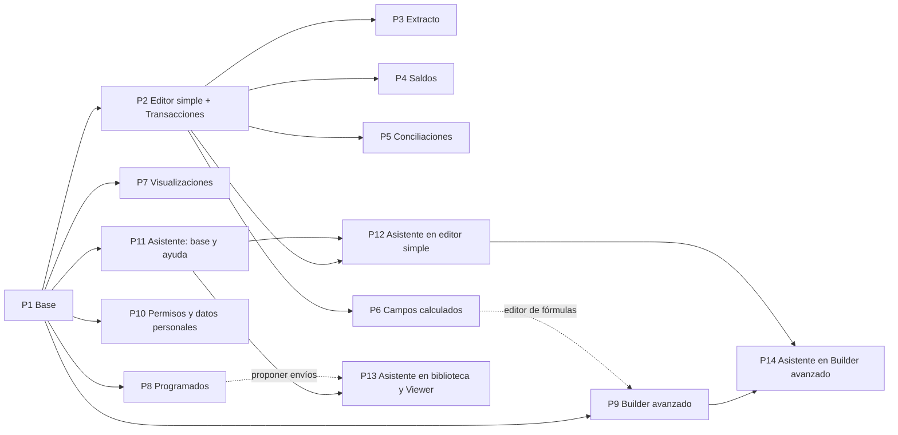

# 06 · Épica funcional e historias de usuario

Esta épica describe **qué tiene que poder hacer el usuario** con el Report Builder: todo lo que el POC hace hoy, más un **asistente AI** que arma y ajusta reportes por conversación. Es la vista funcional; el cómo (repos, servicios, SQL, datos) está en el [plan de ejecución](04-plan-de-ejecucion.md).

El trabajo está dividido en **14 paquetes entregables**. Cada paquete se puede probar y mostrar por separado. El [mapa de paquetes](#mapa-de-paquetes) indica cuáles pueden ir en paralelo y cuáles esperan a otros.

**Cómo usar este documento en Jira:** la épica es la [sección 1](#1-épica). Cada paquete (P1, P2…) puede cargarse como etiqueta, componente o sub-épica, según cómo trabaje el equipo. Cada historia (HU-x.y) es un story, con su texto y sus criterios de aceptación tal cual.

---

## 1. Épica

### RB · Report Builder: reportes propios sobre transacciones, saldos y conciliaciones, con asistente AI

**Objetivo.** Que un usuario de tesorería arme, sin ayuda técnica, los reportes que hoy pide a soporte o arma a mano en Excel: transacciones, extractos con saldo, saldos entre fechas y conciliaciones, agrupados por grupo, empresa, cuenta, moneda o país. Que los ejecute cuando quiera, los reciba programados y pueda pedirlos en lenguaje natural.

**Valor.**
- **Autonomía:** el usuario arma y cambia sus reportes sin esperar a nadie.
- **Confianza en los números:** los totales no duplican, no suman monedas distintas y los saldos se calculan como tesorería espera.
- **Menos trabajo repetitivo:** los reportes se guardan, se reutilizan y llegan solos por mail.
- **Barrera de entrada baja:** el asistente arma el primer borrador, pregunta lo que falta y explica cómo funciona el módulo.

**Usuarios.**

| Perfil | Qué hace con el módulo |
|---|---|
| **Analista de tesorería** | Arma y mantiene reportes, los ejecuta y los programa |
| **Tesorero / CFO** | Consulta reportes ya armados, cambia fechas o cuentas al ejecutarlos, recibe envíos |
| **Usuario avanzado** | Arma reportes complejos (comparaciones entre fechas, fórmulas, JOINs) en el Builder avanzado |
| **Admin de reporting** | Gestiona accesos, reportes de otros y programaciones |

**Incluye.**
- Biblioteca de reportes, Viewer, ejecuciones con historial y exportación.
- Editor simple (arrastrar y soltar) con cuatro fuentes: Transacciones, Extracto de cuenta, Saldos y Conciliaciones.
- Campos calculados, visualizaciones (tabla, pivot, gráficos, KPI) y envíos programados.
- Builder avanzado para casos complejos.
- Permisos, reportes compartidos y tratamiento de datos personales.
- Asistente AI en la biblioteca, en los dos editores y en el Viewer.

**No incluye.**
- **Asignar categorías y tags** a las transacciones: lo hace otro módulo (Transacciones / Tagging). Esta épica solo los usa para agrupar, filtrar y mostrar.
- La página técnica "Modelo Silver" del POC.
- La ingesta y preparación de los datos: la cubren las épicas E1–E5 del [plan de ejecución](04-plan-de-ejecucion.md).

**Supuestos y dependencias.**
- **El POC es la referencia de comportamiento.** Ante una duda funcional, el resultado correcto es el que da el POC con los mismos datos y la misma configuración. Sus reportes de ejemplo sirven como casos de aceptación.
- Las **categorías** (CF01 … O09) y los **tags** de cada transacción llegan desde el módulo de Transacciones / Tagging.
- Varias historias dependen de **definiciones de PO/CEO todavía pendientes** ([DEF-1 a DEF-9](05-definiciones-po-ceo.md)). Cada historia afectada lo indica, y la [sección 5](#5-definiciones-pendientes-que-afectan-historias) las resume.

**Definición de terminado de la épica.**
- [ ] Un usuario arma desde cero, guarda, ejecuta y programa cada uno de los reportes de ejemplo del POC, y obtiene los mismos números.
- [ ] Se cumplen las [reglas funcionales transversales](#2-reglas-funcionales-transversales) en todas las fuentes y salidas.
- [ ] El asistente arma, a partir de un pedido en lenguaje natural, al menos los reportes del [set de evaluación](#hu-115--set-de-evaluación-del-asistente) con la tasa de acierto acordada, sin guardar ni ejecutar nada sin confirmación.
- [ ] Los permisos y el tratamiento de datos personales funcionan según DEF-1 y DEF-5 validadas.

---

## 2. Reglas funcionales transversales

Estas reglas valen para **todas** las fuentes, editores y salidas. Las historias las citan por su código en lugar de repetirlas.

| Código | Regla |
|---|---|
| **RF-1 · Monedas** | Nunca se suman importes de monedas distintas sin avisar. Si una fila mezcla monedas, se muestra un aviso que sugiere agrupar por moneda o usar el valor en USD. Si las filas están en monedas distintas, el **total** de esa columna se oculta y se explica por qué. Los valores en USD siempre suman. |
| **RF-2 · Saldos** | Un saldo nunca se suma en el tiempo: de cada cuenta se toma el **último saldo** dentro del período, y esos saldos se suman entre cuentas. |
| **RF-3 · Sin doble conteo** | Combinar datos relacionados (por ejemplo, saldos y movimientos de la misma cuenta, o una transacción con varios tags) no multiplica filas ni infla totales. Un importe de una conciliación cuenta **una vez** aunque la conciliación tenga muchos movimientos. |
| **RF-4 · Totales correctos** | Los totales se calculan sobre los datos, no sumando las filas que se ven. Por eso un promedio, un porcentaje, una cantidad distinta o un saldo tienen un total correcto. |
| **RF-5 · Período y fechas relativas** | Las fechas pueden ser fijas o relativas ("inicio de mes", "hoy", "hace 30 días"…). Las relativas se resuelven el día de cada ejecución, lo que las hace aptas para reportes programados. |
| **RF-6 · Etiquetas con fechas** | El nombre de una columna puede incluir la fecha del período, por ejemplo "Saldo al {Desde}" → "Saldo al 01/09/2026". |
| **RF-7 · Explicación** | Cada resultado ofrece "Cómo se calculó": en lenguaje simple, qué hizo el módulo (filtros automáticos, cómo se combinaron los datos, totales ocultos y por qué). |
| **RF-8 · Una fila por…** | Los bloques "una fila por movimiento / transacción / conciliación" y los bloques de fecha (día, semana, mes) definen **qué es una fila**, así que solo se usan para agrupar. |

---

## 3. Mapa de paquetes

| Paquete | Qué entrega | Depende de | En paralelo con |
|---|---|---|---|
| **P1** · Base: biblioteca, Viewer y ejecuciones | Ver, ejecutar, exportar y gestionar reportes (con reportes de ejemplo precargados) | — | — |
| **P2** · Editor simple y fuente Transacciones | Armar reportes de transacciones arrastrando bloques | P1 | P7, P8, P9, P10, P11 |
| **P3** · Extracto de cuenta y saldo corrido | Cada movimiento con el saldo después de él, en moneda de la cuenta y en USD | P2 | P4, P5, P6, P12, P13 |
| **P4** · Saldos entre fechas | Saldo al inicio, al cierre y variación | P2 | P3, P5, P6, P12, P13 |
| **P5** · Conciliaciones | KPIs de conciliación y columnas de match | P2 | P3, P4, P6, P12, P13 |
| **P6** · Campos calculados | Combinar valores y escribir fórmulas | P2 | P3, P4, P5, P12, P13 |
| **P7** · Visualizaciones | Pivot, gráficos y KPI | P1 | P2, P8, P9, P10, P11 |
| **P8** · Envíos programados | Programar reportes por mail | P1 | P2, P7, P9, P10, P11 |
| **P9** · Builder avanzado | Casos complejos: comparaciones entre fechas, JOINs, parámetros | P1 (y P6 para su editor de fórmulas) | P2, P7, P8, P10, P11 |
| **P10** · Permisos y datos personales | Roles, reportes privados y compartidos, enmascaramiento | P1 · DEF-1, DEF-5 | P2–P9 |
| **P11** · Asistente: base y ayuda del módulo | Panel del asistente que responde preguntas sobre el módulo | P1 · DEF-8 | P2, P7, P8, P9, P10 |
| **P12** · Asistente en el editor simple | Armar y editar reportes por conversación, con preguntas y sugerencias | P2, P11 (crece con P3–P6) | P3–P6, P13 |
| **P13** · Asistente en biblioteca y Viewer | Empezar un reporte o encontrar uno existente; preguntar por los resultados | P11 (y P8 para proponer envíos) | P3–P6, P12 |
| **P14** · Asistente en el Builder avanzado | Proponer JOINs, parámetros y fórmulas | P9, P12 | — |

**Orden sugerido en olas:**

| Ola | Paquetes | Comentario |
|---|---|---|
| 1 | P1 | La base. Se puede demostrar con los reportes de ejemplo precargados. |
| 2 | P2, P7, P8, P9, P10, P11 | Todos dependen solo de P1. P10 necesita DEF-1 y DEF-5 validadas; P11, DEF-8. |
| 3 | P3, P4, P5, P6, P12, P13 | P3–P6 extienden el editor simple. P12 suma cada fuente a medida que se entrega. |
| 4 | P14 | Cierra el asistente en el Builder avanzado. |

P10 tiene que estar terminado **antes de habilitar el módulo a clientes** con datos reales, aunque se desarrolle en paralelo.

---

## 4. Historias por paquete

### P1 · Base: biblioteca, Viewer y ejecuciones

Entrega el circuito completo **reporte → ejecución → resultado → historial** y la salida en tabla. Se demuestra con los reportes de ejemplo precargados, sin necesidad de editores.

#### HU-1.1 · Biblioteca de reportes
**Como** analista de tesorería **quiero** ver todos mis reportes en un solo lugar **para** encontrarlos, abrirlos y mantenerlos.

**Criterios de aceptación**
- [ ] La página "Reportes" lista cada reporte con: nombre, descripción, tipo de salida (ícono), fuente de datos, editor con que se creó (Simple o Avanzado), programación si la tiene, y fecha y estado de la última ejecución.
- [ ] Cada reporte muestra cuántas agrupaciones, valores, filtros y campos calculados tiene, contando solo lo que el usuario configuró.
- [ ] Desde cada reporte se puede **Ver** (abre el Viewer), **Editar** (abre el editor con que fue creado), **Duplicar** (crea "<nombre> (copia)" sin la programación) y **Eliminar** (pide confirmación y borra también sus ejecuciones).
- [ ] Un panel lateral muestra las últimas ejecuciones de todos los reportes, indicando si fueron manuales o programadas, cuándo, cuántas filas dieron y si fallaron. Al hacer click se abre esa ejecución.
- [ ] El botón **Nuevo reporte** abre el editor simple (P2). Un botón secundario **Avanzado** abre el Builder avanzado (P9). Mientras esos paquetes no estén, los botones no se muestran.

#### HU-1.2 · Reportes de ejemplo
**Como** usuario nuevo **quiero** encontrar reportes de ejemplo ya armados **para** entender qué puedo hacer y usarlos como punto de partida.

**Criterios de aceptación**
- [ ] Cada tenant tiene disponibles los reportes de ejemplo del POC (por ejemplo "Flujo por empresa y categoría", "Movimientos de una cuenta", "Saldo inicial vs final", "KPIs de conciliación por empresa", "Detalle de matches", "Comparación de cierre de caja", "Posición de caja por banco"). Su configuración está en HU-2.10 (editor simple) y HU-9.9 (Builder avanzado).
- [ ] Se pueden ver, ejecutar y duplicar como cualquier otro reporte. Cada ejemplo aparece cuando está entregado el paquete de su fuente.
- [ ] Si el usuario elimina un ejemplo, no vuelve a aparecer solo. Hay una acción para restaurar los ejemplos que pide confirmación.

#### HU-1.3 · Ejecutar un reporte con sus parámetros
**Como** tesorero **quiero** abrir un reporte, elegir las fechas y los valores que me interesan y ejecutarlo **para** ver el resultado de hoy sin editar el reporte.

**Criterios de aceptación**
- [ ] El Viewer muestra el nombre, la descripción (con las fechas reemplazadas según RF-6), la fuente, el tipo de salida y la programación si la tiene.
- [ ] Muestra los **parámetros** del reporte (por ejemplo Desde y Hasta). Cada fecha se puede elegir con un calendario o con una opción relativa (Hoy, Ayer, Hace 30 días, Inicio de mes, Fin de mes, Inicio o fin del mes anterior, Inicio de año, Fin del año anterior), según RF-5.
- [ ] Muestra los **filtros expuestos** (por ejemplo "Cuenta") con el mismo control que en el editor: lista con búsqueda y selección múltiple, rango de fechas, etc. Vacío significa "todos".
- [ ] **Ejecutar** crea una ejecución nueva con los valores elegidos y muestra su resultado.
- [ ] Si el reporte no tiene parámetros ni filtros expuestos, se indica "Este reporte no expone parámetros".

#### HU-1.4 · Ejecuciones e historial
**Como** tesorero **quiero** que cada ejecución quede guardada con lo que se usó **para** volver a un resultado anterior y saber exactamente de qué datos sale.

**Criterios de aceptación**
- [ ] Cada ejecución guarda: identificador, si fue manual o programada, cuándo se ejecutó, cuánto tardó, quién la ejecutó, cuántas filas dio, cómo se agrupó, los valores de los parámetros y los filtros aplicados.
- [ ] Cada ejecución guarda **una copia de la definición** del reporte. Si después se edita el reporte, la ejecución vieja se sigue viendo igual que cuando se ejecutó.
- [ ] Si el reporte cambió desde esa ejecución, el Viewer lo avisa e invita a volver a ejecutar.
- [ ] Un panel lateral lista el historial de ejecuciones del reporte. Al elegir una, se muestra con su copia de la definición.
- [ ] Si una ejecución falla, se muestra como fallida con el motivo, en lugar de un resultado.
- [ ] Si el reporte nunca se ejecutó, se invita a hacerlo ("Ejecutar ahora").

#### HU-1.5 · Resultado en tabla
**Como** usuario **quiero** ver el resultado en una tabla clara **para** leer y comparar los números.

**Criterios de aceptación**
- [ ] La tabla muestra primero las columnas de agrupación y después los valores. Los valores numéricos se alinean a la derecha y los negativos se ven en rojo; las columnas de texto se alinean a la izquierda.
- [ ] Los importes se muestran con dos decimales y separador de miles; los porcentajes, como porcentaje; los identificadores (por ejemplo el número de movimiento), como texto, sin separador de miles.
- [ ] Se puede ordenar por cualquier columna haciendo click en el encabezado.
- [ ] Una fila de **Total** al pie respeta RF-1 y RF-4. Las columnas de texto no tienen total. Los totales se pueden ocultar.
- [ ] Con muchas filas, la tabla muestra las primeras 300 y permite cargar más. El encabezado queda fijo al desplazarse y la tabla se desplaza horizontalmente si no entra en pantalla.
- [ ] Si no hay datos para los filtros actuales, se indica "Sin resultados para los filtros actuales".
- [ ] Un desplegable "Cómo se calculó" muestra las explicaciones de RF-7 y los avisos (por ejemplo, totales ocultos por monedas).

#### HU-1.6 · Exportar a CSV
**Como** analista **quiero** exportar el resultado de una ejecución **para** trabajarlo en Excel o compartirlo.

**Criterios de aceptación**
- [ ] Desde el Viewer, **CSV** descarga el resultado de la ejecución que se está viendo, con los mismos encabezados que la tabla.
- [ ] El archivo contiene los mismos valores que la ejecución, sin redondeos adicionales.
- [ ] Con P10 entregado, la exportación respeta los permisos de datos personales de quien exporta (HU-10.4).

---

### P2 · Editor simple y fuente Transacciones

Entrega el editor donde el usuario arma reportes **arrastrando bloques de negocio**, con la fuente Transacciones completa. Las demás fuentes se suman en P3–P5 sin cambiar la forma de trabajar.

#### HU-2.1 · Estructura del editor en tres pasos
**Como** analista **quiero** que armar un reporte siga pasos simples **para** no tener que entender cómo están guardados los datos.

**Criterios de aceptación**
- [ ] El editor tiene tres pasos numerados: **1. ¿Qué querés analizar?** (fuente), **2. Armá el reporte** (período y zonas) y **3. Resultado** (vista previa).
- [ ] A la izquierda, un panel de **bloques** de la fuente elegida, agrupados en "Agrupar por", "Valores" y "Campos calculados", con buscador.
- [ ] El encabezado tiene nombre y descripción editables, la marca "Simple", el aviso "sin guardar" cuando hay cambios, y los botones **Modo avanzado**, **Programar**, **Guardar** y **Ejecutar**.
- [ ] **Ejecutar** guarda si hace falta y abre el reporte en el Viewer ejecutándolo.
- [ ] Al guardar un reporte nuevo, este aparece en la biblioteca.

#### HU-2.2 · Elegir la fuente Transacciones y sus tipos
**Como** analista **quiero** elegir qué tipos de transacciones incluir **para** analizar, por ejemplo, solo los cobros por PSP.

**Criterios de aceptación**
- [ ] La fuente **Transacciones** muestra los tipos como botones que se activan y desactivan: PSP Payins, PSP Payouts, Internal Payins, Internal Payouts, Bank Movements, External Payins y Órdenes de pago. Por defecto están todos activos.
- [ ] Siempre queda al menos un tipo activo; si el usuario intenta desactivar el último, se le avisa.
- [ ] "Todos" vuelve a activar todos los tipos.
- [ ] Los saldos de cuenta no se incluyen en Transacciones (tienen su propia fuente, P4).

#### HU-2.3 · Período del reporte
**Como** analista **quiero** elegir el período con un click **para** no escribir fechas cada vez.

**Criterios de aceptación**
- [ ] Opciones: Este mes, Mes anterior, Últimos 30 días, En el año, Fechas… (desde/hasta fijas) y Todo.
- [ ] Salvo "Todo", el período se convierte en los parámetros **Desde** y **Hasta**, que se pueden cambiar en el Viewer al ejecutar (HU-1.3). Las opciones relativas cumplen RF-5.
- [ ] Se indica en pantalla que Desde y Hasta se pueden cambiar al ejecutar.

#### HU-2.4 · Agrupar por
**Como** analista **quiero** agrupar por grupo, empresa, cuenta, moneda o país, o por cualquier combinación **para** ver los números al nivel que necesito.

**Criterios de aceptación**
- [ ] La zona **Agrupar por** ("una fila por cada combinación") acepta cualquier bloque de agrupación, y se pueden combinar varios. El resultado tiene una fila por cada combinación que existe en los datos.
- [ ] Bloques de organización en todas las fuentes: Grupo, Empresa, Cuenta, Moneda, País y Banco.
- [ ] Bloques propios de Transacciones: Tipo de transacción, Categoría, Tag, PSP / Partner, Dirección (IN/OUT), Estado, **Transacción (una fila por transacción)**, y las fechas Día, Semana y Mes.
- [ ] Debajo de la zona, accesos rápidos "+ Grupo", "+ Empresa", "+ Cuenta", "+ Moneda", "+ País" agregan los que todavía no están.
- [ ] Combinar organización con campos de la transacción (por ejemplo Empresa × Categoría) **no descarta** ninguna agrupación.
- [ ] Las transacciones sin categoría o sin tag aparecen en su propia fila, identificada como vacía.

#### HU-2.5 · Mostrar valores de Transacciones
**Como** analista **quiero** elegir qué valores ver **para** obtener montos, cantidades y netos.

**Criterios de aceptación**
- [ ] La zona **Mostrar** ("las columnas de cada fila") acepta valores. Para Transacciones: # Transacciones, Monto USD, Ingresos USD, Egresos USD, Neto USD, Neto (moneda original), Ticket promedio USD y Monto (moneda original).
- [ ] Cada valor tiene una ayuda breve (por ejemplo, Neto = ingresos − egresos).
- [ ] Los valores en moneda original cumplen RF-1.
- [ ] Con "Transacción (una fila por transacción)" en Agrupar por, cada fila muestra el importe de esa transacción.
- [ ] Sin valores en Mostrar, el resultado invita a agregar al menos uno en lugar de mostrar una tabla vacía.

#### HU-2.6 · Mostrar un campo como columna, sin agrupar
**Como** analista **quiero** ver la categoría, el tag o la descripción de cada transacción como una columna **para** leerlos sin cambiar cómo se agrupan las filas.

**Criterios de aceptación**
- [ ] Cualquier bloque de agrupación que no sea de fecha ni "una fila por…" se puede soltar en **Mostrar**, o agregar con el botón "Mostrar como columna" del panel. Queda como columna de texto.
- [ ] Agregar una columna de texto **no cambia la cantidad de filas**.
- [ ] Si la fila es una sola transacción, muestra su valor. Si la fila junta varias, muestra el valor cuando todas lo comparten y, si no, cuántos valores distintos hay (por ejemplo "7 valores").
- [ ] Las columnas de texto no tienen total y no se usan en gráficos ni KPI.
- [ ] Arrastrar la columna a **Agrupar por** la convierte en agrupación, y viceversa.

#### HU-2.7 · Filtrar
**Como** analista **quiero** limitar el reporte a ciertas empresas, cuentas, categorías o tags **para** ver solo lo que me interesa.

**Criterios de aceptación**
- [ ] Cualquier bloque de agrupación, y los valores que son montos simples, se pueden soltar en **Filtrar** ("qué datos entran") o agregar con el botón de filtro del panel.
- [ ] Al agregar un filtro se abre su configuración: para listas, una lista con casillas, búsqueda (si hay muchos valores) y "Limpiar"; para fechas, últimos N días, entre, desde, hasta, vacío o no vacío; para números, mayor, menor, entre, igual, distinto, vacío o no vacío; para textos, contiene, igual, distinto, es uno de, vacío o no vacío.
- [ ] Una lista sin nada marcado significa "todos".
- [ ] "Se puede cambiar al ejecutar" viene marcado por defecto y hace que el filtro aparezca en el Viewer (HU-1.3).
- [ ] Filtrar por un campo y agruparlo a la vez es posible: tomar el bloque del panel agrega un filtro sin quitar la agrupación.
- [ ] El texto del filtro resume lo elegido, por ejemplo "Empresa ∈ Acme Chile SpA, Acme Brasil Ltda.".

#### HU-2.8 · Arrastrar, soltar y reordenar
**Como** analista **quiero** que arrastrar bloques sea tolerante a errores **para** no romper el reporte por soltar algo en el lugar equivocado.

**Criterios de aceptación**
- [ ] Todo bloque se puede agregar arrastrándolo o con un click (el click lo agrega a su zona natural).
- [ ] Un valor soltado en Agrupar por va a Mostrar, con un mensaje que lo explica.
- [ ] Un bloque "una fila por…" o de fecha soltado en Mostrar va a Agrupar por, con un mensaje (RF-8).
- [ ] Los bloques dentro de una zona se reordenan arrastrándolos, y se mueven entre zonas arrastrándolos. Mover a Filtrar quita el bloque de donde estaba.
- [ ] Cada bloque colocado tiene una "×" para quitarlo.
- [ ] En el panel, los bloques en uso se destacan y los que no se pueden usar en ese momento se ven atenuados, con el motivo al pasar el mouse.

#### HU-2.9 · Vista previa y salida
**Como** analista **quiero** ver el resultado mientras armo **para** saber si es lo que busco antes de guardar.

**Criterios de aceptación**
- [ ] El paso 3 se actualiza con cada cambio. Muestra cuántas filas da y qué representa una fila (por ejemplo "1 fila por Empresa × Categoría").
- [ ] Se puede elegir el tipo de salida; Tabla está desde P1, el resto se habilita con P7. También el límite de filas y si se muestran totales.
- [ ] Los avisos (RF-1, combinaciones no posibles, valores que faltan) se muestran en rojo arriba del resultado; las explicaciones, en "Cómo se calculó" (RF-7).

#### HU-2.10 · Ejemplos para empezar
**Como** usuario nuevo **quiero** empezar desde un ejemplo **para** no partir de una pantalla vacía.

**Criterios de aceptación**
- [ ] Un reporte nuevo muestra arriba tarjetas de ejemplos ("Empezá desde un ejemplo, o armalo de cero abajo"). Elegir una configura el reporte entero y le pone nombre y descripción.
- [ ] Un reporte ya guardado no muestra las tarjetas.
- [ ] La historia se cierra con P2 cuando funcionan las tarjetas y el primer ejemplo. Los demás se verifican como parte de la entrega de P3, P4 y P5.
- [ ] Estos son los ejemplos, como tarjetas en el editor y como reportes de ejemplo en la biblioteca (HU-1.2). Cada uno aparece cuando se entrega el paquete de su fuente (columna "Se habilita con"):

| Ejemplo | Fuente | Agrupar por | Mostrar | Filtros | Período | Visualización | Se habilita con |
|---|---|---|---|---|---|---|---|
| Flujo por empresa y categoría | Transacciones (todos los tipos) | Empresa · Categoría | # Transacciones · Ingresos USD · Egresos USD · Neto USD | — | En el año | Tabla con totales | P2 |
| Movimientos de una cuenta | Extracto de cuenta | Cuenta · Día · Movimiento | Descripción, Categoría y Tag (como columnas) · Importe · Saldo después del movimiento | Cuenta: una cuenta preseleccionada, se puede cambiar al ejecutar | Este mes | Tabla con totales | P3 |
| Saldo inicial vs final | Saldos | Cuenta · Moneda | Saldo al inicio · Saldo al cierre · Variación | — | Este mes | Tabla con totales | P4 |
| KPIs de conciliación por empresa | Conciliaciones | Empresa · Workflow | # Movimientos · % conciliado · Monto pendiente USD · Días abierto (prom.) · % matches automáticos | — | En el año | Tabla con totales | P5 |
| Detalle de matches | Conciliaciones | Match · Fecha del match · Workflow · Regla · Automático / Manual · Estado del match | Importe izquierdo USD · Importe derecho USD · Diferencia USD · % diferencia | Match: no vacío (solo movimientos con conciliación) | Últimos 30 días | Tabla con totales | P5 |

#### HU-2.11 · Cambiar de fuente sin perder lo que sirve
**Como** analista **quiero** cambiar de fuente sin rearmar todo **para** comparar, por ejemplo, transacciones y conciliaciones de las mismas empresas.

**Criterios de aceptación**
- [ ] Al cambiar de fuente se conservan las agrupaciones que existen en la nueva (por ejemplo Empresa, País, Mes), los filtros sobre esos campos, el período y el tipo de salida. Los valores se reemplazan por los sugeridos de la nueva fuente.
- [ ] Si el reporte tiene campos calculados, se pide confirmación porque se van a quitar.

#### HU-2.12 · Pasar al Builder avanzado
**Como** usuario avanzado **quiero** llevar un reporte del editor simple al Builder avanzado **para** agregarle lo que el editor simple no permite.

**Criterios de aceptación**
- [ ] **Modo avanzado** pide confirmación, explicando que el reporte ya no se podrá editar en el editor simple.
- [ ] El reporte se abre en el Builder avanzado con el mismo resultado.
- [ ] Desde ese momento, "Editar" en la biblioteca y en el Viewer abre el Builder avanzado.

**Depende de:** P9.

---

### P3 · Extracto de cuenta y saldo corrido

#### HU-3.1 · Fuente Extracto de cuenta
**Como** analista **quiero** ver los movimientos del extracto bancario de mis cuentas **para** revisarlos uno por uno.

**Criterios de aceptación**
- [ ] Nueva fuente **Extracto de cuenta**: cada movimiento del extracto de cada cuenta.
- [ ] Bloques de agrupación: los de organización, **Movimiento (una fila por movimiento)**, Descripción, Contraparte, Categoría, Tag, Crédito / Débito, Código bancario, Estado, Día, Semana y Mes.
- [ ] Valores: Importe (moneda de la cuenta, créditos en positivo y débitos en negativo), Créditos, Débitos, # Movimientos e Importe USD.
- [ ] Con Cuenta, Día y Movimiento en Agrupar por, el resultado tiene **una fila por movimiento**, en orden cronológico.
- [ ] El período por defecto es "Este mes".

#### HU-3.2 · Saldo después de cada movimiento
**Como** tesorero **quiero** ver el saldo de la cuenta después de cada movimiento **para** seguir la evolución del saldo como en el extracto del banco.

**Criterios de aceptación**
- [ ] Valor **Saldo después del movimiento** (columna "Saldo"): el último saldo registrado de la cuenta **antes del día Desde**, más cada movimiento en orden cronológico (por día y, dentro del día, por movimiento).
- [ ] Con varias cuentas, cada una lleva su propio saldo, que arranca de su saldo anterior.
- [ ] El total de la columna es el **saldo final** de cada cuenta, y el del Importe es el neto del período. Con cuentas en monedas distintas, el total se oculta (RF-1).
- [ ] "Cómo se calculó" indica desde qué saldo y qué fecha arranca. Si no hay saldo anterior al período, lo avisa y arranca en 0.
- [ ] Agregar este valor agrega también Cuenta, Día y Movimiento a Agrupar por, si faltan, con un mensaje.
- [ ] Si después se quita alguno de esos tres, el valor queda tachado, con el motivo, y con un botón (por ejemplo "+ Día") que vuelve a agregar lo que falta.

#### HU-3.3 · Saldo después de cada movimiento en USD
**Como** tesorero **quiero** el mismo saldo expresado en USD **para** consolidar cuentas en monedas distintas.

**Criterios de aceptación**
- [ ] Valor **Saldo después del movimiento (USD)** (columna "Saldo USD"): el saldo en moneda de la cuenta de HU-3.2, convertido al **tipo de cambio del día** de cada movimiento.
- [ ] Agregarlo agrega la columna **Tipo de cambio** (unidades de la moneda de la cuenta por 1 USD, del día del movimiento), que se quita junto con él.
- [ ] Tiene los mismos requisitos de agrupación que HU-3.2, con el mismo botón para completarlos.
- [ ] Con varias cuentas, aunque estén en monedas distintas, el total suma los saldos finales en USD.
- [ ] La ayuda explica que la variación del Saldo USD entre dos filas puede no coincidir con el Importe USD del movimiento, porque el saldo se revalúa con el tipo de cambio de cada día.

**Notas:** la moneda de consolidación depende de DEF-2 (propuesta: USD).

---

### P4 · Saldos entre fechas

#### HU-4.1 · Fuente Saldos
**Como** tesorero **quiero** ver el saldo de mis cuentas al inicio y al cierre de un período **para** saber cuánto variaron.

**Criterios de aceptación**
- [ ] Nueva fuente **Saldos**. Bloques de agrupación: los de organización, Tipo de saldo, Día, Semana y Mes.
- [ ] Valores en moneda de la cuenta: **Saldo al inicio**, **Saldo al cierre**, **Variación** (cierre − inicio) y **Variación %**. Los mismos en USD: Saldo al inicio USD, Saldo al cierre USD y Variación USD.
- [ ] El saldo al inicio es el último saldo de cada cuenta **hasta la fecha Desde**, y el saldo al cierre, el último **hasta la fecha Hasta**. Se suman entre cuentas según RF-2.
- [ ] Las columnas se titulan con la fecha (RF-6), por ejemplo "Saldo al 01/09/2026" y "Saldo al 30/09/2026".
- [ ] El período no admite "Todo"; el período por defecto es "Este mes".
- [ ] Variación y Variación % agregan solos los saldos que necesitan si no están.

#### HU-4.2 · Saldos agrupados por fecha
**Como** tesorero **quiero** ver el saldo al cierre de cada día, semana o mes **para** seguir su evolución.

**Criterios de aceptación**
- [ ] Con Día, Semana o Mes en Agrupar por, Saldo al cierre muestra el último saldo de cada período (RF-2).
- [ ] En ese caso, Saldo al inicio y las variaciones no aplican: se ven tachadas en el panel y en Mostrar, con el motivo.

---

### P5 · Conciliaciones

#### HU-5.1 · Fuente Conciliaciones
**Como** responsable de conciliación **quiero** reportes sobre el estado de mis conciliaciones **para** saber qué está conciliado y qué falta.

**Criterios de aceptación**
- [ ] Nueva fuente **Conciliaciones**, basada en los movimientos a conciliar de cada workflow.
- [ ] Bloques de agrupación: los de organización (también para movimientos pendientes, que todavía no tienen conciliación), Workflow, **Match (una fila por conciliación)**, Fecha del match, Estado del match, Automático / Manual, Regla, Lado (izquierdo / derecho), Conciliado (sí / no), Estado del movimiento, Tipo de transacción, Categoría, Tag, Día, Semana y Mes.

#### HU-5.2 · KPIs de conciliación
**Como** responsable de conciliación **quiero** indicadores de avance **para** detectar dónde se acumulan pendientes.

**Criterios de aceptación**
- [ ] Valores: # Movimientos, # Conciliados, # Pendientes, % conciliado (conciliados / movimientos), % conciliado por monto, Monto conciliado USD, Monto pendiente USD, Días abierto (promedio) y % de matches automáticos.
- [ ] **Monto conciliado** y **Monto pendiente** también en la moneda de los movimientos (normalmente la de la cuenta). Cumplen RF-1: si una fila o el total mezclan monedas, se avisa y el total se oculta. Se sugiere agrupar por Moneda.
- [ ] % conciliado por monto tiene un solo valor, calculado en USD, así que es válido aunque la fila mezcle monedas.
- [ ] Los porcentajes y promedios tienen un total correcto (RF-4), no la suma de las filas.

#### HU-5.3 · Columnas de match
**Como** responsable de conciliación **quiero** ver cada conciliación con sus importes de cada lado **para** revisar las diferencias.

**Criterios de aceptación**
- [ ] Valores en USD: # Matches, Importe izquierdo USD, Importe derecho USD, Diferencia USD, % diferencia (diferencia / importe izquierdo) y Monto movimientos USD.
- [ ] Los mismos importes en **moneda de la conciliación** (la de sus movimientos, normalmente la de la cuenta): Importe izquierdo, Importe derecho, Diferencia y Monto movimientos. Cumplen RF-1: si una fila o el total mezclan monedas, se avisa y el total se oculta. Se sugiere agrupar por Moneda.
- [ ] % diferencia tiene un solo valor, calculado en USD, así que es válido aunque la fila mezcle monedas.
- [ ] Los importes de una conciliación cuentan **una vez** por conciliación, aunque tenga muchos movimientos (RF-3).
- [ ] Con Match en Agrupar por, hay exactamente una fila por conciliación.

---

### P6 · Campos calculados

#### HU-6.1 · Combinar dos valores
**Como** analista **quiero** crear una columna a partir de otras dos **para** calcular, por ejemplo, egresos sobre ingresos, sin escribir fórmulas.

**Criterios de aceptación**
- [ ] "Nuevo campo calculado" abre un diálogo con: valor A, operación y valor B. Las operaciones son menos, más, por, dividido, "como % de" y "variación % contra".
- [ ] Los valores disponibles son todos los de la fuente y los campos calculados ya creados, estén o no en Mostrar.
- [ ] El nombre se propone solo (por ejemplo "Variación % Saldo al cierre vs Saldo al inicio") y se puede cambiar. El formato (moneda, número, porcentaje) se propone según la operación y se puede cambiar.
- [ ] Se muestra la fórmula en palabras antes de crear. Si usa valores que no están en Mostrar, se avisa que se agregan solos.
- [ ] El campo se calcula en cada fila y en el total; una división por cero da vacío, no un error.
- [ ] El campo creado aparece en el panel ("Campos calculados") y en Mostrar.

#### HU-6.2 · Escribir una fórmula
**Como** usuario avanzado **quiero** escribir una fórmula **para** cálculos que el diálogo simple no cubre.

**Criterios de aceptación**
- [ ] "Escribir una fórmula libre…" abre el editor de fórmulas, con nombre, formato y expresión.
- [ ] Se puede referenciar un campo, otra fórmula por su nombre (por ejemplo `[Ingresos USD] - [Egresos USD]`) o una columna del reporte.
- [ ] Operadores: aritméticos, comparaciones, AND, OR y NOT. Funciones: SUM, AVG, MIN, MAX, COUNT, COUNTD, LAST, FIRST, IF, COALESCE, ABS, ROUND, DIV (división segura), DATEDIFF, YEAR, MONTH, CONCAT, UPPER, LOWER y CONTAINS. Cada una tiene su ayuda en pantalla.
- [ ] La fórmula se valida mientras se escribe: muestra el error y su posición, o "Válida", indica si es por fila, de agregación o entre columnas, y muestra un valor de ejemplo con los filtros actuales.
- [ ] Campos, fórmulas y columnas se insertan con un click.

#### HU-6.3 · Editar y borrar campos calculados
**Criterios de aceptación**
- [ ] Desde el panel, cada campo calculado se puede editar (abre el editor de fórmulas con su contenido) y borrar (se quita también de Mostrar).

---

### P7 · Visualizaciones

#### HU-7.1 · Tabla jerárquica
**Como** analista **quiero** ver grupos que se despliegan **para** pasar del resumen al detalle.

**Criterios de aceptación**
- [ ] Cuando el reporte es jerárquico (Builder avanzado, HU-9.4), cada grupo muestra su subtotal y la cantidad de filas, y se despliega con un click.
- [ ] Los subtotales cumplen RF-4.

#### HU-7.2 · Pivot
**Como** analista **quiero** llevar una agrupación a columnas **para** comparar, por ejemplo, PSP por canal.

**Criterios de aceptación**
- [ ] Salida **Pivot**: se elige qué agrupación va en columnas; el resto queda en filas. Soporta varios valores.
- [ ] Totales por fila, por columna y general. Se calculan sobre los datos (RF-4), así que funcionan con promedios, cantidades distintas y saldos.

#### HU-7.3 · Gráficos de barras, apiladas, líneas y área
**Como** tesorero **quiero** ver los números en un gráfico **para** detectar tendencias de un vistazo.

**Criterios de aceptación**
- [ ] Se elige qué agrupación va en el eje X y qué forma las series (otra agrupación o los valores).
- [ ] Barras y apiladas pasan a horizontales cuando hay más de 8 categorías que no son fechas.
- [ ] Líneas y área tienen una línea guía y un tooltip con todos los valores del punto.
- [ ] Hasta 8 series con colores fijos; desde la novena se agrupan en "Otros" y se indica. Una misma serie conserva su color en todos los gráficos.
- [ ] Siempre hay leyenda y tooltip.
- [ ] Si el gráfico muestra menos agrupaciones que el resultado, los valores se recalculan a ese nivel (RF-4), no se suman los de la tabla.
- [ ] Las columnas de texto no se grafican. Sin valores numéricos, se indica que el gráfico necesita al menos uno.

#### HU-7.4 · Torta y KPI
**Criterios de aceptación**
- [ ] **Torta**: hasta 6 porciones más "Otros". Los valores negativos se muestran en valor absoluto, con aviso.
- [ ] **KPI**: una tarjeta por valor, con el total del período filtrado.

---

### P8 · Envíos programados

#### HU-8.1 · Programar un reporte
**Como** analista **quiero** programar un reporte **para** que el equipo lo reciba sin ejecutarlo a mano.

**Criterios de aceptación**
- [ ] **Programar** (en los dos editores) abre la configuración: frecuencia **diaria, semanal o mensual**, hora, día de la semana o del mes según la frecuencia, destinatarios y formato de entrega (Excel, CSV, link al Viewer; PDF cuando esté disponible).
- [ ] Se muestran **las próximas ejecuciones** antes de guardar.
- [ ] No se puede programar más de una ejecución por día (frecuencia mínima diaria, ya decidida).
- [ ] Las fechas relativas del reporte se resuelven a la fecha de cada ejecución (RF-5) y los filtros expuestos usan sus valores por defecto; la pantalla lo explica.
- [ ] La programación se ve en la biblioteca y en el Viewer, y se puede pausar, modificar o quitar.

**Notas:** destinatarios externos, formatos y límites dependen de DEF-6; frescura de los datos, de DEF-3.

#### HU-8.2 · Ejecución y entrega programada
**Como** tesorero **quiero** recibir el reporte a la hora acordada **para** empezar el día con la información.

**Criterios de aceptación**
- [ ] A la hora programada se crea una ejecución marcada como "programada", visible en el historial.
- [ ] Cada destinatario recibe el archivo o el link en el formato elegido.
- [ ] Si falla, se avisa al dueño del reporte; tras varios fallos seguidos la programación se pausa sola (DEF-6).
- [ ] Desde la configuración, "Guardar y probar ahora" genera una ejecución programada de prueba.

---

### P9 · Builder avanzado

Para usuarios que necesitan lo que el editor simple no ofrece: comparar la misma fuente en dos fechas, combinar fuentes, decidir cómo agrupar padre e hijo, y parámetros propios.

#### HU-9.1 · Catálogo de campos por dominio
**Como** usuario avanzado **quiero** ver todos los campos disponibles organizados **para** armar cualquier combinación.

**Criterios de aceptación**
- [ ] Cuatro dominios de partida: Financial Events, Accounts, Reconciliation Workflows y Tagging. "Nuevo reporte → Avanzado" pide elegir uno.
- [ ] Cada dominio muestra un árbol de entidades padre → hijo, con los subtipos de Financial Events (Payin, Payout, Bank Movement), y una sección de entidades relacionadas.
- [ ] Cada campo indica si es una dimensión (texto, categoría, fecha, número, sí/no) o una medida (número que se agrega); los saldos se marcan como "semi". Cada entidad tiene una ayuda.
- [ ] Buscador por nombre de campo. Los campos se agregan arrastrando o con botones para Dimensiones, Medidas o Filtros.

#### HU-9.2 · Dimensiones, Medidas y Filtros
**Criterios de aceptación**
- [ ] Zonas **Dimensiones**, **Medidas** y **Filtros**. Una medida soltada en Dimensiones va a Medidas, con aviso; una dimensión soltada en Medidas se convierte en "cantidad distinta".
- [ ] Opciones de cada columna: etiqueta (admite fechas, RF-6), agregación (suma, promedio, mínimo, máximo, cantidad, cantidad distinta, último por fecha, valor), granularidad de fecha (exacta, día, semana, mes, trimestre, año) y orden. En los saldos se explica por qué conviene "último".
- [ ] Un filtro sobre una fórmula de agregación se aplica después de agregar. Un filtro sobre una entidad hija se aplica como "que tenga al menos uno".
- [ ] Usar un campo de un subtipo (por ejemplo, de Payin) filtra solo por ese tipo y lo explica.
- [ ] Las columnas se reordenan y mueven arrastrando.

#### HU-9.3 · Parámetros del reporte
**Criterios de aceptación**
- [ ] Una fila **Parámetros** permite crear parámetros de tipo fecha, número o texto, con valor por defecto fijo o relativo (RF-5).
- [ ] Cualquier valor de un filtro se puede fijar o ligar a un parámetro, y desde ahí se puede crear uno nuevo.
- [ ] Las etiquetas y la descripción pueden mostrar el valor del parámetro (`{Desde}`), según RF-6. El Viewer los pide al ejecutar.

#### HU-9.4 · Cómo agrupar padre e hijo
**Como** usuario avanzado **quiero** decidir cómo se combinan una cuenta y sus movimientos **para** obtener el nivel de detalle correcto.

**Criterios de aceptación**
- [ ] Al combinar campos de un padre y su hijo (por ejemplo Cuenta y Saldos), se pregunta una vez cómo agrupar: **Resumir por padre**, **Jerárquico** (subtotales que se despliegan, HU-7.1), **Detalle por hijo** o **Plano** (una fila por cada combinación de dimensiones). Cada opción muestra cuántas filas daría.
- [ ] La elección queda guardada y se vuelve a preguntar solo si cambia la combinación de entidades. Se puede cambiar en cualquier momento.
- [ ] En "Resumir por padre", un campo del hijo en Dimensiones se ignora con un aviso que explica por qué.

#### HU-9.5 · La misma fuente dos veces (comparaciones entre fechas)
**Como** tesorero **quiero** comparar el saldo a dos fechas, o el gasto de este mes contra el anterior, **para** explicar variaciones.

**Criterios de aceptación**
- [ ] Al agregar una medida de una tabla que ya está en el reporte, se pregunta si va en el **mismo JOIN** o en uno **nuevo**. Con uno nuevo, las medidas existentes pasan a "t1" y la nueva a "t2".
- [ ] Cada JOIN tiene su propia fila de filtros, que aplican solo a él; se renombra y se puede eliminar (sus medidas vuelven al principal).
- [ ] Los JOINs se combinan por las dimensiones del reporte. Una dimensión que no existe en todos los JOINs se quita con aviso.
- [ ] Caso de aceptación: "Comparación de cierre de caja" (saldo al t1, saldo al t2, variación, movimientos del período y diferencia no explicada) da los mismos números que el POC.

#### HU-9.6 · Comparar con…
**Criterios de aceptación**
- [ ] Desde una medida, "Comparar con…" otra agrega las columnas Δ y Δ%.

#### HU-9.7 · Combinaciones automáticas y avisos
**Criterios de aceptación**
- [ ] Combinar entidades hermanas (por ejemplo Saldos y Transacciones de la misma cuenta) no duplica datos (RF-3), y lo explica.
- [ ] Combinar tags con transacciones (una transacción puede tener varios tags) cuenta cada transacción en cada grupo, pero el total la cuenta una vez, y lo explica.
- [ ] Una banda indica la combinación de padre e hijo actual y permite cambiarla. En rojo se muestra lo que se ignoró o daría mal; en azul, lo que el módulo hizo solo.
- [ ] Se puede ver la definición del reporte y la consulta resultante (pestañas para usuarios técnicos).

#### HU-9.8 · Guardar, programar y ejecutar desde el Builder
**Criterios de aceptación**
- [ ] El Builder tiene Guardar, Programar (P8) y Ejecutar en Viewer, con el mismo comportamiento que el editor simple.
- [ ] Los campos calculados usan el mismo editor de fórmulas (HU-6.2).
- [ ] Un reporte guardado desde el Builder queda como avanzado (HU-2.12).

#### HU-9.9 · Ejemplos del Builder avanzado
**Como** usuario avanzado **quiero** ejemplos de reportes complejos **para** ver qué se puede hacer y partir de uno parecido.

**Criterios de aceptación**
- [ ] La biblioteca incluye estos ejemplos. Cada uno aparece cuando están entregados los paquetes de su columna "Se habilita con":

| Ejemplo | Dominio | Dimensiones | Medidas | Filtros y parámetros | Cómo agrupa | Visualización y programación | Se habilita con |
|---|---|---|---|---|---|---|---|
| Comparación de cierre de caja | Accounts | Cuenta · Moneda | **Saldo al {Desde}** (JOIN "Inicio": fecha de saldo ≤ Desde) · **Saldo al {Hasta}** (JOIN "Cierre": fecha de saldo ≤ Hasta) · **Variación** = Saldo al {Hasta} − Saldo al {Desde} · **Movimientos del período** (JOIN de transacciones: fecha contable > Desde y ≤ Hasta) · **Diferencia no explicada** = Variación − Movimientos del período | Parámetros Desde = Inicio de mes, Hasta = Fin de mes · Empresa (se puede cambiar al ejecutar) | Combina los tres JOINs por Cuenta × Moneda | Tabla con totales · Programado mensual, día 1, 07:30, Excel | P9, P6, P8 |
| Egresos: mes actual vs anterior | Accounts (transacciones) | Contraparte | **Mes anterior** (JOIN: fecha contable entre inicio y fin del mes anterior) · **Mes actual** (JOIN: fecha contable entre inicio de mes y hoy), ambos Monto USD · **Δ %** = (actual − anterior) / \|anterior\| | Cuatro parámetros de fecha relativos · Crédito / Débito = Débito (se puede cambiar al ejecutar) | Combina los dos JOINs por Contraparte · orden por Mes actual | Tabla con totales | P9, P6 |
| Posición de caja por banco | Accounts | Banco · Grupo de empresas | Saldo USD (último por cuenta) | Rango de fechas de saldo (se puede cambiar al ejecutar) | Resumir por padre | Barras apiladas (eje X Banco, series Grupo) · Programado diario, 08:00, PDF | P9, P7, P8 |
| Flujo mensual cobros vs pagos | Financial Events | Fecha (mes) | **Cobros USD** = suma de montos USD con dirección IN · **Pagos USD** = suma con dirección OUT · **Neto USD** = Cobros − Pagos (fórmulas de agregación) | Estado = BOOKED (se puede cambiar al ejecutar) · Tipo: excluye saldos y bank movements | Plano | Barras · Programado mensual, día 1, 07:00, Excel | P9, P6, P7, P8 |
| Payins por PSP y canal de venta | Financial Events (subtipo Payin) | Partner / PSP · Merchant | # eventos · Monto USD · **Ticket promedio USD** = Monto USD / # eventos | Fecha: últimos 30 días (se puede cambiar al ejecutar) · Estado = BOOKED · filtro automático por tipo Payin | Plano | Pivot (Merchant en columnas) con totales · orden por Monto USD | P9, P6, P7 |
| Saldo vs movimientos por cuenta | Accounts | Cuenta · Moneda | Saldo actual (último) · # transacciones · Neto movimientos | Empresa (se puede cambiar al ejecutar) | Saldos y transacciones se calculan por separado y se combinan por cuenta, sin duplicar (RF-3) | Tabla sin totales (las cuentas están en monedas distintas) | P9 |
| Conciliaciones por workflow | Reconciliation | Workflow · Estado de la conciliación | # conciliaciones · Importe total USD · Diferencia USD · **% diferencia** = Diferencia / Importe total | Fecha de conciliación: últimos 90 días (se puede cambiar al ejecutar) | Jerárquico: subtotal por workflow, desplegable por estado | Tabla con totales · Programado semanal, lunes 09:00, Excel | P9, P6, P7, P8 |
| Egresos por grupo de tags | Tagging | Grupo de tags · Tag | Monto USD · # transacciones | Crédito / Débito = Débito (se puede cambiar al ejecutar) | Jerárquico; una transacción con varios tags cuenta en cada uno, pero una sola vez en el total (RF-3) | Tabla con totales · orden por Monto USD | P9, P7 · **grupos de tags del módulo de Tagging (DEF-7)** |
| Movimientos sin conciliar | Reconciliation | Workflow · External ID · Tipo de movimiento · Estado en el workflow · Fecha · **Antigüedad** (fórmula por fila: "0–3 días", "4–7 días", "> 7 días") | Monto USD · Días abierto (máximo) | Conciliado = No · Workflow (se puede cambiar al ejecutar) | Detalle: una fila por movimiento | Tabla con totales · orden por días abierto · límite 200 filas | P9, P6 |
| KPIs de conciliación | Reconciliation | — | Movimientos · **Tasa de conciliación** = conciliados / movimientos · Días abiertos (prom.) · **Abierto USD** = monto de los no conciliados | Fecha: últimos 30 días (se puede cambiar al ejecutar) | Total del período | KPI (una tarjeta por medida) | P9, P6, P7 |
| Evolución de saldo por moneda | Accounts | Fecha de saldo (semana) · Moneda de la cuenta | Saldo USD (último de cada semana) | — | Jerárquico | Área apilada (eje X semana, series moneda) | P9, P7 |

- [ ] Cada uno da los mismos números que el mismo reporte en el POC, con los mismos datos.
- [ ] Abrirlos con "Editar" lleva al Builder avanzado.

---

### P10 · Permisos, reportes compartidos y datos personales

Todas las historias de este paquete dependen de **DEF-1** (datos personales) y **DEF-5** (roles). Los criterios siguen las propuestas actuales y se ajustan cuando se validen.

#### HU-10.1 · Roles
**Criterios de aceptación**
- [ ] **Visualizador:** ejecuta y ve los reportes compartidos con él y exporta.
- [ ] **Creador:** además crea, edita y comparte sus reportes.
- [ ] **Programador:** además programa envíos.
- [ ] **Admin de reporting:** además gestiona reportes y programaciones de otros y asigna accesos.
- [ ] Cada pantalla y botón se muestra o habilita según el rol.

#### HU-10.2 · Reportes privados y compartidos
**Criterios de aceptación**
- [ ] Un reporte nuevo es **privado** de su creador.
- [ ] El creador lo comparte con usuarios o equipos del tenant, como lectura o edición.
- [ ] La biblioteca distingue "Mis reportes" de "Compartidos conmigo".

#### HU-10.3 · Acceso por fuente de datos
**Criterios de aceptación**
- [ ] Cada fuente (Transacciones, Extracto, Saldos, Conciliaciones y sus dominios equivalentes en el Builder avanzado) se habilita por rol.
- [ ] Un usuario sin acceso a una fuente no la ve en los editores, ni puede ejecutar reportes que la usan; se le explica por qué.

#### HU-10.4 · Datos personales
**Criterios de aceptación**
- [ ] Sin el permiso correspondiente, los identificadores financieros propios se ven enmascarados (`****1234`) y los datos personales de terceros (pagadores, beneficiarios, contrapartes y textos libres como la descripción) como seudónimos estables (por ejemplo "Pagador #4F2A").
- [ ] Sin permiso, se puede agrupar por el seudónimo pero no filtrar por el valor real.
- [ ] Los identificadores fuertes (documentos, cuentas de terceros, emails) no están disponibles en reportes.
- [ ] Una ejecución guardada se ve con los permisos **de quien la mira**, no de quien la ejecutó.
- [ ] Exportaciones y envíos programados respetan los permisos de quien exporta o de **todos** los destinatarios; si no se cumplen, se envía solo el link.
- [ ] Queda registrado quién ejecutó, exportó o programó reportes con datos personales reales.

---

### P11 · Asistente AI: base y ayuda del módulo

El asistente **propone y nunca ejecuta**: no guarda, no ejecuta, no programa ni comparte nada sin que el usuario lo confirme. Todo el paquete depende de **DEF-8** (qué datos ve el modelo y con qué proveedor) y de **DEF-1** (nunca recibe datos personales).

#### HU-11.1 · Panel del asistente
**Como** usuario **quiero** un asistente siempre a mano **para** pedir ayuda sin salir de lo que estoy haciendo.

**Criterios de aceptación**
- [ ] Un panel lateral, que se abre y cierra, disponible en la biblioteca, el editor simple, el Builder avanzado y el Viewer.
- [ ] El asistente sabe en qué pantalla y en qué reporte está el usuario, y se presenta con lo que puede hacer ahí. Ofrece 2 o 3 sugerencias de primer pedido según la pantalla.
- [ ] Responde en el idioma del usuario.
- [ ] La conversación se mantiene mientras el usuario navega dentro del módulo, y se puede empezar una nueva.
- [ ] Cada respuesta se puede valorar (útil / no útil, con comentario opcional).
- [ ] Mientras procesa, lo indica; si falla, lo dice y permite reintentar.
- [ ] Disponible según el rol que defina DEF-8 (propuesta: Creador o superior).

#### HU-11.2 · Preguntas sobre el módulo
**Como** usuario **quiero** preguntarle al asistente cómo funciona el módulo **para** resolver dudas sin buscar documentación.

**Criterios de aceptación**
- [ ] Responde preguntas sobre conceptos y uso, por ejemplo: "¿qué diferencia hay entre Agrupar por y Mostrar?", "¿qué es el saldo después del movimiento?", "¿por qué está tachado este valor?", "¿cómo programo un envío?", "¿por qué no veo el total?".
- [ ] Las respuestas se basan en el contenido de ayuda oficial del módulo y son coherentes con las reglas RF-1 a RF-8.
- [ ] Cuando la pregunta es sobre algo de la pantalla (un aviso, un valor tachado), usa el estado actual del reporte para responder, y puede señalar el elemento en pantalla.
- [ ] Si no sabe la respuesta o la pregunta está fuera del módulo, lo dice, sin inventar.

#### HU-11.3 · Contenido de ayuda del módulo
**Como** PO **quiero** un contenido de ayuda mantenido **para** que las respuestas del asistente sean correctas y estén al día.

**Criterios de aceptación**
- [ ] Existe una base de ayuda del módulo: glosario (fuente, agrupar, mostrar, filtrar, período, una fila por…, campo calculado, ejecución…), descripción de cada fuente con sus bloques y valores, reglas RF-1 a RF-8 y preguntas frecuentes.
- [ ] Cada paquete que agrega funcionalidad actualiza esta base como parte de su definición de terminado.

#### HU-11.4 · Privacidad y límites
**Criterios de aceptación**
- [ ] El asistente trabaja con el catálogo (nombres de campos y bloques), con los valores de categorías no personales (bancos, monedas, estados, empresas, cuentas propias, categorías, tags) y con resultados agregados. **Nunca** recibe datos personales de terceros ni identificadores fuertes (DEF-1).
- [ ] Si un resultado incluye columnas con datos personales (por ejemplo la descripción de un movimiento), el asistente no las recibe y, si se le pregunta por ellas, explica por qué no puede verlas.
- [ ] Antes de cualquier acción que guarde, ejecute, programe o comparta, el usuario la confirma con un botón. El asistente nunca la hace solo.
- [ ] Las conversaciones se conservan el tiempo que defina DEF-8 (propuesta: 30 días) y el tenant puede desactivar su registro.

#### HU-11.5 · Set de evaluación del asistente
**Como** PO **quiero** un conjunto de pedidos de prueba con su resultado esperado **para** medir si el asistente funciona antes de cada entrega.

**Criterios de aceptación**
- [ ] Al menos 30 pedidos en lenguaje natural, derivados de los reportes de ejemplo y sus variantes (otra cuenta, otro período, otra agrupación, en USD…), con la configuración esperada.
- [ ] Incluye pedidos ambiguos, donde lo correcto es **preguntar**, y pedidos imposibles (por ejemplo, un envío cada hora), donde lo correcto es **explicar por qué no** y ofrecer una alternativa.
- [ ] Se compara el **resultado** del reporte propuesto con el esperado, no la forma de configurarlo.
- [ ] La tasa de acierto mínima se acuerda con el PO; cada paquete del asistente amplía el set con sus casos.

---

### P12 · Asistente en el editor simple

#### HU-12.1 · Armar un reporte desde un pedido
**Como** analista **quiero** describir el reporte que necesito **para** que el asistente lo arme por mí.

**Criterios de aceptación**
- [ ] A partir de un pedido como "movimientos de la cuenta Galicia ARS de agosto con su saldo, en USD también", el asistente propone fuente, tipos de transacción, agrupaciones, valores, columnas, filtros, período y tipo de salida.
- [ ] La propuesta se aplica en el editor como **vista previa** y se resume en el panel ("Fuente: Extracto de cuenta · Agrupar por: Cuenta, Día, Movimiento · …"). El usuario elige **Aplicar** o **Descartar**.
- [ ] Usa valores reales del tenant: si el usuario dice "Galicia", busca las cuentas que coinciden; si hay varias, pregunta cuál (HU-12.3).
- [ ] La propuesta respeta las reglas del editor: "una fila por…" y fechas solo en Agrupar por, los requisitos del saldo corrido, los saldos al inicio no se combinan con agrupación por fecha, etc. Nunca deja valores tachados sin explicarlo.
- [ ] El asistente **no guarda ni ejecuta**: después de aplicar, sugiere guardar o ejecutar y el usuario lo hace con un click.
- [ ] Cubre las fuentes entregadas en P2–P5 y los campos calculados de P6. Si se pide algo de una fuente todavía no disponible, lo dice.

#### HU-12.2 · Editar el reporte actual por conversación
**Como** analista **quiero** pedir cambios sobre el reporte que tengo abierto **para** ajustarlo sin buscar cada bloque.

**Criterios de aceptación**
- [ ] Entiende pedidos de cambio como "agregá el saldo en USD", "sacá la categoría", "solo Banco de Chile", "mostralo por mes", "pasalo a barras", "agregá egresos sobre ingresos como porcentaje".
- [ ] Muestra qué cambia (agregados, quitados, modificados) antes de aplicar.
- [ ] Después de aplicar, se puede **deshacer** el cambio del asistente con un click.
- [ ] Puede crear campos calculados (HU-6.1, HU-6.2), y explica la fórmula en palabras.

#### HU-12.3 · Preguntas de aclaración
**Como** analista **quiero** que el asistente me pregunte lo que falta en lugar de adivinar **para** no terminar con un reporte equivocado.

**Criterios de aceptación**
- [ ] Si el pedido es ambiguo o incompleto, pregunta antes de proponer. Por ejemplo: qué período, qué cuentas (cuando varias coinciden), en qué moneda, si quiere una fila por transacción o totales, qué significa "pagos" (egresos, órdenes de pago o PSP Payouts).
- [ ] Las preguntas ofrecen opciones como botones, además de respuesta libre, e indican qué asumiría si el usuario no elige.
- [ ] Hace como máximo las preguntas necesarias, de a una o agrupadas; no pregunta lo que puede deducir del contexto (por ejemplo, la cuenta del filtro ya puesto).
- [ ] Si el usuario dice "decidí vos", aplica valores por defecto razonables y los enumera.

#### HU-12.4 · Sugerencias útiles
**Como** analista **quiero** que el asistente me sugiera mejoras **para** sacar más provecho del reporte.

**Criterios de aceptación**
- [ ] Después de proponer o aplicar, ofrece hasta 3 sugerencias relevantes y accionables con un click. Por ejemplo:
  - si una columna suma monedas distintas, agrupar por Moneda o usar el valor en USD (RF-1);
  - si el resultado está vacío, ampliar el período o revisar los filtros;
  - si hay saldos al inicio y al cierre, agregar la variación;
  - si el reporte parece de uso periódico, programarlo (solo la propuesta, con P8);
  - si ya existe un reporte guardado o un ejemplo que responde lo mismo, abrirlo o duplicarlo.
- [ ] Las sugerencias no se repiten si el usuario las descartó en esa conversación.

---

### P13 · Asistente en la biblioteca y el Viewer

#### HU-13.1 · Empezar o encontrar un reporte desde la biblioteca
**Criterios de aceptación**
- [ ] Desde la biblioteca, un pedido como "quiero ver los pendientes de conciliación por empresa" ofrece: abrir un reporte existente que ya lo responde (si lo hay), duplicar un ejemplo, o crear uno nuevo con esa configuración en el editor simple (o en el Builder avanzado si el pedido lo requiere, explicando por qué).
- [ ] Responde preguntas sobre los reportes guardados, como "¿qué reportes tengo de saldos?" o "¿cuáles están programados?", y enlaza a cada uno.

#### HU-13.2 · Preguntas sobre los resultados en el Viewer
**Como** tesorero **quiero** preguntar sobre el resultado que estoy viendo **para** entenderlo sin analizarlo a mano.

**Criterios de aceptación**
- [ ] Responde preguntas sobre la ejecución en pantalla, por ejemplo "¿qué cuenta tiene más pendiente?", "¿cuánto variaron los saldos en ARS?", "¿qué movimientos explican la caída del día 12?".
- [ ] Cada respuesta indica de qué filas o columnas sale y cita los números. Si la ejecución no tiene datos suficientes para responder, lo dice y sugiere qué cambiar.
- [ ] Usa solo los datos permitidos (HU-11.4); si la respuesta requiere una columna con datos personales, lo explica.
- [ ] "Explicame este reporte" describe en lenguaje simple qué muestra, de qué fuente sale y cómo se calculó (RF-7).

#### HU-13.3 · Proponer otra ejecución o una programación
**Criterios de aceptación**
- [ ] Ante pedidos como "y en agosto?" o "solo para Chile", propone ejecutar con otros parámetros o filtros; el usuario confirma y se crea una ejecución nueva.
- [ ] Ante "mandámelo todos los lunes a tesorería", propone una programación con su frecuencia, hora, destinatarios, formato y próximas ejecuciones; el usuario la revisa y confirma (P8).
- [ ] Pedidos que no cumplen las reglas (por ejemplo, más de una vez por día) se rechazan con la explicación y una alternativa válida.

---

### P14 · Asistente en el Builder avanzado

#### HU-14.1 · Armar y editar reportes avanzados por conversación
**Criterios de aceptación**
- [ ] Entiende pedidos que requieren el Builder avanzado, por ejemplo "saldo a fin del mes anterior contra hoy, con los movimientos del período", y propone las medidas, los JOINs con sus filtros, los parámetros y las etiquetas con fechas.
- [ ] Propone la forma de agrupar padre e hijo (HU-9.4) y explica la elección.
- [ ] Propone "Comparar con…" o fórmulas entre columnas cuando el pedido es una comparación.
- [ ] Igual que en el editor simple: vista previa, aplicar o descartar, deshacer, preguntas de aclaración y sugerencias.

#### HU-14.2 · Explicar avisos y decisiones del Builder
**Criterios de aceptación**
- [ ] Explica cualquier aviso o banda del Builder en lenguaje simple ("¿por qué se quitó esta dimensión?", "¿qué es un JOIN nuevo?") y ofrece la corrección como propuesta.

---

## 5. Definiciones pendientes que afectan historias

| Definición ([doc 05](05-definiciones-po-ceo.md)) | Historias afectadas |
|---|---|
| DEF-1 · Datos personales | HU-1.6, HU-10.4, HU-11.4, HU-13.2 |
| DEF-2 · Moneda de reporte | HU-2.5, HU-3.3, HU-4.1, HU-5.2, HU-5.3 |
| DEF-3 · Frescura de los datos | HU-1.3 (mostrar "datos al …"), HU-8.2 |
| DEF-4 · Retención de ejecuciones | HU-1.4 |
| DEF-5 · Roles y permisos | P10 completo, HU-11.1 |
| DEF-6 · Envíos programados | P8 completo, HU-13.3 |
| DEF-7 · Modelo de Tag Groups | HU-9.9 (ejemplo "Egresos por grupo de tags") |
| DEF-8 · Agente AI | P11–P14 |
| DEF-9 · Alcance comercial | Orden de entrega de los paquetes y límites por plan |

**Dependencia externa:** categorías y tags de las transacciones (HU-2.4, HU-2.6, HU-3.1, HU-5.1) llegan del módulo de Transacciones / Tagging.

## 6. Fuera de alcance de esta épica

- Asignar, editar o aplicar automáticamente categorías y tags a transacciones.
- La página "Modelo Silver" y cualquier tarea de ingesta o preparación de datos (épicas E1–E5).
- Envíos a emails externos al tenant y PDF con gráficos, hasta que DEF-6 y E10.3 los habiliten.
- Que el asistente guarde, ejecute, programe o comparta sin confirmación del usuario.
